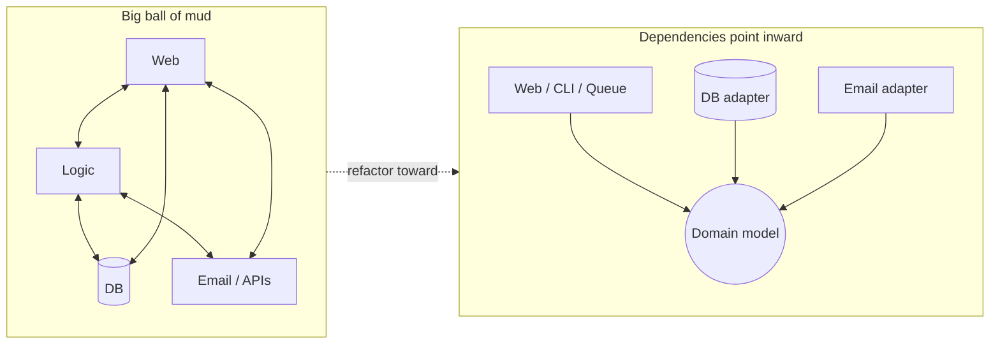

# Preface + Introduction: Why architecture at all?

## ✈️ 30,000 ft
Code starts clean, then every feature touches every file until nobody dares change anything: the **big ball of mud**. This book is a toolkit for keeping business rules separate from plumbing (web, DB, queues) so the software stays changeable as it grows.

## 🛫 10,000 ft
- **Encapsulation and abstraction** are the base tools. Hide *how*, expose *what*.
- **Layering**: dependencies point inward toward the domain model.
- **Dependency inversion**: high-level policy must not import low-level detail; both depend on abstractions.
- **Ports and adapters / hexagonal / onion / clean architecture**: same idea under different names.
- The book's thesis: *put your domain model at the center, with no imports from infrastructure.*

Honest trade-off: this adds files, indirection and ceremony. It pays off when the domain logic is genuinely complex.

### 🗺️ Diagram: ball of mud vs. layered, dependencies pointing inward

## 🛬 1,000 ft: what to notice while reading
- The authors' "Why do we need architecture?" argument: the **cost of change** curve.
- The domain-modeling-first approach (DDD-lite): talk to business people, use their words.
- The dependency diagram that is repeated, in growing form, in every chapter. Redraw it each time.

## 🛞 Touchdown
No code yet. Do this instead:
1. Sketch a codebase you know as boxes and arrows. Where do arrows point *out* of your business logic into the DB or HTTP framework?
2. Write down one change that was painful in that codebase.

## Check yourself
- What is dependency inversion, in one sentence, without jargon?
- Why does the book start with the *model*, not the database or API?
- Name one situation where you would *not* use these patterns.
