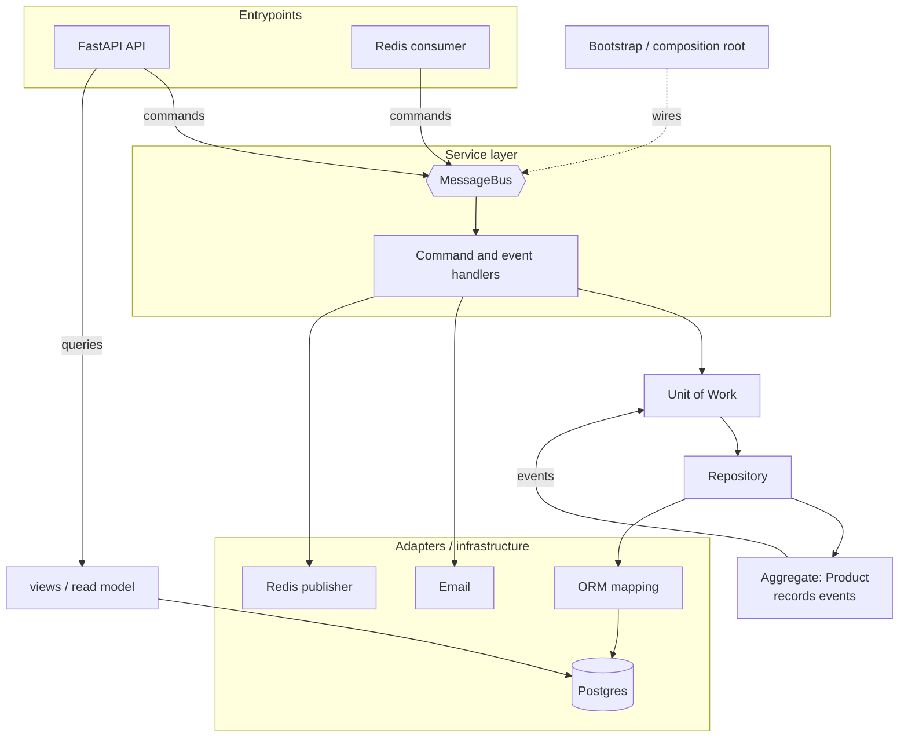
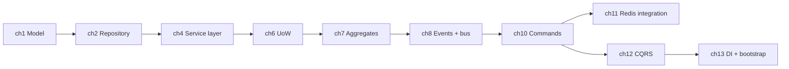

# Epilogue + Appendices: Landing

## ✈️ 30,000 ft
Take the ideas to real, messy codebases. Don't rewrite everything: **strangle** a legacy system incrementally, by finding seams and extracting use cases first.

## 🛫 10,000 ft: the epilogue's advice
- Start with a **domain model for the hardest part**, not the whole system.
- Identify **use cases** and carve a service layer / command handlers first. This is the biggest win for the least risk.
- Extract **events** where side effects bloat functions.
- Be careful with **eventual consistency**. Decide with the business what staleness is OK.
- "Strangler fig" pattern for migrations.
- Questions you'll get: *event sourcing? Django? validation?* → see appendices.

### 🗺️ Diagram: the whole architecture (cf. Appendix A)

## 🛬 1,000 ft: appendices, what each gives you
- **A**: summary diagram and table of every pattern, with pros/cons. Print it, and use it as your cheat sheet.
- **B**: template project structure (Docker, Makefile, layout). Use it for your next real project.
- **C**: swap infrastructure for CSVs. Proof that the architecture really decouples storage.
- **D**: repository/UoW with Django. Mapping to a framework that has its own ORM.
- **E**: validation: syntax vs semantics vs pragmatics; where each kind of check lives.

## 🛞 Touchdown (capstone)
1. Redo Appendix A from memory: layers, patterns, arrows. Compare with the book.
2. Do **Appendix C**: implement a CSV repository + UoW and run your existing service/bus tests unchanged.
3. Pick one real code you maintain and write a one-page plan: first use case to extract, first event, what you would *not* change.
4. Teach it: explain the whole book in 5 minutes to a friend, or in a blog post, with the 30k → 1k structure.

## Check yourself (final)
- Draw the full architecture and annotate which patterns solve which pain.
- Which pattern would you adopt first on a legacy app, and why?
- Which would you refuse to adopt for a simple CRUD app?
- What's the single sentence that explains the book?
