# Architecture Patterns with Python — Follow-Along Study Guide

Book: <https://www.cosmicpython.com/book/preface.html> (Percival & Gregory, free online).
Running example: allocating customer orders to warehouse stock for a furniture retailer (MADE.com).

## How each chapter is structured: the flight plan

| Level | What you do | Question it answers |
|---|---|---|
| ✈️ **30,000 ft** | Read 1 paragraph | *Why does this chapter exist? What pain does it remove?* |
| 🛫 **10,000 ft** | Read the diagrams and concepts | *What is the pattern, and what are the trade-offs?* |
| 🛬 **1,000 ft** | Read the book chapter with the guide beside it | *Which design decisions are made in the code, and why?* |
| 🛞 **Touchdown** | Close the book and type the code yourself | *Can I produce it from memory, with tests green?* |

Then a **Check yourself** list: if you can't answer these out loud, re-read before moving on.

## The route

| # | Chapter | Core idea | Guide |
|---|---|---|---|
| – | Setup | venv, pytest, repo layout | [00-setup](00-setup.md) |
| – | Preface + Introduction | Why architecture; the "big ball of mud" | [01-intro](01-intro.md) |
| **Part 1** | **Domain modeling & architecture** | | |
| 1 | Domain Modeling | Pure-Python model, value objects, entities | [ch01](ch01-domain-modeling.md) |
| 2 | Repository Pattern | Hide the DB behind a collection-like abstraction | [ch02](ch02-repository.md) |
| 3 | Coupling & Abstractions | When abstractions help (fakes over mocks) | [ch03](ch03-coupling-abstractions.md) |
| 4 | Flask API & Service Layer | Orchestration lives in services | [ch04](ch04-service-layer.md) |
| 5 | TDD high gear / low gear | Which level should tests target? | [ch05](ch05-tdd-gears.md) |
| 6 | Unit of Work | Atomic operations, one transaction boundary | [ch06](ch06-unit-of-work.md) |
| 7 | Aggregates | Consistency boundaries, concurrency | [ch07](ch07-aggregates.md) |
| **Part 2** | **Event-driven architecture** | | |
| 8 | Events & Message Bus | Decouple side-effects from core logic | [ch08](ch08-events-message-bus.md) |
| 9 | Going to Town on the Message Bus | Everything is a handler | [ch09](ch09-message-bus-everything.md) |
| 10 | Commands | Commands vs events, error handling | [ch10](ch10-commands.md) |
| 11 | Events & Microservices | Redis pub/sub integration | [ch11](ch11-integration.md) |
| 12 | CQRS | Separate reads from writes | [ch12](ch12-cqrs.md) |
| 13 | Dependency Injection | Bootstrapping, composition root | [ch13](ch13-dependency-injection.md) |
| – | Epilogue + Appendices | What to do Monday morning | [epilogue](14-epilogue.md) |

## What's in each chapter's "Touchdown: code along"

Numbered steps, each with **Do** (what to type), **Why** (the reasoning), the code, and the command to run. The code in the guides was **extracted from working projects whose tests I ran**, one per chapter, not written from memory.

| Ch | Tests I ran | Not run (need external services) |
|---|---|---|
| 1 | 11 passed | |
| 2 | 19 passed | |
| 3 | 5 passed | |
| 4 | 24 passed | |
| 5 | 28 passed | |
| 6 | 30 passed | |
| 7 | 32 passed | 1 test needing **Postgres** (concurrency) |
| 8 | 34 passed | same Postgres test |
| 9 | 35 passed | same Postgres test |
| 10 | 38 passed | same Postgres test |
| 11 | 41 passed | Postgres test + the **Redis end-to-end** test (needs the full stack) |
| 12 | 43 passed | same two |
| 13 | 43 passed | same two (the finished app was also run for real with curl on SQLite) |

The tests marked "not run" are written, and skip themselves unless you provide the service (`POSTGRES_URI`, `API_URL`). Ch07 and ch11 tell you how to run them with Docker. If one of those fails on your machine, the chapter's test is the first suspect, not you.

## The route as a map

```mermaid
flowchart LR
    S[Setup] --> I[Intro]
    subgraph P1["Part 1: domain modeling"]
        C1[1 Model] --> C2[2 Repository] --> C3[3 Coupling] --> C4[4 Service layer] --> C5[5 TDD gears] --> C6[6 Unit of Work] --> C7[7 Aggregates]
    end
    subgraph P2["Part 2: event-driven"]
        C8[8 Events + bus] --> C9[9 Bus everywhere] --> C10[10 Commands] --> C11[11 Integration] --> C12[12 CQRS] --> C13[13 DI]
    end
    I --> C1
    C7 --> C8
    C13 --> E[Epilogue + appendices]
```

## Suggested pace

- ~1 chapter per sitting (60–90 min): 10 min guide → 30 min book → 30 min touchdown.
- Chapters 1–7 are the foundation. Don't skip to Part 2 until ch06 (UoW) feels natural.
- Keep **one repo, one commit per chapter** (`git tag chNN`). The book's own repo has the same branches (`chapter_01_domain_model` etc.) to diff against when stuck: <https://github.com/cosmicpython/code>.

## Rules for learning it well

1. **Type, don't paste.** Even the book's code. Typos teach you what you didn't see.
2. **Tests first, as the book does.** Watch them fail for the right reason.
3. **After each chapter, write 3 sentences:** the problem, the pattern, the cost. If you can't name the cost, you don't understand it yet.
4. **Ask "when would I NOT use this?"** The authors are explicit that these patterns are overkill for simple CRUD.
