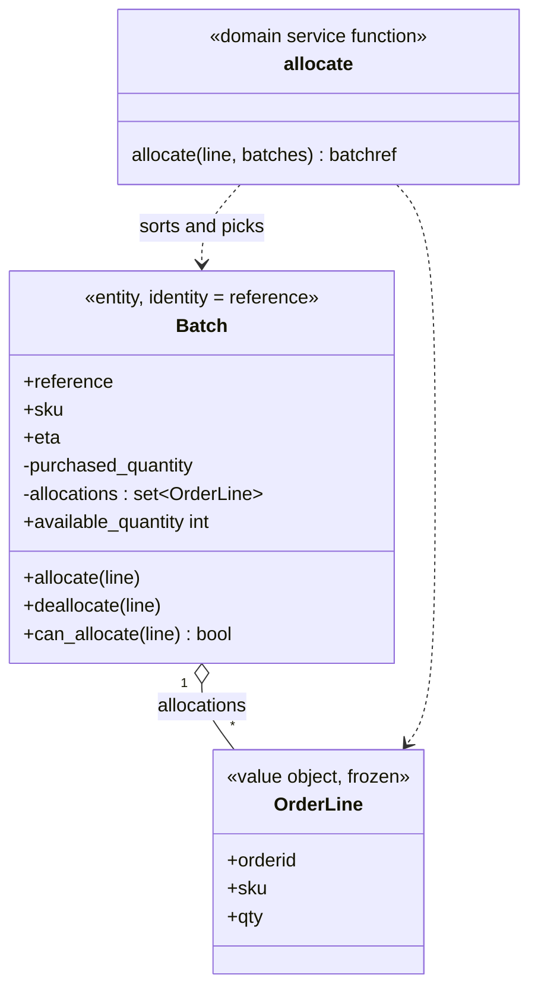
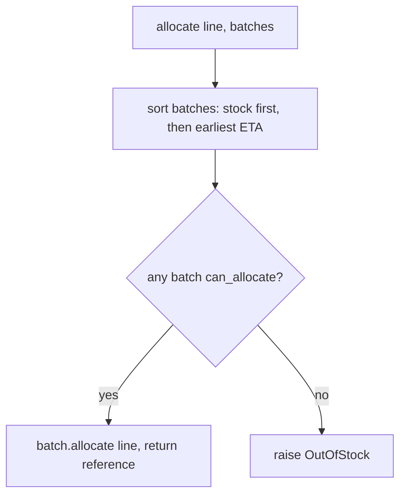

# Chapter 1: Domain Modeling

## ✈️ 30,000 ft
Before touching a database or web framework, model the business problem in plain Python objects that you can test in milliseconds. The domain model is the most valuable, most volatile part of the system, so it must be free of infrastructure.

## 🛫 10,000 ft
Vocabulary (DDD-lite):
- **Value Object**: defined by its data, immutable, equality by value (`OrderLine`).
- **Entity**: has an identity that persists as attributes change; equality by identity (`Batch`, via `reference`).
- **Domain Service**: logic that doesn't naturally belong on one entity (`allocate()`).
- **Ubiquitous language**: class and method names come from the business (batch, allocate, SKU, ETA).

Business rules in this chapter:
- An order line (orderid, sku, qty) is allocated to a **batch** of stock.
- Can't allocate if available quantity < line qty.
- Can't allocate the same line twice (idempotent).
- Warehouse stock (no ETA) is preferred over shipments; earlier ETAs are preferred over later.

### 🗺️ Diagram: the model

## 🛬 1,000 ft: design decisions
- `@dataclass(frozen=True)` gives value-object equality and hashability for free.
- `Batch` overrides `__eq__` and `__hash__` using `reference` only. Entity semantics.
- Batches keep a `set` of allocated lines, and `available_quantity` is *computed* (purchased − allocated), not stored. Fewer states to keep consistent.
- `__gt__` on `Batch` makes `sorted(batches)` express the business preference rule. Stock (`eta=None`) sorts first.
- `allocate(line, batches)` is a plain function, not a method. The book explains that Python lets you pick the shape that fits the concept.
- `OutOfStock` is a domain exception: the failure is a business concept.

## 🛞 Touchdown
In `model.py`, write tests first (`test_batches.py`), one at a time:
1. allocating to a batch reduces available quantity
2. can allocate only if available ≥ required
3. cannot allocate if SKU doesn't match
4. allocation is idempotent
5. can deallocate only allocated lines
6. prefers warehouse stock over shipments
7. prefers earlier batches
8. raises `OutOfStock`

Then implement `OrderLine`, `Batch`, `allocate`, `OutOfStock` until green.

**Stretch:** replace the `eta` comparison with a `sort_key` and compare. Which reads better?

## Check yourself
- Why is `OrderLine` a value object but `Batch` an entity? What would break if both used the same equality?
- Why is `allocate` not a method on `Batch`?
- Where does the "prefer warehouse stock" rule live, and how would you change it?
- What's the benefit of tests that import only `model`?
