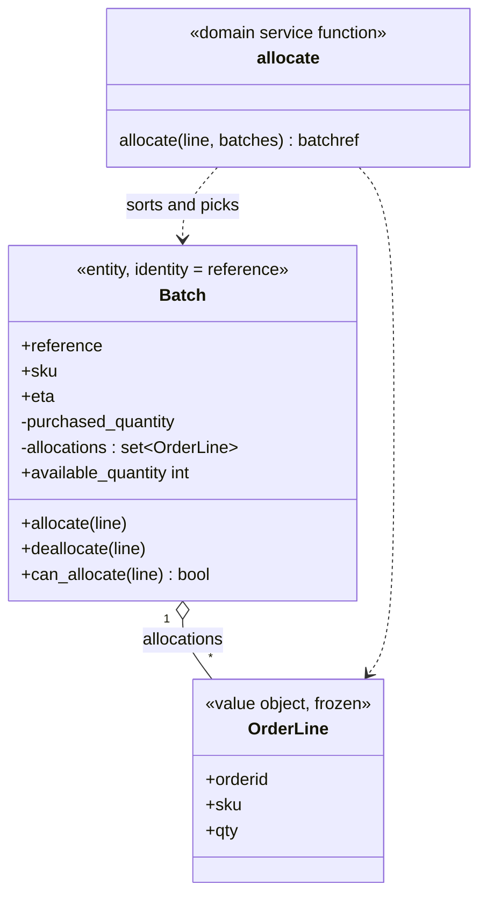
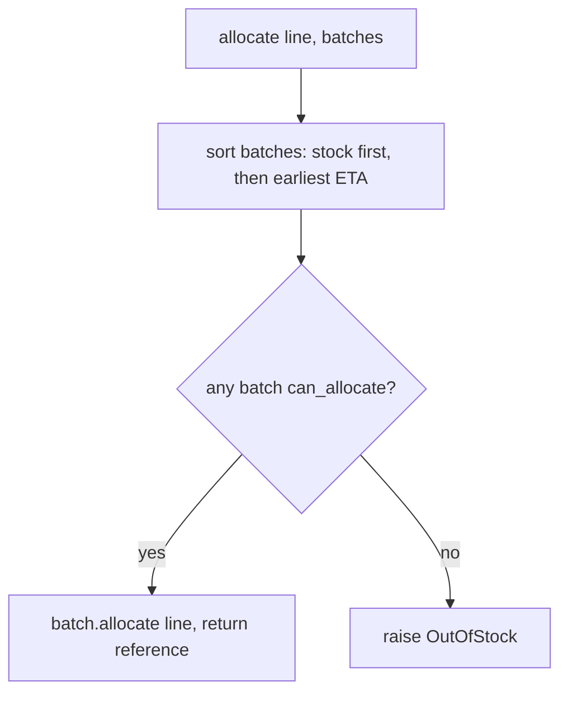

# Chapter 1: Domain Modeling

## ✈️ 30,000 ft
Before touching a database or web framework, model the business problem in plain Python objects that you can test in milliseconds. The domain model is the most valuable, most volatile part of the system, so it must be free of infrastructure.

## 🛫 10,000 ft
Vocabulary (DDD-lite):
- **Value Object**: defined by its data, immutable, equality by value (`OrderLine`).
- **Entity**: has an identity that persists as attributes change; equality by identity (`Batch`, via `reference`).
- **Domain Service**: logic that doesn't naturally belong on one entity (`allocate()`).
- **Ubiquitous language**: class and method names come from the business (batch, allocate, SKU, ETA).

Business rules in this chapter:
- An order line (orderid, sku, qty) is allocated to a **batch** of stock.
- Can't allocate if available quantity < line qty.
- Can't allocate the same line twice (idempotent).
- Warehouse stock (no ETA) is preferred over shipments; earlier ETAs are preferred over later.

### 🗺️ Diagram: the model





## 🛬 1,000 ft: design decisions
- A `@dataclass` gives value-object equality for free; `unsafe_hash=True` adds hashability so lines can live in a `set`. (The book uses `frozen=True`; see the version note in the code-along.)
- `Batch` overrides `__eq__` and `__hash__` using `reference` only. Entity semantics.
- Batches keep a `set` of allocated lines, and `available_quantity` is *computed* (purchased − allocated), not stored. Fewer states to keep consistent.
- `__gt__` on `Batch` makes `sorted(batches)` express the business preference rule. Stock (`eta=None`) sorts first.
- `allocate(line, batches)` is a plain function, not a method. The book explains that Python lets you pick the shape that fits the concept.
- `OutOfStock` is a domain exception: the failure is a business concept.

## 🛞 Touchdown: code along

> **How to use this section.** Do each step in order: read the *Do* and *Why*, **type** the code (don't paste it), run the test, and watch it go red then green. All code below was run and passes on Python 3.14.

### Step 0: Project skeleton

```bash
mkdir allocation && cd allocation
python3 -m venv .venv && source .venv/bin/activate
pip install pytest
mkdir -p src/allocation/domain tests/unit
touch src/allocation/__init__.py src/allocation/domain/__init__.py
```

Create `pytest.ini` so tests can `import allocation`:

**📄 `pytest.ini`**

```ini
[pytest]
pythonpath = src
testpaths = tests
```

*Why `src/` layout?* The code in `src/allocation` is the thing you ship. Tests live beside it, not inside it, and import it like any other user would.

### Step 1: Write the first test (red)

**Do:** create `tests/unit/test_batches.py` and start with just this one test and the imports. Run `pytest`. It fails with `ImportError`: that's the correct red.

```python
from datetime import date
from allocation.domain.model import Batch, OrderLine


def test_allocating_to_a_batch_reduces_the_available_quantity():
    batch = Batch("batch-001", "SMALL-TABLE", qty=20, eta=date.today())
    line = OrderLine("order-ref", "SMALL-TABLE", 2)

    batch.allocate(line)

    assert batch.available_quantity == 18
```

**Why:** the test is written in the business's language (batch, order line, allocate). It *is* the first spec of the model.

### Step 2: Make it pass with a minimal model

**Do:** create `src/allocation/domain/model.py` with `OrderLine` and `Batch` (below is the finished file; at this step you only need `OrderLine`, `Batch.__init__`, `allocate`, and `available_quantity`). Add the rest as later tests demand it.

**Why each piece exists:**

| Piece | Reason |
|---|---|
| `@dataclass(unsafe_hash=True) class OrderLine` | **Value object**: two lines with the same orderid/sku/qty *are* the same thing. A dataclass gives you value `__eq__` for free; `unsafe_hash=True` also makes it hashable so it can live in a `set`. |
| `Batch.__eq__` / `__hash__` use only `reference` | **Entity**: a batch stays the same batch even if its quantity changes, so identity is its reference. |
| `_allocations: Set[OrderLine]` | A set makes allocating the same line twice a no-op (idempotence) with no extra code. |
| `available_quantity` is a *property* | Computed = purchased − allocated. There's no second number to keep in sync. |
| `__gt__` on `Batch` | Lets `sorted(batches)` express the business rule: stock first (`eta is None`), then earliest ETA. |
| `allocate()` is a plain function | The rule involves *many* batches, so it doesn't belong to one of them. Python lets a domain service be just a function. |
| `OutOfStock` exception | A business failure with a business name. |

> **⚠️ Version note (this differs from the book).** The book writes `@dataclass(frozen=True)`. With SQLAlchemy 2.x (needed on current Python) that raises `FrozenInstanceError: cannot assign to field '_sa_instance_state'` as soon as you map the class in chapter 2, because SQLAlchemy must attach bookkeeping to the instance. `unsafe_hash=True` keeps value-equality and hashability; just treat the object as immutable by convention.

**📄 `src/allocation/domain/model.py`**

```python
from dataclasses import dataclass
from datetime import date
from typing import Optional, List, Set


class OutOfStock(Exception):
    pass


def allocate(line: "OrderLine", batches: List["Batch"]) -> str:
    try:
        batch = next(b for b in sorted(batches) if b.can_allocate(line))
    except StopIteration:
        raise OutOfStock(f"Out of stock for sku {line.sku}")
    batch.allocate(line)
    return batch.reference


@dataclass(unsafe_hash=True)
class OrderLine:
    orderid: str
    sku: str
    qty: int


class Batch:
    def __init__(self, ref: str, sku: str, qty: int, eta: Optional[date]):
        self.reference = ref
        self.sku = sku
        self.eta = eta
        self._purchased_quantity = qty
        self._allocations: Set[OrderLine] = set()

    def __repr__(self):
        return f"<Batch {self.reference}>"

    def __eq__(self, other):
        if not isinstance(other, Batch):
            return False
        return other.reference == self.reference

    def __hash__(self):
        return hash(self.reference)

    def __gt__(self, other):
        if self.eta is None:
            return False
        if other.eta is None:
            return True
        return self.eta > other.eta

    def allocate(self, line: OrderLine):
        if self.can_allocate(line):
            self._allocations.add(line)

    def deallocate(self, line: OrderLine):
        if line in self._allocations:
            self._allocations.remove(line)

    @property
    def allocated_quantity(self) -> int:
        return sum(line.qty for line in self._allocations)

    @property
    def available_quantity(self) -> int:
        return self._purchased_quantity - self.allocated_quantity

    def can_allocate(self, line: OrderLine) -> bool:
        return self.sku == line.sku and self.available_quantity >= line.qty
```

### Step 3: Add the remaining tests one at a time

Each test below is a rule from the business. Add them **one by one**, each time seeing it fail (or pass) for the reason you expect before moving on. Full test file:

**📄 `tests/unit/test_batches.py`**

```python
from datetime import date, timedelta
import pytest

from allocation.domain.model import allocate, OrderLine, Batch, OutOfStock

today = date.today()
tomorrow = today + timedelta(days=1)
later = tomorrow + timedelta(days=10)


def make_batch_and_line(sku, batch_qty, line_qty):
    return (
        Batch("batch-001", sku, batch_qty, eta=today),
        OrderLine("order-123", sku, line_qty),
    )


def test_allocating_to_a_batch_reduces_the_available_quantity():
    batch = Batch("batch-001", "SMALL-TABLE", qty=20, eta=date.today())
    line = OrderLine("order-ref", "SMALL-TABLE", 2)

    batch.allocate(line)

    assert batch.available_quantity == 18


def test_can_allocate_if_available_greater_than_required():
    large_batch, small_line = make_batch_and_line("ELEGANT-LAMP", 20, 2)
    assert large_batch.can_allocate(small_line)


def test_cannot_allocate_if_available_smaller_than_required():
    small_batch, large_line = make_batch_and_line("ELEGANT-LAMP", 2, 20)
    assert small_batch.can_allocate(large_line) is False


def test_can_allocate_if_available_equal_to_required():
    batch, line = make_batch_and_line("ELEGANT-LAMP", 2, 2)
    assert batch.can_allocate(line)


def test_cannot_allocate_if_skus_do_not_match():
    batch = Batch("batch-001", "UNCOMFORTABLE-CHAIR", 100, eta=None)
    different_sku_line = OrderLine("order-123", "EXPENSIVE-TOASTER", 10)
    assert batch.can_allocate(different_sku_line) is False


def test_can_only_deallocate_allocated_lines():
    batch, unallocated_line = make_batch_and_line("DECORATIVE-TRINKET", 20, 2)
    batch.deallocate(unallocated_line)
    assert batch.available_quantity == 20


def test_allocation_is_idempotent():
    batch, line = make_batch_and_line("ANGULAR-DESK", 20, 2)
    batch.allocate(line)
    batch.allocate(line)
    assert batch.available_quantity == 18


def test_prefers_warehouse_batches_to_shipments():
    in_stock_batch = Batch("in-stock-batch", "RETRO-CLOCK", 100, eta=None)
    shipment_batch = Batch("shipment-batch", "RETRO-CLOCK", 100, eta=tomorrow)
    line = OrderLine("oref", "RETRO-CLOCK", 10)

    allocate(line, [in_stock_batch, shipment_batch])

    assert in_stock_batch.available_quantity == 90
    assert shipment_batch.available_quantity == 100


def test_prefers_earlier_batches():
    earliest = Batch("speedy-batch", "MINIMALIST-SPOON", 100, eta=today)
    medium = Batch("normal-batch", "MINIMALIST-SPOON", 100, eta=tomorrow)
    latest = Batch("slow-batch", "MINIMALIST-SPOON", 100, eta=later)
    line = OrderLine("order1", "MINIMALIST-SPOON", 10)

    allocate(line, [medium, earliest, latest])

    assert earliest.available_quantity == 90
    assert medium.available_quantity == 100
    assert latest.available_quantity == 100


def test_returns_allocated_batch_ref():
    in_stock_batch = Batch("in-stock-batch-ref", "HIGHBROW-POSTER", 100, eta=None)
    shipment_batch = Batch("shipment-batch-ref", "HIGHBROW-POSTER", 100, eta=tomorrow)
    line = OrderLine("oref", "HIGHBROW-POSTER", 10)
    allocation = allocate(line, [in_stock_batch, shipment_batch])
    assert allocation == in_stock_batch.reference


def test_raises_out_of_stock_exception_if_cannot_allocate():
    batch = Batch("batch1", "SMALL-FORK", 10, eta=today)
    allocate(OrderLine("order1", "SMALL-FORK", 10), [batch])

    with pytest.raises(OutOfStock, match="SMALL-FORK"):
        allocate(OrderLine("order2", "SMALL-FORK", 1), [batch])
```

Suggested order and what each drives into the model:

1. `can_allocate` tests (greater, smaller, equal) → `can_allocate()` comparing `available_quantity`.
2. SKU mismatch → add `self.sku == line.sku`.
3. Deallocate only allocated lines → `deallocate()` guarded by `if line in self._allocations`.
4. Idempotent allocate → already true because `_allocations` is a set. **Check it passes immediately and ask why.**
5. Prefers warehouse stock / earlier batches → `__gt__` and `allocate()` using `sorted(...)`.
6. Returns the batch reference → `allocate()` returns `batch.reference`.
7. Raises `OutOfStock` → catch `StopIteration` from `next(...)` and raise the domain error.

### Step 4: Run and expect

```bash
pytest -q
# ...........                                                  [100%]
# 11 passed
```

The whole suite runs in a few milliseconds, with no database or web server. That speed is the payoff of a pure model.

### Stretch

- Replace `__gt__` with a `sort_key` function and compare readability.
- Add a rule: a batch with `eta` in the past is treated like warehouse stock. Which one place do you edit?

## Check yourself
- Why is `OrderLine` a value object but `Batch` an entity? What would break if both used the same equality?
- Why is `allocate` not a method on `Batch`?
- Where does the "prefer warehouse stock" rule live, and how would you change it?
- What's the benefit of tests that import only `model`?
