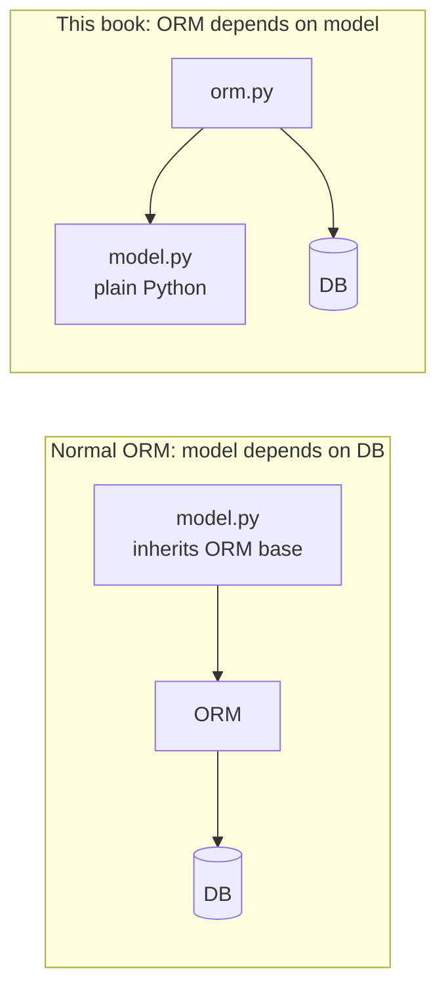
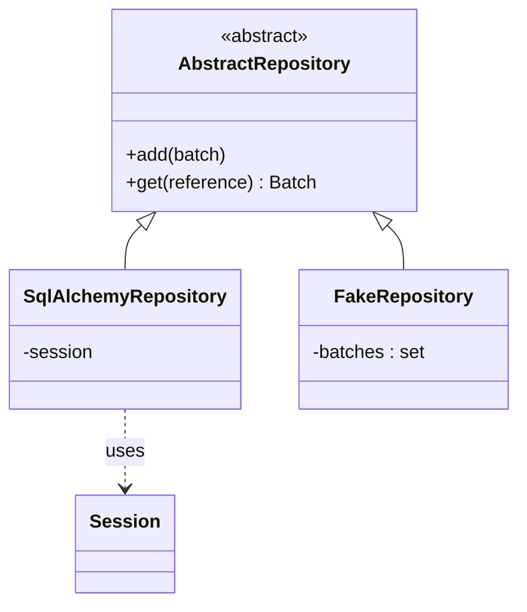

# Chapter 2: Repository Pattern

## ✈️ 30,000 ft
You need to save the model somewhere, but the model shouldn't know about SQL. A **repository** makes persistent storage look like an in-memory collection of domain objects, so the domain stays pure and storage is swappable.

## 🛫 10,000 ft
- **ORM inversion**: normally the model inherits from ORM base classes (model depends on DB). Here the ORM depends on the model: `orm.py` imports `model.py`, never the reverse.
- **Repository** = abstraction with the smallest API the app needs: `add(batch)`, `get(reference)`.
- Two implementations: `SqlAlchemyRepository` (real) and `FakeRepository` (a set in memory, used in tests).
- Trade-off: one more layer to maintain, but you gain fast tests and the freedom to change storage. The cost is that the ORM mapping now has to be written explicitly.

### 🗺️ Diagram: inverting the ORM dependency

## 🛬 1,000 ft: design decisions
- `AbstractRepository(abc.ABC)` with `@abc.abstractmethod`. The book says the ABC is optional documentation; duck typing works too.
- Classical/imperative mapping in `orm.py`: `Table` definitions, then map the existing classes. SQLAlchemy 2.x: `registry.map_imperatively(model.OrderLine, order_lines)`; the book's `mapper(...)` is the 1.x spelling.
- `allocations` is a many-to-many join table, mapped via `relationship(..., secondary=allocations, collection_class=set)`.
- Repository tests are "integration tests" that use a real session: save a batch, read it back, assert equality **and** attributes (because entity `__eq__` only checks reference).

## 🛞 Touchdown
1. Write `orm.py` with tables `order_lines`, `batches`, `allocations` and the mappers.
2. Write `repository.py` with the abstract class + SQLAlchemy impl.
3. Tests (SQLite in memory is fine):
   - `test_orm.py`: load order lines, save order lines, retrieve batches, save allocations, retrieve allocations
   - `test_repository.py`: `add` then `get`
4. Notice: your domain tests from ch01 must still pass untouched.

**Stretch:** write the `FakeRepository` now; you'll use it in ch04.

## Check yourself
- Which way does the import arrow point between `orm.py` and `model.py`? Why does it matter?
- Why is the repository interface so small?
- What's the downside of the repository if your app is basically CRUD?
- How would `FakeRepository` differ from a `MagicMock`? (Preview of ch03.)
