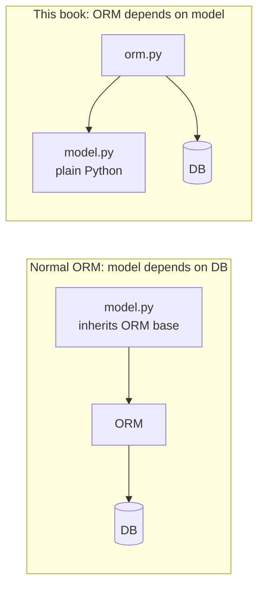
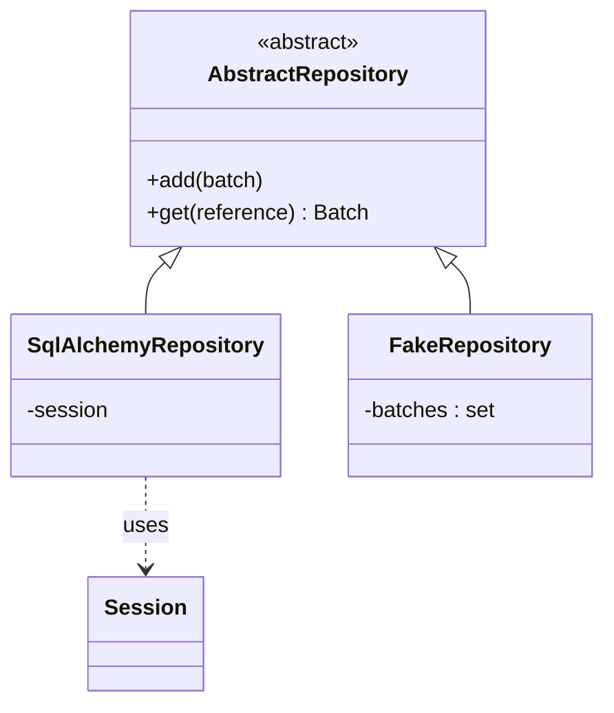

# Chapter 2: Repository Pattern

## ✈️ 30,000 ft
You need to save the model somewhere, but the model shouldn't know about SQL. A **repository** makes persistent storage look like an in-memory collection of domain objects, so the domain stays pure and storage is swappable.

## 🛫 10,000 ft
- **ORM inversion**: normally the model inherits from ORM base classes (model depends on DB). Here the ORM depends on the model: `orm.py` imports `model.py`, never the reverse.
- **Repository** = abstraction with the smallest API the app needs: `add(batch)`, `get(reference)`.
- Two implementations: `SqlAlchemyRepository` (real) and `FakeRepository` (a set in memory, used in tests).
- Trade-off: one more layer to maintain, but you gain fast tests and the freedom to change storage. The cost is that the ORM mapping now has to be written explicitly.

### 🗺️ Diagram: inverting the ORM dependency





## 🛬 1,000 ft: design decisions
- `AbstractRepository(abc.ABC)` with `@abc.abstractmethod`. The book says the ABC is optional documentation; duck typing works too.
- Classical/imperative mapping in `orm.py`: `Table` definitions, then map the existing classes. SQLAlchemy 2.x: `registry.map_imperatively(model.OrderLine, order_lines)`; the book's `mapper(...)` is the 1.x spelling.
- `allocations` is a many-to-many join table, mapped via `relationship(..., secondary=allocations, collection_class=set)`.
- Repository tests are "integration tests" that use a real session: save a batch, read it back, assert equality **and** attributes (because entity `__eq__` only checks reference).

## 🛞 Touchdown: code along

> Starts from your finished ch01 project. New in this chapter: `adapters/orm.py`, `adapters/repository.py`, two integration test files, and a `conftest.py`. All code below was run and passes (19 tests total).

### Step 0: Dependencies and folders

```bash
pip install sqlalchemy
mkdir -p src/allocation/adapters tests/integration
touch src/allocation/adapters/__init__.py
```

### Step 1: Write the ORM mapping (`orm.py`)

**Do:** describe the tables with SQLAlchemy `Table` objects, then *map your existing plain classes onto them*.

**Why:** in a normal ORM your model inherits from `db.Model`, so the model depends on the database. Here it's reversed: `orm.py` imports `model`; `model.py` knows nothing about SQL. That's the "ORM depends on the model" inversion.

Key points to understand in the code:
- `registry().map_imperatively(Class, table)` is the SQLAlchemy 2.x spelling. The book uses the older `mapper(Class, table)`, which no longer exists.
- `Batch._allocations` is mapped as a `relationship(..., secondary=allocations, collection_class=set)`. The many-to-many `allocations` table links batches to order lines; `collection_class=set` keeps the in-memory type the model expects.
- `start_mappers()` is a function (not run at import) so tests can run the model without any ORM, and call `clear_mappers()` between tests.

**📄 `src/allocation/adapters/orm.py`**

```python
from sqlalchemy import Table, Column, Integer, String, Date, ForeignKey
from sqlalchemy.orm import registry, relationship

from allocation.domain import model

mapper_registry = registry()
metadata = mapper_registry.metadata

order_lines = Table(
    "order_lines",
    metadata,
    Column("id", Integer, primary_key=True, autoincrement=True),
    Column("sku", String(255)),
    Column("qty", Integer, nullable=False),
    Column("orderid", String(255)),
)

batches = Table(
    "batches",
    metadata,
    Column("id", Integer, primary_key=True, autoincrement=True),
    Column("reference", String(255)),
    Column("sku", String(255)),
    Column("_purchased_quantity", Integer, nullable=False),
    Column("eta", Date, nullable=True),
)

allocations = Table(
    "allocations",
    metadata,
    Column("id", Integer, primary_key=True, autoincrement=True),
    Column("orderline_id", ForeignKey("order_lines.id")),
    Column("batch_id", ForeignKey("batches.id")),
)


def start_mappers():
    # The ORM depends on the model, not the other way round.
    lines_mapper = mapper_registry.map_imperatively(model.OrderLine, order_lines)
    mapper_registry.map_imperatively(
        model.Batch,
        batches,
        properties={
            "_allocations": relationship(
                lines_mapper,
                secondary=allocations,
                collection_class=set,
            )
        },
    )
```

### Step 2: Test the ORM (red first)

**Do:** write `tests/conftest.py` with the two fixtures every integration test shares, then `tests/integration/test_orm.py`.

**Why:** these tests prove the *mapping* works, i.e. that SQLAlchemy can load and save your plain objects. They use SQLite in memory, so they're fast and need no Docker.

**📄 `tests/conftest.py`**

```python
import pytest
from sqlalchemy import create_engine
from sqlalchemy.orm import sessionmaker, clear_mappers

from allocation.adapters.orm import metadata, start_mappers


@pytest.fixture
def in_memory_db():
    engine = create_engine("sqlite:///:memory:")
    metadata.create_all(engine)
    return engine


@pytest.fixture
def session(in_memory_db):
    start_mappers()
    yield sessionmaker(bind=in_memory_db)()
    clear_mappers()
```

**📄 `tests/integration/test_orm.py`**

```python
from datetime import date
from sqlalchemy import text

from allocation.domain import model


def test_orderline_mapper_can_load_lines(session):
    session.execute(
        text(
            "INSERT INTO order_lines (orderid, sku, qty) VALUES "
            '("order1", "RED-CHAIR", 12),'
            '("order1", "RED-TABLE", 13),'
            '("order2", "BLUE-LIPSTICK", 14)'
        )
    )
    expected = [
        model.OrderLine("order1", "RED-CHAIR", 12),
        model.OrderLine("order1", "RED-TABLE", 13),
        model.OrderLine("order2", "BLUE-LIPSTICK", 14),
    ]
    assert session.query(model.OrderLine).all() == expected


def test_orderline_mapper_can_save_lines(session):
    new_line = model.OrderLine("order1", "DECORATIVE-WIDGET", 12)
    session.add(new_line)
    session.commit()

    rows = list(session.execute(text('SELECT orderid, sku, qty FROM "order_lines"')))
    assert rows == [("order1", "DECORATIVE-WIDGET", 12)]


def test_retrieving_batches(session):
    session.execute(
        text(
            "INSERT INTO batches (reference, sku, _purchased_quantity, eta)"
            ' VALUES ("batch1", "sku1", 100, null)'
        )
    )
    session.execute(
        text(
            "INSERT INTO batches (reference, sku, _purchased_quantity, eta)"
            ' VALUES ("batch2", "sku2", 200, "2011-04-11")'
        )
    )
    expected = [
        model.Batch("batch1", "sku1", 100, eta=None),
        model.Batch("batch2", "sku2", 200, eta=date(2011, 4, 11)),
    ]

    assert session.query(model.Batch).all() == expected


def test_saving_batches(session):
    batch = model.Batch("batch1", "sku1", 100, eta=None)
    session.add(batch)
    session.commit()
    rows = session.execute(
        text('SELECT reference, sku, _purchased_quantity, eta FROM "batches"')
    )
    assert list(rows) == [("batch1", "sku1", 100, None)]


def test_saving_allocations(session):
    batch = model.Batch("batch1", "sku1", 100, eta=None)
    line = model.OrderLine("order1", "sku1", 10)
    batch.allocate(line)
    session.add(batch)
    session.commit()
    rows = list(session.execute(text('SELECT orderline_id, batch_id FROM "allocations"')))
    assert rows == [(1, 1)]


def test_retrieving_allocations(session):
    session.execute(
        text('INSERT INTO order_lines (orderid, sku, qty) VALUES ("order1", "sku1", 12)')
    )
    [[olid]] = session.execute(
        text("SELECT id FROM order_lines WHERE orderid=:orderid AND sku=:sku"),
        dict(orderid="order1", sku="sku1"),
    )
    session.execute(
        text(
            "INSERT INTO batches (reference, sku, _purchased_quantity, eta)"
            ' VALUES ("batch1", "sku1", 100, null)'
        )
    )
    [[bid]] = session.execute(
        text("SELECT id FROM batches WHERE reference=:ref AND sku=:sku"),
        dict(ref="batch1", sku="sku1"),
    )
    session.execute(
        text("INSERT INTO allocations (orderline_id, batch_id) VALUES (:olid, :bid)"),
        dict(olid=olid, bid=bid),
    )

    batch = session.query(model.Batch).one()

    assert batch._allocations == {model.OrderLine("order1", "sku1", 12)}
```

Run `pytest tests/integration/test_orm.py`. It fails until `orm.py` exists, then passes.

> Note the `text(...)` wrapper around raw SQL: SQLAlchemy 2.x requires it. The book's examples pass plain strings.

### Step 3: Write the repository

**Do:** create `adapters/repository.py` with an abstract base class and the SQLAlchemy implementation.

**Why:** the repository is the *smallest* interface the application needs from storage: `add` and `get` (plus `list`, which we'll need in ch04). Anything that implements these can be swapped in: a real DB now, a fake in tests, CSV files in Appendix C. The `ABC` documents the contract; Python would work without it.

**📄 `src/allocation/adapters/repository.py`**

```python
import abc

from allocation.domain import model


class AbstractRepository(abc.ABC):
    @abc.abstractmethod
    def add(self, batch: model.Batch):
        raise NotImplementedError

    @abc.abstractmethod
    def get(self, reference) -> model.Batch:
        raise NotImplementedError


class SqlAlchemyRepository(AbstractRepository):
    def __init__(self, session):
        self.session = session

    def add(self, batch):
        self.session.add(batch)

    def get(self, reference):
        return self.session.query(model.Batch).filter_by(reference=reference).one()

    def list(self):
        return self.session.query(model.Batch).all()
```

### Step 4: Test the repository

**Do:** add `tests/integration/test_repository.py`.

**Why:** note the assertions at the end of the "retrieve" test. `Batch.__eq__` compares only `reference`, so `retrieved == expected` would pass even if every other column were lost. The extra asserts on `sku`, `_purchased_quantity` and `_allocations` check the data actually round-tripped.

**📄 `tests/integration/test_repository.py`**

```python
from sqlalchemy import text

from allocation.adapters import repository
from allocation.domain import model


def test_repository_can_save_a_batch(session):
    batch = model.Batch("batch1", "RUSTY-SOAPDISH", 100, eta=None)

    repo = repository.SqlAlchemyRepository(session)
    repo.add(batch)
    session.commit()

    rows = session.execute(
        text('SELECT reference, sku, _purchased_quantity, eta FROM "batches"')
    )
    assert list(rows) == [("batch1", "RUSTY-SOAPDISH", 100, None)]


def insert_order_line(session):
    session.execute(
        text(
            "INSERT INTO order_lines (orderid, sku, qty)"
            ' VALUES ("order1", "GENERIC-SOFA", 12)'
        )
    )
    [[orderline_id]] = session.execute(
        text("SELECT id FROM order_lines WHERE orderid=:orderid AND sku=:sku"),
        dict(orderid="order1", sku="GENERIC-SOFA"),
    )
    return orderline_id


def insert_batch(session, batch_id):
    session.execute(
        text(
            "INSERT INTO batches (reference, sku, _purchased_quantity, eta)"
            ' VALUES (:batch_id, "GENERIC-SOFA", 100, null)'
        ),
        dict(batch_id=batch_id),
    )
    [[batch_id]] = session.execute(
        text('SELECT id FROM batches WHERE reference=:batch_id AND sku="GENERIC-SOFA"'),
        dict(batch_id=batch_id),
    )
    return batch_id


def insert_allocation(session, orderline_id, batch_id):
    session.execute(
        text(
            "INSERT INTO allocations (orderline_id, batch_id)"
            " VALUES (:orderline_id, :batch_id)"
        ),
        dict(orderline_id=orderline_id, batch_id=batch_id),
    )


def test_repository_can_retrieve_a_batch_with_allocations(session):
    orderline_id = insert_order_line(session)
    batch1_id = insert_batch(session, "batch1")
    insert_batch(session, "batch2")
    insert_allocation(session, orderline_id, batch1_id)

    repo = repository.SqlAlchemyRepository(session)
    retrieved = repo.get("batch1")

    expected = model.Batch("batch1", "GENERIC-SOFA", 100, eta=None)
    assert retrieved == expected  # Batch.__eq__ only compares reference
    assert retrieved.sku == expected.sku
    assert retrieved._purchased_quantity == expected._purchased_quantity
    assert retrieved._allocations == {model.OrderLine("order1", "GENERIC-SOFA", 12)}
```

### Step 5: Run everything

```bash
pytest -q
# 19 passed
```

Your ch01 domain tests must still pass **untouched**. That's the proof that the model really is independent of storage.

### Stretch

- Write `FakeRepository` now (a class wrapping a `set` of batches, implementing `add`, `get`, `list`). You'll use it in ch04.
- Delete `orm.py` and confirm `tests/unit` still passes. What does that tell you?

## Check yourself
- Which way does the import arrow point between `orm.py` and `model.py`? Why does it matter?
- Why is the repository interface so small?
- What's the downside of the repository if your app is basically CRUD?
- How would `FakeRepository` differ from a `MagicMock`? (Preview of ch03.)
