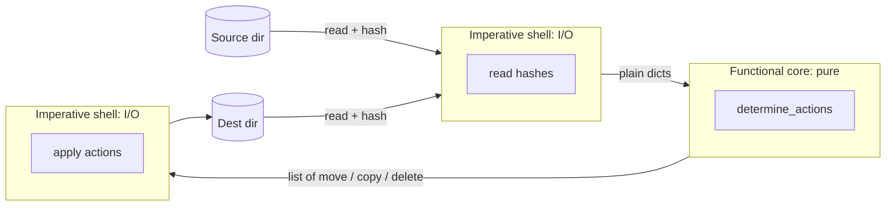
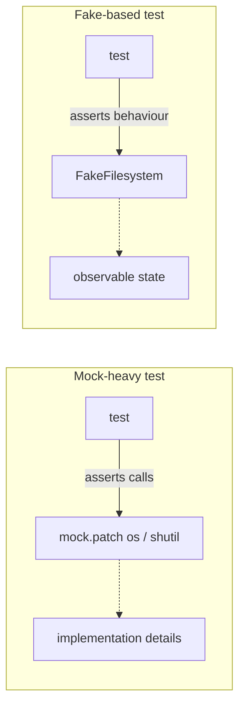

# Chapter 3: A Brief Interlude: On Coupling and Abstractions

## ✈️ 30,000 ft
A short, conceptual chapter. Abstractions exist to **reduce coupling** so you can change one side without breaking the other, and some abstractions are better than others. It teaches how to pick one and how to test against it.

## 🛫 10,000 ft
- **Coupling**: how much changing A forces a change in B.
- Good abstraction: simplifies the interface, hides detail, and is *easy to fake*.
- Worked example: syncing two directories. The messy version mixes I/O with decisions. The better design splits it into **functional core** (decides *what* to do from plain dicts/values) and **imperative shell** (does the I/O).
- **Edge-to-edge testing with fakes** beats mock-heavy tests: test behaviour, not call sequences.
- Rule of thumb: *"Don't mock what you don't own"*, and prefer fakes for your own abstractions.

### 🗺️ Diagram: functional core, imperative shell





## 🛬 1,000 ft: what to notice
- The first version tests with `tempfile`, which is slow and awkward.
- The refactor produces a pure function of inputs → list of actions (`move`, `copy`, `delete`).
- Then a `FileSystem`-style abstraction with a `FakeFileSystem`. Compare the tests with the `mock.patch` version the authors show as the counter-example.
- The key sentence: mocks tie tests to implementation; fakes tie tests to behaviour.

## 🛞 Touchdown: code along

> A standalone mini-project, separate from `allocation/`. It's the book's directory-sync example: make the destination folder match the source folder. All code below was run and passes (5 tests).

```bash
mkdir sync-exercise && cd sync-exercise
python3 -m venv .venv && source .venv/bin/activate && pip install pytest
mkdir -p sync tests && touch sync/__init__.py
printf '[pytest]\npythonpath = .\ntestpaths = tests\n' > pytest.ini
```

### The rules (what "sync" means)

Compare files by **content hash**, not by name:

| Situation | Action |
|---|---|
| Hash exists in source but not in destination | **copy** it |
| Same hash exists in both, but under a different filename | **move** (rename) in the destination |
| Hash exists in destination but not in source | **delete** it |

### Step 1: Write the *decision* logic as a pure function (the "functional core")

**Do:** write `determine_actions` first. Its inputs are plain dicts of `{hash: filename}` and two folder paths; its output is a list of action tuples. It never touches the disk.

**Why:** the hard part of this program is the *decisions*. If decisions live inside code that also walks directories and copies files, you can only test them with real temp folders, slowly. Pulling them out means a test is just a dict in, a list out.

### Step 2: Test the core with plain data (red → green)

**Do:** start `tests/test_sync.py` with these three tests. They fail on `ImportError`, then pass once you write `determine_actions`.

```python
from pathlib import Path
from sync.sync import determine_actions


def test_when_a_file_exists_in_the_source_but_not_the_destination():
    src_hashes = {"hash1": "fn1"}
    dst_hashes = {}
    actions = determine_actions(src_hashes, dst_hashes, Path("/src"), Path("/dst"))
    assert list(actions) == [("copy", Path("/src/fn1"), Path("/dst/fn1"))]


def test_when_a_file_has_been_renamed_in_the_source():
    src_hashes = {"hash1": "fn1"}
    dst_hashes = {"hash1": "fn2"}
    actions = determine_actions(src_hashes, dst_hashes, Path("/src"), Path("/dst"))
    assert list(actions) == [("move", Path("/dst/fn2"), Path("/dst/fn1"))]


def test_when_a_file_no_longer_exists_in_the_source():
    src_hashes = {}
    dst_hashes = {"hash1": "fn1"}
    actions = determine_actions(src_hashes, dst_hashes, Path("/src"), Path("/dst"))
    assert list(actions) == [("delete", Path("/dst/fn1"))]
```

*Notice:* no temp files, no mocks, no `/src` or `/dst` that actually exist. The paths are only labels.

### Step 3: Write the "imperative shell" (everything that does I/O)

**Do:** write the real file-touching code in the same module, then a small `sync()` that wires core and shell together.

**Why this shape:** `sync()` takes its two I/O collaborators as arguments (`reader`, `filesystem`) with real defaults. That's what makes it possible to give it **fakes** in tests, without `mock.patch`.

**📄 `sync/sync.py`**

```python
import hashlib
import os
import shutil
from pathlib import Path

BLOCKSIZE = 65536


def hash_file(path):
    hasher = hashlib.sha1()
    with path.open("rb") as file:
        buf = file.read(BLOCKSIZE)
        while buf:
            hasher.update(buf)
            buf = file.read(BLOCKSIZE)
    return hasher.hexdigest()


# --- functional core: plain data in, plain data out, no I/O -----------------
def determine_actions(src_hashes, dst_hashes, src_folder, dst_folder):
    for sha, filename in src_hashes.items():
        if sha not in dst_hashes:
            sourcepath = Path(src_folder) / filename
            destpath = Path(dst_folder) / filename
            yield "copy", sourcepath, destpath

        elif dst_hashes[sha] != filename:
            olddestpath = Path(dst_folder) / dst_hashes[sha]
            newdestpath = Path(dst_folder) / filename
            yield "move", olddestpath, newdestpath

    for sha, filename in dst_hashes.items():
        if sha not in src_hashes:
            yield "delete", Path(dst_folder) / filename


# --- imperative shell: the only code that touches the disk ------------------
def read_paths_and_hashes(root):
    hashes = {}
    for folder, _, files in os.walk(root):
        for fn in files:
            hashes[hash_file(Path(folder) / fn)] = fn
    return hashes


class FileSystem:
    def copy(self, source, dest):
        shutil.copyfile(source, dest)

    def move(self, source, dest):
        shutil.move(source, dest)

    def delete(self, dest):
        os.remove(dest)


def sync(source, dest, reader=read_paths_and_hashes, filesystem=None):
    if filesystem is None:  # not `or`: an empty fake list is falsy!
        filesystem = FileSystem()

    source_hashes = reader(source)
    dest_hashes = reader(dest)

    for action, *paths in determine_actions(source_hashes, dest_hashes, source, dest):
        getattr(filesystem, action)(*paths)
```

> **🐞 A real bug to learn from.** The first draft of `sync()` said `filesystem = filesystem or FileSystem()`. An empty `FakeFileSystem` (a `list` subclass) is *falsy*, so `or` quietly replaced the fake with the real filesystem and the test tried to move real files. Use `is None` when a default stands in for an argument. Fakes that look like containers make this easy to miss.

### Step 4: Test edge to edge with a fake, plus one real-disk test

**Do:** add the rest of `tests/test_sync.py`: a `FakeFileSystem` that records what it was asked to do, an edge-to-edge test, and one slow test with real temp files.

**Why:** the fake test checks *behaviour* ("a move then a delete happened") without caring *how* `sync` is implemented. A mock-based test (`mock.patch("shutil.move")`) would assert on call details and break whenever you refactor. The single real-disk test proves the real adapter works.

**📄 `tests/test_sync.py`**

```python
from pathlib import Path

from sync.sync import determine_actions, sync


# 1. Test the functional core with plain dicts: no disk, no mocks.
def test_when_a_file_exists_in_the_source_but_not_the_destination():
    src_hashes = {"hash1": "fn1"}
    dst_hashes = {}
    actions = determine_actions(src_hashes, dst_hashes, Path("/src"), Path("/dst"))
    assert list(actions) == [("copy", Path("/src/fn1"), Path("/dst/fn1"))]


def test_when_a_file_has_been_renamed_in_the_source():
    src_hashes = {"hash1": "fn1"}
    dst_hashes = {"hash1": "fn2"}
    actions = determine_actions(src_hashes, dst_hashes, Path("/src"), Path("/dst"))
    assert list(actions) == [("move", Path("/dst/fn2"), Path("/dst/fn1"))]


def test_when_a_file_no_longer_exists_in_the_source():
    src_hashes = {}
    dst_hashes = {"hash1": "fn1"}
    actions = determine_actions(src_hashes, dst_hashes, Path("/src"), Path("/dst"))
    assert list(actions) == [("delete", Path("/dst/fn1"))]


# 2. Test the shell edge to edge with fakes: a fake reader and a fake filesystem.
class FakeFileSystem(list):
    def copy(self, src, dest):
        self.append(("COPY", src, dest))

    def move(self, src, dest):
        self.append(("MOVE", src, dest))

    def delete(self, dest):
        self.append(("DELETE", dest))


def test_sync_edge_to_edge_with_fakes():
    source = {"sha1": "my-file"}
    dest = {"sha1": "renamed-file", "sha2": "stale-file"}
    reader = {"/source": source, "/dest": dest}
    filesystem = FakeFileSystem()

    sync("/source", "/dest", reader=reader.pop, filesystem=filesystem)

    assert filesystem == [
        ("MOVE", Path("/dest/renamed-file"), Path("/dest/my-file")),
        ("DELETE", Path("/dest/stale-file")),
    ]


# 3. One slow test against the real disk proves the real adapter works.
def test_sync_with_real_files(tmp_path):
    source = tmp_path / "source"
    dest = tmp_path / "dest"
    source.mkdir()
    dest.mkdir()
    (source / "new.txt").write_text("hello")
    (source / "renamed.txt").write_text("same content")
    (dest / "old-name.txt").write_text("same content")
    (dest / "stale.txt").write_text("remove me")

    sync(source, dest)

    assert sorted(p.name for p in dest.iterdir()) == ["new.txt", "renamed.txt"]
    assert (dest / "new.txt").read_text() == "hello"
```

```bash
pytest -q
# .....                                      [100%]
# 5 passed
```

### Stretch

- Rewrite the first test using `mock.patch` instead of the fake. Then rename `FileSystem.copy` to `FileSystem.copy_file`. Which tests break? That is the cost of mocks.
- Add a rule: don't delete files in the destination whose names end with `.keep`. Which function do you change, and how many tests need disk access?

## Check yourself
- Which of the two designs is easier to change, and why?
- What does "functional core, imperative shell" mean in your own words?
- When is a mock acceptable?
- How does this chapter foreshadow the Unit of Work?
