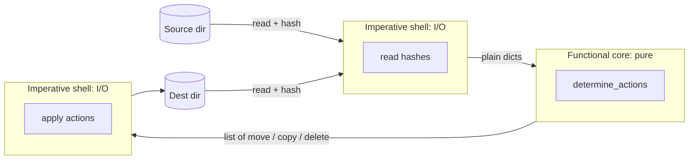
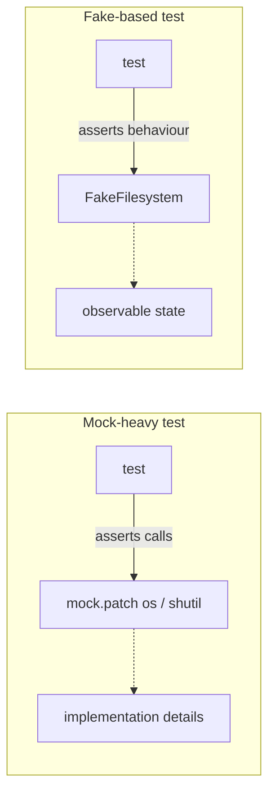

# Chapter 3: A Brief Interlude: On Coupling and Abstractions

## ✈️ 30,000 ft
A short, conceptual chapter. Abstractions exist to **reduce coupling** so you can change one side without breaking the other, and some abstractions are better than others. It teaches how to pick one and how to test against it.

## 🛫 10,000 ft
- **Coupling**: how much changing A forces a change in B.
- Good abstraction: simplifies the interface, hides detail, and is *easy to fake*.
- Worked example: syncing two directories. The messy version mixes I/O with decisions. The better design splits it into **functional core** (decides *what* to do from plain dicts/values) and **imperative shell** (does the I/O).
- **Edge-to-edge testing with fakes** beats mock-heavy tests: test behaviour, not call sequences.
- Rule of thumb: *"Don't mock what you don't own"*, and prefer fakes for your own abstractions.

### 🗺️ Diagram: functional core, imperative shell

## 🛬 1,000 ft: what to notice
- The first version tests with `tempfile`, which is slow and awkward.
- The refactor produces a pure function of inputs → list of actions (`move`, `copy`, `delete`).
- Then a `FileSystem`-style abstraction with a `FakeFileSystem`. Compare the tests with the `mock.patch` version the authors show as the counter-example.
- The key sentence: mocks tie tests to implementation; fakes tie tests to behaviour.

## 🛞 Touchdown
Small standalone exercise, in `scratch/sync/`:
1. Write a naive `sync(src, dst)` using `os`/`shutil` and test it with temp dirs.
2. Refactor into `determine_actions(src_hashes, dst_hashes, src_folder, dst_folder)` that returns a list of tuples.
3. Test the core with plain dicts. No filesystem.
4. Write a thin `sync()` that wires hashing + actions + real I/O.
5. Bonus: dependency-inject a `FakeFilesystem` and test `sync` edge to edge.

## Check yourself
- Which of the two designs is easier to change, and why?
- What does "functional core, imperative shell" mean in your own words?
- When is a mock acceptable?
- How does this chapter foreshadow the Unit of Work?
