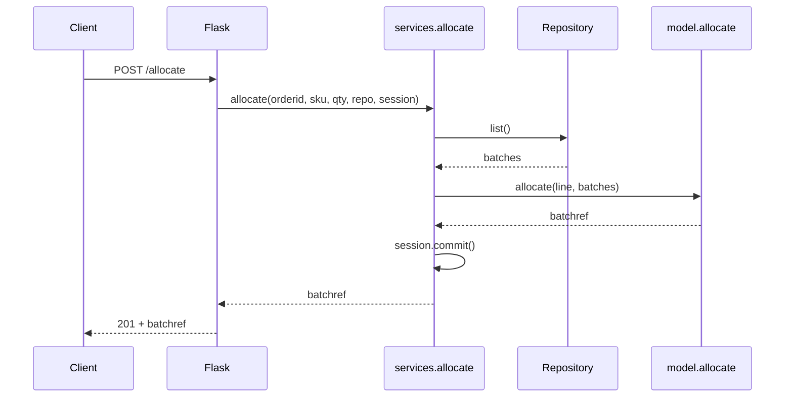

# Chapter 4: Our First Use Case: Flask API and Service Layer

## ✈️ 30,000 ft
You now have a model and storage, but nobody can use them. Add a thin web endpoint, but put the *orchestration* (fetch → validate → call model → save) in a **service layer**, not in Flask. Then the same use case can be driven by an API, a CLI or a message queue.

## 🛫 10,000 ft
- **Entrypoint / adapter** (Flask): translate HTTP → function call → HTTP. No business logic.
- **Service layer / application layer**: one function per *use case* (`allocate`, `add_batch`). Does the plumbing: repo + session + domain.
- **Domain model**: does the business rules.
- Services depend on the **abstract** repo, so tests can inject a fake.
- Trade-off: a "pointless" extra layer for trivial apps; essential once there are multiple entrypoints.

### 🗺️ Diagram: layers and one request

## 🛬 1,000 ft: design decisions
- `services.allocate(orderid, sku, qty, repo, session)` takes primitives, not domain objects. The API layer needn't know about the model.
- It raises `InvalidSku` for bad input, and the Flask handler maps exceptions to 400/404/201.
- Service tests use `FakeRepository` and a `FakeSession` with `committed = False`. (Ch06 will replace the fake session. Notice the smell.)
- Typical e2e test posts to `/allocate` and `/add_batch` against a real DB.
- Smell the authors acknowledge: the service still knows about `session.commit()`, and the API still creates the repo.

## 🛞 Touchdown
1. Write `services.py` with `allocate`, `is_valid_sku`, `InvalidSku`.
2. Write `test_services.py` using `FakeRepository`/`FakeSession`:
   - returns an allocation
   - errors for invalid SKU
   - commits
3. Write `flask_app.py` with `POST /allocate` (201 with `batchref`, 400 on invalid SKU or out of stock).
4. Write one e2e test with `requests` against the running app and DB.
5. Add `add_batch` to services, and have the e2e tests use it instead of raw SQL.

## Check yourself
- Why should Flask code not call `model.allocate` directly?
- What does the service layer know that the domain doesn't, and vice versa?
- Why do service functions accept primitives?
- What two smells remain (hint: `session`, repo creation)?
