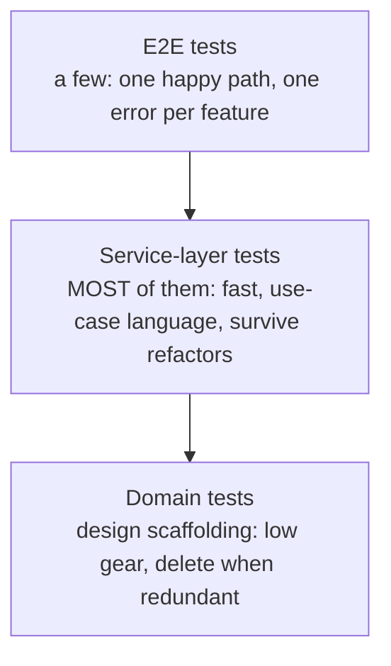
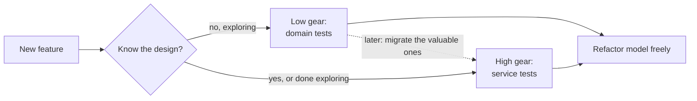

# Chapter 5: TDD in High Gear and Low Gear

## ✈️ 30,000 ft
You have tests at three levels (domain, service, e2e). Which level should most of your tests live at? The answer: shift most of them to the **service layer**, so they're fast and survive refactors of the domain.

## 🛫 10,000 ft
- **Low gear**: tests against the domain model. Tight feedback while building, but tightly coupled to model internals; they're hard to keep when the model changes.
- **High gear**: tests against the service layer's API. Describe *use cases*, so they let you refactor the model freely.
- **Test pyramid, adjusted**: a few e2e tests, most tests on the service layer, domain tests only where they help you design.
- Rule: *"Once a feature is covered by service-layer tests, you can delete some domain tests."* They're scaffolding.

### 🗺️ Diagram: where tests should live

## 🛬 1,000 ft: design decisions
- Service tests currently use domain objects (`model.Batch`, `model.OrderLine`). That couples them to the model. Fix: services expose `add_batch(ref, sku, qty, eta, repo, session)` so tests only use primitives.
- Add `deallocate` and `reallocate` use cases to see the pattern at speed.
- The domain rule "SKU must be valid" is arguably a service concern (needs the repo).
- Best practice from the chapter: **express your service tests in the language of the domain**, with no raw `model.*` imports.

## 🛞 Touchdown
1. Add `services.add_batch(...)` and rewrite all service tests to use it. Grep tests for `model.` and aim for zero.
2. Add a test + implementation for `deallocate`, using primitives only.
3. Add a service-level test for `allocate` returning the batch ref.
4. Review the domain tests from ch01: mark which are now redundant. Keep them anyway, but tag the ones you'd delete in a mature codebase.
5. Count: how many tests per layer? Does it look like the pyramid?

## Check yourself
- When is low gear the right choice? When is high gear?
- What does it cost you when tests import `model`?
- Why can service-layer tests make a refactor of the domain cheaper?
- Which tests would you keep long-term, and why?
