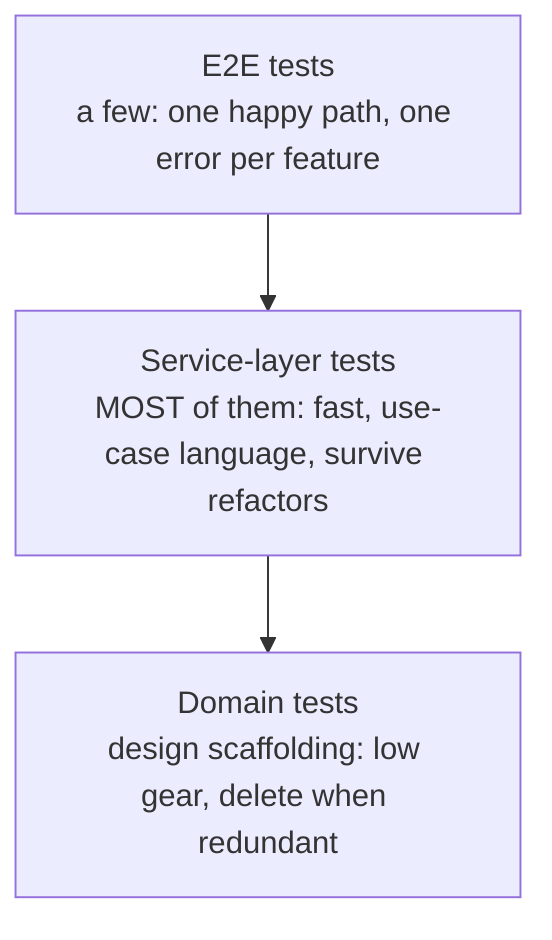
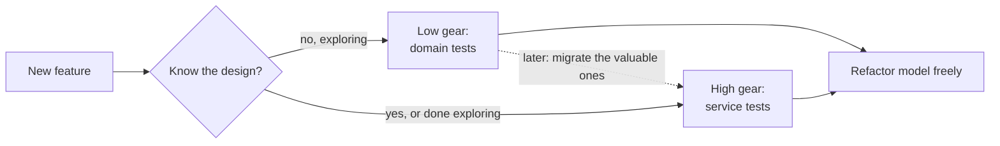

# Chapter 5: TDD in High Gear and Low Gear

## ✈️ 30,000 ft
You have tests at three levels (domain, service, e2e). Which level should most of your tests live at? The answer: shift most of them to the **service layer**, so they're fast and survive refactors of the domain.

## 🛫 10,000 ft
- **Low gear**: tests against the domain model. Tight feedback while building, but tightly coupled to model internals; they're hard to keep when the model changes.
- **High gear**: tests against the service layer's API. Describe *use cases*, so they let you refactor the model freely.
- **Test pyramid, adjusted**: a few e2e tests, most tests on the service layer, domain tests only where they help you design.
- Rule: *"Once a feature is covered by service-layer tests, you can delete some domain tests."* They're scaffolding.

### 🗺️ Diagram: where tests should live





## 🛫 5,000 ft: the conventional way vs. the better way

> Evidence tags: 🧪 I ran it · 🧮 arithmetic · 📖 documentation or reasoning (not run).

### Addition 1: how service tests set up their data

**The conventional way:** build domain objects directly in the tests.

```python
def test_returns_allocation():
    batch = model.Batch("b1", "COMPLICATED-LAMP", 100, eta=None)
    repo = FakeRepository([batch])
    assert services.allocate("o1", "COMPLICATED-LAMP", 10, repo, FakeSession()) == "b1"
```

**Where it breaks**
- Every test is welded to `Batch`'s constructor. 🧪 Even our tiny ch04 service suite has 3 direct `model.Batch(` calls; a real suite has hundreds. Add a required argument to `Batch` and they all go red, though no behaviour changed.
- The model becomes expensive to refactor, which is the opposite of why we separated it.

**The better way** (Steps 1-2): set up through the service's own API: `services.add_batch(...)`.

**Why it's right:** 🧪 the ch05 service suite has **0** direct domain constructions. Change `Batch` and you fix one line inside `add_batch`.
**What it costs:** setup now depends on `add_batch` working (if it breaks, many tests fail together, though the cause is one obvious place), and it takes longer to read as "pure unit" tests.

### Addition 2: which level do most tests live at?

**The conventional way:** either test only through HTTP ("test the real thing") or only through the domain model.

**Where it breaks**
- *Only HTTP:* every test needs the app and a database; the suite slows as it grows; a failing test says `400 != 201` and you start digging. The number of combinations (rules x endpoints x states) explodes. 📖
- *Only domain:* the tests double as a frozen API for the model, so refactoring it breaks them; and orchestration (SKU validation, committing, event wiring) isn't covered at all. That is the low-gear trap.

**The better way** (Step 6): a **pyramid**: many service-layer tests in the language of use cases, a few e2e tests as a safety net, and domain tests mostly as design scaffolding you may delete later.

**Why it's right:** service tests are fast, cover behaviour users care about, and survive model refactors.
**What it costs:** fakes can drift from the real adapters (hence the few integration/e2e tests), and you must resist adding domain tests for everything just because they're easy to write.

## 🛬 1,000 ft: design decisions
- Service tests currently use domain objects (`model.Batch`, `model.OrderLine`). That couples them to the model. Fix: services expose `add_batch(ref, sku, qty, eta, repo, session)` so tests only use primitives.
- Add `deallocate` and `reallocate` use cases to see the pattern at speed.
- The domain rule "SKU must be valid" is arguably a service concern (needs the repo).
- Best practice from the chapter: **express your service tests in the language of the domain**, with no raw `model.*` imports.

## 🛞 Touchdown: code along

> Starts from your finished ch04 project. Changes: add `add_batch` and `deallocate` services and an `/add_batch` endpoint; **rewrite the service tests so they never import `model`**. All code below was run and passes (31 tests).

### The idea in one picture

Your ch04 service tests did this:

```python
batch = model.Batch("b1", "AREALSKU", 100, eta=None)   # reaches into the domain
repo = FakeRepository([batch])
```

If you later change `Batch.__init__`, every one of those tests breaks even though no *behaviour* changed. After this chapter they say:

```python
services.add_batch("b1", "AREALSKU", 100, None, repo, session)   # speaks in use cases
```

### Step 1: Add the `add_batch` service

**Do:** write a test that adds a batch through the service, then add the function.

```python
def test_add_batch():
    repo, session = FakeRepository([]), FakeSession()
    services.add_batch("b1", "CRUNCHY-ARMCHAIR", 100, None, repo, session)
    assert repo.get("b1") is not None
    assert session.committed
```

**Why:** the tests need a way to set up stock *through the service API*. Once that exists, no test needs `model.Batch` just for arrange steps.

### Step 2: Rewrite the other service tests to use only service functions

**Do:** replace every `model.Batch(...)` in `test_services.py` with a call to `services.add_batch(...)`. When you finish, `grep "model\." tests/unit/test_services.py` should return nothing (apart from a comment).

### Step 3: Add `deallocate`, test first

**Do:** write the two deallocate tests below, see them fail with `AttributeError`, then add `services.deallocate`.

**Why these assertions?** They are written purely in terms of observable behaviour: "after deallocating, the stock is available again". They don't peek at `batch._allocations`.

**📄 `tests/unit/test_services.py`**

```python
from datetime import date

import pytest

from allocation.adapters import repository
from allocation.service_layer import services


class FakeRepository(repository.AbstractRepository):
    def __init__(self, batches):
        self._batches = set(batches)

    def add(self, batch):
        self._batches.add(batch)

    def get(self, reference):
        return next(b for b in self._batches if b.reference == reference)

    def list(self):
        return list(self._batches)


class FakeSession:
    committed = False

    def commit(self):
        self.committed = True


# Note: no `model.` objects are used to set up or assert in these tests.
# They speak the language of the use cases: add a batch, allocate, deallocate.


def test_add_batch():
    repo, session = FakeRepository([]), FakeSession()
    services.add_batch("b1", "CRUNCHY-ARMCHAIR", 100, None, repo, session)
    assert repo.get("b1") is not None
    assert session.committed


def test_allocate_returns_allocation():
    repo, session = FakeRepository([]), FakeSession()
    services.add_batch("batch1", "COMPLICATED-LAMP", 100, None, repo, session)
    result = services.allocate("o1", "COMPLICATED-LAMP", 10, repo, session)
    assert result == "batch1"


def test_allocate_errors_for_invalid_sku():
    repo, session = FakeRepository([]), FakeSession()
    services.add_batch("b1", "AREALSKU", 100, None, repo, session)

    with pytest.raises(services.InvalidSku, match="Invalid sku NONEXISTENTSKU"):
        services.allocate("o1", "NONEXISTENTSKU", 10, repo, FakeSession())


def test_allocate_commits():
    repo, session = FakeRepository([]), FakeSession()
    services.add_batch("b1", "OMINOUS-MIRROR", 100, None, repo, session)
    session.committed = False

    services.allocate("o1", "OMINOUS-MIRROR", 10, repo, session)
    assert session.committed is True


def test_deallocate_decrements_available_quantity():
    repo, session = FakeRepository([]), FakeSession()
    services.add_batch("b1", "BLUE-PLINTH", 100, None, repo, session)
    services.allocate("o1", "BLUE-PLINTH", 100, repo, session)

    services.deallocate("o1", "BLUE-PLINTH", 100, repo, session)

    # the whole batch is free again, so another order can take all of it
    assert services.allocate("o2", "BLUE-PLINTH", 100, repo, session) == "b1"


def test_deallocate_decrements_correct_quantity():
    repo, session = FakeRepository([]), FakeSession()
    services.add_batch("b1", "BLUE-PLINTH", 100, None, repo, session)
    services.add_batch("b2", "BLUE-PLINTH", 100, date(2030, 1, 1), repo, session)
    services.allocate("o1", "BLUE-PLINTH", 60, repo, session)  # -> b1
    services.allocate("o2", "BLUE-PLINTH", 30, repo, session)  # -> b1

    services.deallocate("o1", "BLUE-PLINTH", 60, repo, session)

    # b1 now has 70 free (only o2's 30 remain), so a 70-unit order still goes to b1
    assert services.allocate("o3", "BLUE-PLINTH", 70, repo, session) == "b1"
    # ...and a 1-unit order spills over to the later shipment
    assert services.allocate("o4", "BLUE-PLINTH", 1, repo, session) == "b2"


def test_prefers_warehouse_batches_to_shipments():
    repo, session = FakeRepository([]), FakeSession()
    services.add_batch("in-stock-batch", "RETRO-CLOCK", 100, None, repo, session)
    services.add_batch("shipment-batch", "RETRO-CLOCK", 100, date(2030, 1, 1), repo, session)

    batchref = services.allocate("oref", "RETRO-CLOCK", 10, repo, session)

    assert batchref == "in-stock-batch"
```

### Step 4: The services

**📄 `src/allocation/service_layer/services.py`**

```python
from datetime import date

from allocation.adapters import repository
from allocation.domain import model


class InvalidSku(Exception):
    pass


def is_valid_sku(sku, batches):
    return sku in {b.sku for b in batches}


def add_batch(
    ref: str,
    sku: str,
    qty: int,
    eta: date | None,
    repo: repository.AbstractRepository,
    session,
):
    repo.add(model.Batch(ref, sku, qty, eta))
    session.commit()


def allocate(orderid: str, sku: str, qty: int, repo: repository.AbstractRepository, session) -> str:
    line = model.OrderLine(orderid, sku, qty)
    batches = repo.list()
    if not is_valid_sku(line.sku, batches):
        raise InvalidSku(f"Invalid sku {line.sku}")
    batchref = model.allocate(line, batches)
    session.commit()
    return batchref


def deallocate(orderid: str, sku: str, qty: int, repo: repository.AbstractRepository, session):
    line = model.OrderLine(orderid, sku, qty)
    batches = repo.list()
    if not is_valid_sku(line.sku, batches):
        raise InvalidSku(f"Invalid sku {line.sku}")
    for batch in batches:
        batch.deallocate(line)
    session.commit()
```

### Step 5: Expose `add_batch` over HTTP and use it in the e2e tests

**Do:** add the endpoint, then update `tests/e2e/test_api.py` to seed data through `POST /add_batch` rather than inserting rows by hand.

**Why:** the e2e tests now describe the system only through its public API, so they survive a rewrite of the model, ORM or database.

Pydantic does the date handling here: `AddBatchRequest.eta` is typed `date | None`, so the ISO string `"2030-01-01"` arrives as a real `date`, and `"next tuesday"` is rejected with a 422. There's no hand-written parsing in the entrypoint.

**📄 `src/allocation/entrypoints/fastapi_app.py`**

```python
from collections.abc import Iterator
from datetime import date
from typing import Annotated

from fastapi import Depends, FastAPI, HTTPException
from pydantic import BaseModel, Field
from sqlalchemy import create_engine
from sqlalchemy.orm import Session, sessionmaker

from allocation import config
from allocation.adapters import orm, repository
from allocation.domain import model
from allocation.service_layer import services


class AddBatchRequest(BaseModel):
    ref: str
    sku: str
    qty: int = Field(gt=0)
    eta: date | None = None  # pydantic parses "2030-01-01" for us


class AllocateRequest(BaseModel):
    orderid: str
    sku: str
    qty: int = Field(gt=0)


class AllocateResponse(BaseModel):
    batchref: str


def create_app(session_factory=None) -> FastAPI:
    if session_factory is None:
        engine = create_engine(config.get_settings().db_uri)
        orm.metadata.create_all(engine)
        orm.start_mappers()
        session_factory = sessionmaker(bind=engine)

    app = FastAPI(title="Allocation service")

    def get_session() -> Iterator[Session]:
        session = session_factory()
        try:
            yield session
        finally:
            session.close()

    DbSession = Annotated[Session, Depends(get_session)]

    @app.post("/add_batch", status_code=201)
    def add_batch_endpoint(body: AddBatchRequest, session: DbSession) -> None:
        repo = repository.SqlAlchemyRepository(session)
        services.add_batch(body.ref, body.sku, body.qty, body.eta, repo, session)

    @app.post("/allocate", status_code=201)
    def allocate_endpoint(body: AllocateRequest, session: DbSession) -> AllocateResponse:
        repo = repository.SqlAlchemyRepository(session)
        try:
            batchref = services.allocate(body.orderid, body.sku, body.qty, repo, session)
        except (model.OutOfStock, services.InvalidSku) as e:
            raise HTTPException(status_code=400, detail=str(e)) from e
        return AllocateResponse(batchref=batchref)

    return app
```

**📄 `tests/e2e/test_api.py`**

```python
import uuid

import pytest
from fastapi.testclient import TestClient

from allocation.entrypoints.fastapi_app import create_app


def random_suffix():
    return uuid.uuid4().hex[:6]


def random_sku(name=""):
    return f"sku-{name}-{random_suffix()}"


def random_batchref(name=""):
    return f"batch-{name}-{random_suffix()}"


def random_orderid(name=""):
    return f"order-{name}-{random_suffix()}"


@pytest.fixture
def client(session_factory):
    return TestClient(create_app(session_factory))


def post_to_add_batch(client, ref, sku, qty, eta):
    r = client.post("/add_batch", json={"ref": ref, "sku": sku, "qty": qty, "eta": eta})
    assert r.status_code == 201


def test_happy_path_returns_201_and_allocated_batch(client):
    sku, othersku = random_sku(), random_sku("other")
    earlybatch = random_batchref(1)
    laterbatch = random_batchref(2)
    otherbatch = random_batchref(3)
    post_to_add_batch(client, laterbatch, sku, 100, "2011-01-02")
    post_to_add_batch(client, earlybatch, sku, 100, "2011-01-01")
    post_to_add_batch(client, otherbatch, othersku, 100, None)
    data = {"orderid": random_orderid(), "sku": sku, "qty": 3}

    r = client.post("/allocate", json=data)

    assert r.status_code == 201
    assert r.json()["batchref"] == earlybatch


def test_unhappy_path_returns_400_and_error_message(client):
    unknown_sku, orderid = random_sku(), random_orderid()
    data = {"orderid": orderid, "sku": unknown_sku, "qty": 20}

    r = client.post("/allocate", json=data)

    assert r.status_code == 400
    assert r.json()["detail"] == f"Invalid sku {unknown_sku}"


@pytest.mark.parametrize("qty", [0, -3])
def test_non_positive_quantity_is_rejected_by_validation(client, qty):
    r = client.post("/allocate", json={"orderid": "o1", "sku": "ANY-SKU", "qty": qty})

    assert r.status_code == 422  # rejected by pydantic before any of our code ran


def test_malformed_eta_is_rejected_by_validation(client):
    r = client.post(
        "/add_batch", json={"ref": "b1", "sku": "ANY-SKU", "qty": 10, "eta": "next tuesday"}
    )

    assert r.status_code == 422
```

```bash
uv run pytest -q
# 31 passed
```

### Step 6: Take stock of your pyramid

```bash
uv run pytest tests/unit -q --co | tail -1      # count unit tests (domain + service)
uv run pytest tests/e2e  -q --co | tail -1      # count e2e tests
```

Roughly: many fast domain/service tests, a handful of slow e2e tests. Mark in your notes which `test_batches.py` tests you would **delete** in a mature codebase because a service test now covers the same behaviour. Keep them for now: low-gear tests are scaffolding for design, and the book suggests deleting only the ones that no longer teach you anything.

### Stretch

- Move `is_valid_sku` into the domain? Or keep it in the service? Write down which and why (it needs the repository).
- Add a service test for `allocate` when stock is out; where does the exception come from, and which layer should translate it to a status code?

## Check yourself
- When is low gear the right choice? When is high gear?
- What does it cost you when tests import `model`?
- Why can service-layer tests make a refactor of the domain cheaper?
- Which tests would you keep long-term, and why?
