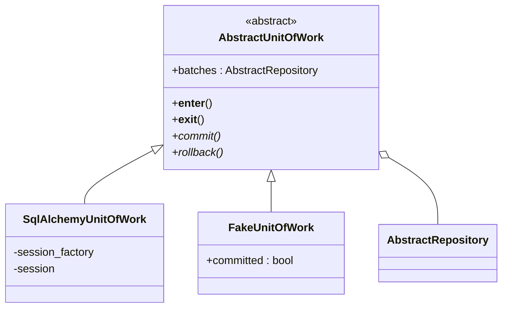
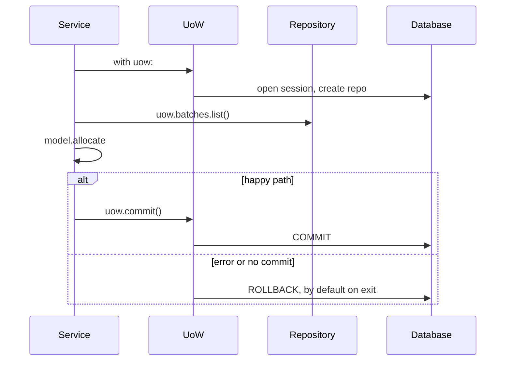

# Chapter 6: Unit of Work Pattern

## ✈️ 30,000 ft
Services still juggle `repo` and `session`, and they know about commits. The **Unit of Work (UoW)** is a single abstraction over "a transaction plus all the repositories involved", used as a context manager. It defines the atomic boundary of a use case.

## 🛫 10,000 ft
- UoW = *"one atomic operation"*: either everything in the `with` block commits, or nothing does.
- Gives services access to repos via `uow.batches`. They no longer see the session.
- **Default is rollback**: if you don't call `uow.commit()` explicitly, work is discarded. Safe by default.
- Two implementations: `SqlAlchemyUnitOfWork` (real) and `FakeUnitOfWork` (in-memory repo + `committed` flag).
- Trade-off: yet another abstraction, but it removes the main smell from ch04 and centralises the transaction logic.

### 🗺️ Diagram: the unit of work





## 🛫 5,000 ft: the conventional way vs. the better way

> Evidence tags: 🧪 I ran it · 🧮 arithmetic · 📖 documentation or reasoning (not run).

### Addition 1: where the transaction starts and ends

**The conventional way:** commit wherever it's convenient, sometimes more than once.

```python
def allocate(orderid, sku, qty, repo, session):
    ...
    batchref = model.allocate(line, batches)
    session.commit()                      # commit #1
    email.send("stock@made.com", "...")   # step 2
    audit_log.write(orderid, batchref)    # step 3
    session.commit()                      # commit #2
    return batchref
```

**Where it breaks**
- 🧪 I made step 2 fail after commit #1. The request failed (the client sees a 500) and **the allocation was persisted anyway**. The client retries, and now you have a half-done operation plus a duplicate attempt.
- There is no single place that defines "this is one atomic operation", so every new step re-opens the question.

**The better way** (Step 1): a **Unit of Work**, a context manager where one `with` block is one transaction.

**Why it's right:** the boundary is explicit and in one spot, and *leaving the block without calling `commit()` rolls everything back*: safe by default.
**What it costs:** another abstraction to learn and a `uow` argument everywhere, and for a request that does one write it is more machinery than the job needs.

### Addition 2: cleaning up after a failure

**The conventional way:** hand-written `try / except / rollback` in each service, or none at all.

```python
def allocate(...):
    try:
        ...
        session.commit()
    except Exception:
        session.rollback()    # easy to forget in one of the twenty services
        raise
```

**Where it breaks**
- 🧪 After a failed flush the session is unusable until you roll back: the very next query raised `PendingRollbackError`. If a session is shared (a thread-scoped session in a worker, say) one failed request poisons the next ones.
- Forgetting the `rollback()` in one of many services creates a bug that only shows up after a different request has failed.

**The better way** (Step 1): `__exit__` always calls `rollback()`, and each unit of work opens its own fresh session in `__enter__` and closes it in `__exit__`.

**Why it's right:** cleanup is structural, so nobody can forget it.
**What it costs:** a new session (and connection checkout) per unit of work, which is fine for request-sized work but worth knowing about at high throughput.

## 🛬 1,000 ft: design decisions
- `AbstractUnitOfWork` implements `__enter__`/`__exit__`; `__exit__` calls `self.rollback()`.
- `commit()` and `rollback()` are abstract; `batches` is an attribute set in `__enter__`.
- The real UoW takes a `session_factory`, creates the session in `__enter__`, and creates the repo from it.
- Services become `with uow: batches = uow.batches.list(); ...; uow.commit()`.
- Integration tests for the UoW itself:
  - can retrieve a batch and allocate to it
  - rolls back uncommitted work
  - rolls back on error

## 🛞 Touchdown: code along

> Starts from your finished ch05 project. New: `service_layer/unit_of_work.py`. Changed: services, FastAPI app, service tests. Added: UoW integration tests. All code below was run and passes (33 tests).

### The smell you're fixing

Every service takes `(…, repo, session)` and has to remember to call `session.commit()`. The FastAPI handler creates the session and repo. Two things know about the transaction. The Unit of Work makes *one* object own it.

### Step 1: Write the abstraction

**Do:** create `service_layer/unit_of_work.py`. Start with just `AbstractUnitOfWork`.

**Why each part exists:**
- It's a **context manager** (`with uow:`), so "start" and "end" of an atomic operation are explicit and impossible to forget.
- `__exit__` calls `rollback()`. That makes **rollback the default**: if the code inside the `with` block raises, or never calls `uow.commit()`, nothing is saved. Safe by default; you have to *opt in* to persistence.
- It exposes `batches`, the repository, so services reach storage through the UoW and never see the session.
- `SqlAlchemyUnitOfWork` takes a `session_factory`, creates a fresh session in `__enter__`, and closes it in `__exit__`. One unit of work = one session = one transaction.

**📄 `src/allocation/service_layer/unit_of_work.py`**

```python
"""The Unit of Work: one atomic operation, usable as a context manager.

Leaving the ``with`` block without calling ``commit()`` rolls everything back.
"""

from __future__ import annotations

import abc

from allocation.adapters import repository


class AbstractUnitOfWork(abc.ABC):
    """One atomic operation over a set of repositories.

    Anything not explicitly committed is rolled back when the ``with`` block ends.
    """

    batches: repository.AbstractRepository

    def __enter__(self) -> AbstractUnitOfWork:
        """Start the unit of work."""
        return self

    def __exit__(self, *args):
        # Safe by default: anything not explicitly committed is thrown away.
        """End the unit of work, rolling back anything not committed."""
        self.rollback()

    @abc.abstractmethod
    def commit(self):
        """Persist all changes made inside the block."""
        raise NotImplementedError

    @abc.abstractmethod
    def rollback(self):
        """Discard all uncommitted changes."""
        raise NotImplementedError


class SqlAlchemyUnitOfWork(AbstractUnitOfWork):
    """Unit of work backed by a SQLAlchemy session.

    A new session is opened on entering the block and closed on leaving it, so one unit of work
    is one transaction.

    Args:
        session_factory: Callable that returns a new SQLAlchemy session.
    """

    def __init__(self, session_factory):
        self.session_factory = session_factory

    def __enter__(self):
        """Open a new session and the repository that uses it."""
        self.session = self.session_factory()  # a fresh session per unit of work
        self.batches = repository.SqlAlchemyRepository(self.session)
        return super().__enter__()

    def __exit__(self, *args):
        """Roll back anything not committed, then close the session."""
        super().__exit__(*args)
        self.session.close()

    def commit(self):
        """Commit the session."""
        self.session.commit()

    def rollback(self):
        """Roll back the session."""
        self.session.rollback()
```

### Step 2: Rewrite the service tests with a `FakeUnitOfWork` (red → green)

**Do:** replace `FakeSession` with a `FakeUnitOfWork` in the unit tests. Update each call from `(…, repo, session)` to `(…, uow)`. The tests fail until the services change.

**Why:** the fake UoW is trivially simple, because it only holds a fake repo and a `committed` flag. Deleting `FakeSession` removes the smell from ch04.

**📄 `tests/unit/test_services.py`**

```python
from datetime import date

import pytest

from allocation.adapters import repository
from allocation.service_layer import services, unit_of_work


class FakeRepository(repository.AbstractRepository):
    def __init__(self, batches):
        self._batches = set(batches)

    def add(self, batch):
        self._batches.add(batch)

    def get(self, reference):
        return next(b for b in self._batches if b.reference == reference)

    def list(self):
        return list(self._batches)


class FakeUnitOfWork(unit_of_work.AbstractUnitOfWork):
    def __init__(self):
        self.batches = FakeRepository([])
        self.committed = False

    def commit(self):
        self.committed = True

    def rollback(self):
        pass


def test_add_batch():
    uow = FakeUnitOfWork()
    services.add_batch("b1", "CRUNCHY-ARMCHAIR", 100, None, uow)
    assert uow.batches.get("b1") is not None
    assert uow.committed


def test_allocate_returns_allocation():
    uow = FakeUnitOfWork()
    services.add_batch("batch1", "COMPLICATED-LAMP", 100, None, uow)
    result = services.allocate("o1", "COMPLICATED-LAMP", 10, uow)
    assert result == "batch1"


def test_allocate_errors_for_invalid_sku():
    uow = FakeUnitOfWork()
    services.add_batch("b1", "AREALSKU", 100, None, uow)

    with pytest.raises(services.InvalidSku, match="Invalid sku NONEXISTENTSKU"):
        services.allocate("o1", "NONEXISTENTSKU", 10, uow)


def test_allocate_commits():
    uow = FakeUnitOfWork()
    services.add_batch("b1", "OMINOUS-MIRROR", 100, None, uow)
    uow.committed = False

    services.allocate("o1", "OMINOUS-MIRROR", 10, uow)
    assert uow.committed is True


def test_deallocate_decrements_available_quantity():
    uow = FakeUnitOfWork()
    services.add_batch("b1", "BLUE-PLINTH", 100, None, uow)
    services.allocate("o1", "BLUE-PLINTH", 100, uow)

    services.deallocate("o1", "BLUE-PLINTH", 100, uow)

    assert services.allocate("o2", "BLUE-PLINTH", 100, uow) == "b1"


def test_prefers_warehouse_batches_to_shipments():
    uow = FakeUnitOfWork()
    services.add_batch("in-stock-batch", "RETRO-CLOCK", 100, None, uow)
    services.add_batch("shipment-batch", "RETRO-CLOCK", 100, date(2030, 1, 1), uow)

    batchref = services.allocate("oref", "RETRO-CLOCK", 10, uow)

    assert batchref == "in-stock-batch"
```

### Step 3: Change the services to use the UoW

**Do:** wrap each service body in `with uow:`, use `uow.batches`, and call `uow.commit()` explicitly.

**📄 `src/allocation/service_layer/services.py`**

```python
"""Application services: one function per use case.

Services orchestrate (fetch, call the domain, commit); the business rules stay in the model.
They take plain values, never web objects, so any entrypoint can call them.
"""

from __future__ import annotations

from datetime import date

from allocation.domain import model
from allocation.service_layer import unit_of_work


class InvalidSku(Exception):
    """Raised when an order refers to a SKU we do not stock."""

    pass


def is_valid_sku(sku, batches):
    """Return whether any of ``batches`` is for ``sku``."""
    return sku in {b.sku for b in batches}


def add_batch(
    ref: str,
    sku: str,
    qty: int,
    eta: date | None,
    uow: unit_of_work.AbstractUnitOfWork,
):
    """Add a batch of stock.

    Args:
        ref: Unique reference of the new batch.
        sku: The product the batch contains.
        qty: Quantity purchased.
        eta: Arrival date, or ``None`` for warehouse stock.
        uow: The unit of work that wraps the transaction.
    """
    with uow:
        uow.batches.add(model.Batch(ref, sku, qty, eta))
        uow.commit()


def allocate(orderid: str, sku: str, qty: int, uow: unit_of_work.AbstractUnitOfWork) -> str:
    """Allocate an order line to a batch, inside one unit of work.

    Args:
        orderid: The customer order the line belongs to.
        sku: The product ordered.
        qty: How many units.
        uow: The unit of work that wraps the transaction.

    Returns:
        The reference of the batch that was allocated.

    Raises:
        InvalidSku: If the SKU is not one we stock.
        OutOfStock: If no batch can take the line.
    """
    line = model.OrderLine(orderid, sku, qty)
    with uow:
        batches = uow.batches.list()
        if not is_valid_sku(line.sku, batches):
            raise InvalidSku(f"Invalid sku {line.sku}")
        batchref = model.allocate(line, batches)
        uow.commit()
    return batchref


def deallocate(orderid: str, sku: str, qty: int, uow: unit_of_work.AbstractUnitOfWork):
    """Release an order line from whichever batch holds it.

    Args:
        orderid: The customer order the line belongs to.
        sku: The product ordered.
        qty: How many units.
        uow: The unit of work that wraps the transaction.

    Raises:
        InvalidSku: If the SKU is not one we stock.
    """
    line = model.OrderLine(orderid, sku, qty)
    with uow:
        batches = uow.batches.list()
        if not is_valid_sku(line.sku, batches):
            raise InvalidSku(f"Invalid sku {line.sku}")
        for batch in batches:
            batch.deallocate(line)
        uow.commit()
```

### Step 4: Change the FastAPI app

**Do:** the handlers now build a `SqlAlchemyUnitOfWork(session_factory)` and hand it over. No session, no repo in the entrypoint, and ch04's `get_session` yield-dependency is gone: the UoW opens and closes its own session.

**📄 `src/allocation/entrypoints/fastapi_app.py`**

```python
"""The HTTP entrypoint: translates requests into calls to the service layer and back.

No business logic lives here. Pydantic models validate what comes in; domain and service
errors are turned into HTTP status codes.
"""

from datetime import date

from fastapi import FastAPI, HTTPException
from pydantic import BaseModel, Field
from sqlalchemy import create_engine
from sqlalchemy.orm import sessionmaker

from allocation import config
from allocation.adapters import orm
from allocation.domain import model
from allocation.service_layer import services, unit_of_work


class AddBatchRequest(BaseModel):
    """Body of ``POST /add_batch``.

    Attributes:
        ref: Unique reference of the new batch.
        sku: The product the batch contains.
        qty: Quantity purchased. Must be greater than zero.
        eta: Arrival date, or ``null`` for warehouse stock.
    """

    ref: str
    sku: str
    qty: int = Field(gt=0)
    eta: date | None = None  # pydantic parses "2030-01-01" for us


class AllocateRequest(BaseModel):
    """Body of ``POST /allocate``.

    Attributes:
        orderid: The customer order the line belongs to.
        sku: The product ordered.
        qty: How many units. Must be greater than zero.
    """

    orderid: str
    sku: str
    qty: int = Field(gt=0)


class AllocateResponse(BaseModel):
    """Body returned by ``POST /allocate``.

    Attributes:
        batchref: Reference of the batch the line was allocated to.
    """

    batchref: str


def create_app(session_factory=None) -> FastAPI:
    """Build the FastAPI application.

    Args:
        session_factory: Creates database sessions. Tests pass a throwaway database; when
            omitted, the real one from the settings is used.

    Returns:
        The configured application.
    """
    if session_factory is None:
        engine = create_engine(config.get_settings().db_uri)
        orm.metadata.create_all(engine)
        orm.start_mappers()
        session_factory = sessionmaker(bind=engine)

    app = FastAPI(title="Allocation service")

    @app.post("/add_batch", status_code=201)
    def add_batch_endpoint(body: AddBatchRequest) -> None:
        """Add a batch of stock, creating its product if the SKU is new."""
        uow = unit_of_work.SqlAlchemyUnitOfWork(session_factory)
        services.add_batch(body.ref, body.sku, body.qty, body.eta, uow)

    @app.post("/allocate", status_code=201)
    def allocate_endpoint(body: AllocateRequest) -> AllocateResponse:
        """Allocate an order line to a batch.

        Returns 201 with the batch reference, or 400 if the SKU is unknown or out of stock.
        """
        uow = unit_of_work.SqlAlchemyUnitOfWork(session_factory)
        try:
            batchref = services.allocate(body.orderid, body.sku, body.qty, uow)
        except (model.OutOfStock, services.InvalidSku) as e:
            raise HTTPException(status_code=400, detail=str(e)) from e
        return AllocateResponse(batchref=batchref)

    return app
```

### Step 5: Integration tests for the UoW itself

**Do:** create `tests/integration/test_uow.py`. These tests run against a real (file-based SQLite) database because the UoW's job *is* to manage a real transaction.

They prove three guarantees:
1. you can read a batch and a committed allocation is persisted;
2. work that isn't committed is rolled back;
3. an exception inside the block rolls back too.

**📄 `tests/integration/test_uow.py`**

```python
import pytest
from sqlalchemy import text

from allocation.domain import model
from allocation.service_layer import unit_of_work


def insert_batch(session, ref, sku, qty, eta):
    session.execute(
        text(
            "INSERT INTO batches (reference, sku, _purchased_quantity, eta)"
            " VALUES (:ref, :sku, :qty, :eta)"
        ),
        dict(ref=ref, sku=sku, qty=qty, eta=eta),
    )


def get_allocated_batch_ref(session, orderid, sku):
    [[orderlineid]] = session.execute(
        text("SELECT id FROM order_lines WHERE orderid=:orderid AND sku=:sku"),
        dict(orderid=orderid, sku=sku),
    )
    [[batchref]] = session.execute(
        text(
            "SELECT b.reference FROM allocations JOIN batches AS b ON batch_id = b.id"
            " WHERE orderline_id=:orderlineid"
        ),
        dict(orderlineid=orderlineid),
    )
    return batchref


def test_uow_can_retrieve_a_batch_and_allocate_to_it(session_factory):
    session = session_factory()
    insert_batch(session, "batch1", "HIPSTER-WORKBENCH", 100, None)
    session.commit()

    uow = unit_of_work.SqlAlchemyUnitOfWork(session_factory)
    with uow:
        batch = uow.batches.get(reference="batch1")
        line = model.OrderLine("o1", "HIPSTER-WORKBENCH", 10)
        batch.allocate(line)
        uow.commit()

    batchref = get_allocated_batch_ref(session, "o1", "HIPSTER-WORKBENCH")
    assert batchref == "batch1"


def test_rolls_back_uncommitted_work_by_default(session_factory):
    uow = unit_of_work.SqlAlchemyUnitOfWork(session_factory)
    with uow:
        insert_batch(uow.session, "batch1", "MEDIUM-PLINTH", 100, None)

    new_session = session_factory()
    rows = list(new_session.execute(text('SELECT * FROM "batches"')))
    assert rows == []


def test_rolls_back_on_error(session_factory):
    class MyException(Exception):
        pass

    uow = unit_of_work.SqlAlchemyUnitOfWork(session_factory)
    with pytest.raises(MyException), uow:
        insert_batch(uow.session, "batch1", "LARGE-FORK", 100, None)
        raise MyException()

    new_session = session_factory()
    rows = list(new_session.execute(text('SELECT * FROM "batches"')))
    assert rows == []
```

> The `session_factory` fixture (from ch04's `conftest.py`) uses a SQLite *file* in pytest's `tmp_path`, so that "another session" really is another connection. With in-memory SQLite, separate sessions can share one connection and make the rollback tests misleading.

### Step 6: Run everything

```bash
uv run pytest -q
# 33 passed
```

### Stretch

- Make the real code fail: delete `self.rollback()` from `AbstractUnitOfWork.__exit__`. Which test catches it?
- Sketch (on paper) how you'd write a Django version of the UoW using `transaction.atomic()` (Appendix D).

## Check yourself
- Why is rollback the default?
- What problem does the context manager solve compared with try/finally everywhere?
- Why does the UoW own the repository rather than the other way around?
- Where would you start a transaction in a Django app, and how would you map that to this pattern? (See Appendix D.)
