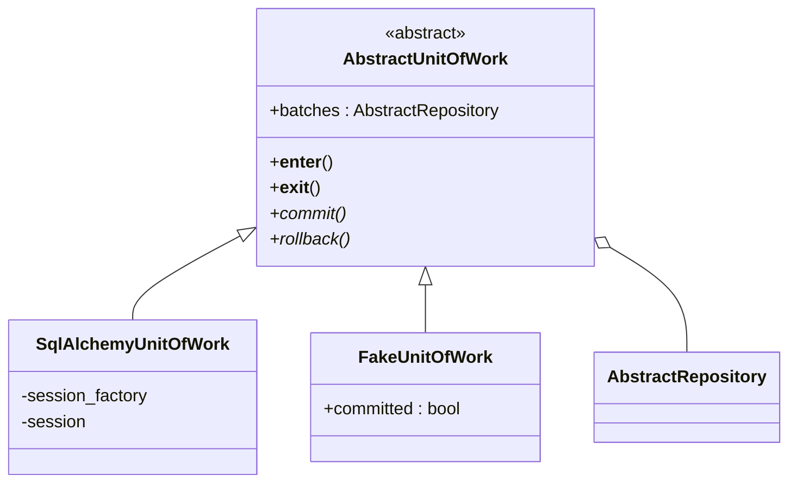
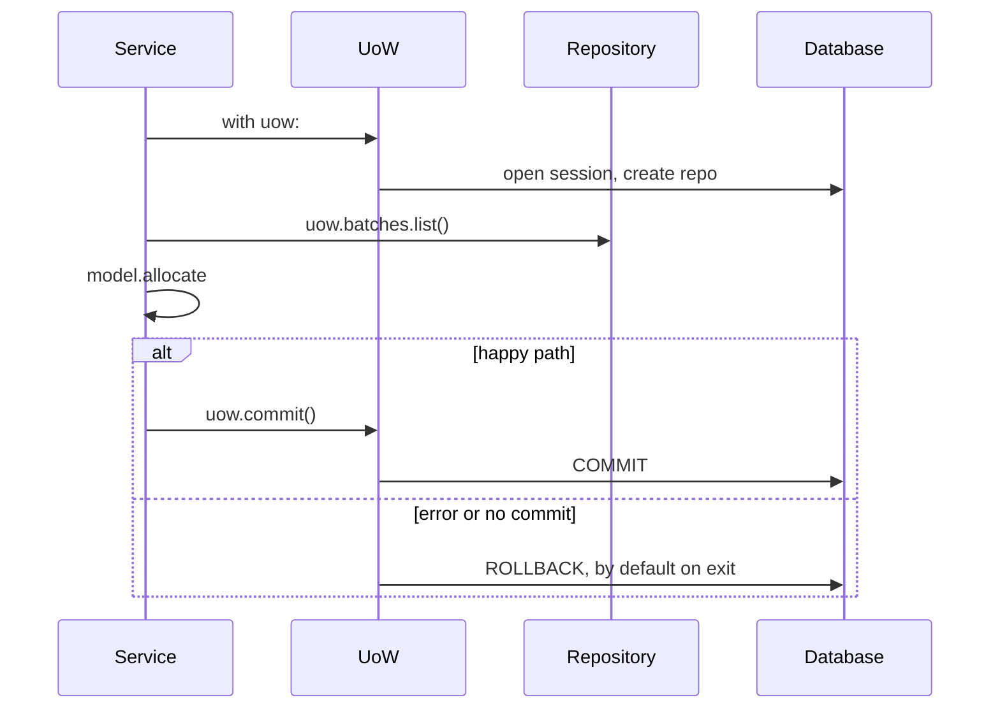

# Chapter 6: Unit of Work Pattern

## ✈️ 30,000 ft
Services still juggle `repo` and `session`, and they know about commits. The **Unit of Work (UoW)** is a single abstraction over "a transaction plus all the repositories involved", used as a context manager. It defines the atomic boundary of a use case.

## 🛫 10,000 ft
- UoW = *"one atomic operation"*: either everything in the `with` block commits, or nothing does.
- Gives services access to repos via `uow.batches`. They no longer see the session.
- **Default is rollback**: if you don't call `uow.commit()` explicitly, work is discarded. Safe by default.
- Two implementations: `SqlAlchemyUnitOfWork` (real) and `FakeUnitOfWork` (in-memory repo + `committed` flag).
- Trade-off: yet another abstraction, but it removes the main smell from ch04 and centralises the transaction logic.

### 🗺️ Diagram: the unit of work

## 🛬 1,000 ft: design decisions
- `AbstractUnitOfWork` implements `__enter__`/`__exit__`; `__exit__` calls `self.rollback()`.
- `commit()` and `rollback()` are abstract; `batches` is an attribute set in `__enter__`.
- The real UoW takes a `session_factory`, creates the session in `__enter__`, and creates the repo from it.
- Services become `with uow: batches = uow.batches.list(); ...; uow.commit()`.
- Needs a `list()` method on the repo (added here).
- Integration tests for the UoW itself:
  - can retrieve a batch and allocate to it
  - rolls back uncommitted work
  - rolls back on error
  - concurrent updates (preview of ch07)

## 🛞 Touchdown
1. Write `unit_of_work.py` (abstract + SQLAlchemy).
2. Add `repository.list()` (+ fake).
3. Rewrite services to take `uow` instead of `repo, session`.
4. `FakeUnitOfWork` in service tests; confirm `uow.committed`.
5. Write the rollback tests against the real DB.
6. Delete `FakeSession`. Feel good.

## Check yourself
- Why is rollback the default?
- What problem does the context manager solve compared with try/finally everywhere?
- Why does the UoW own the repository rather than the other way around?
- Where would you start a transaction in a Django app, and how would you map that to this pattern? (See Appendix D.)
