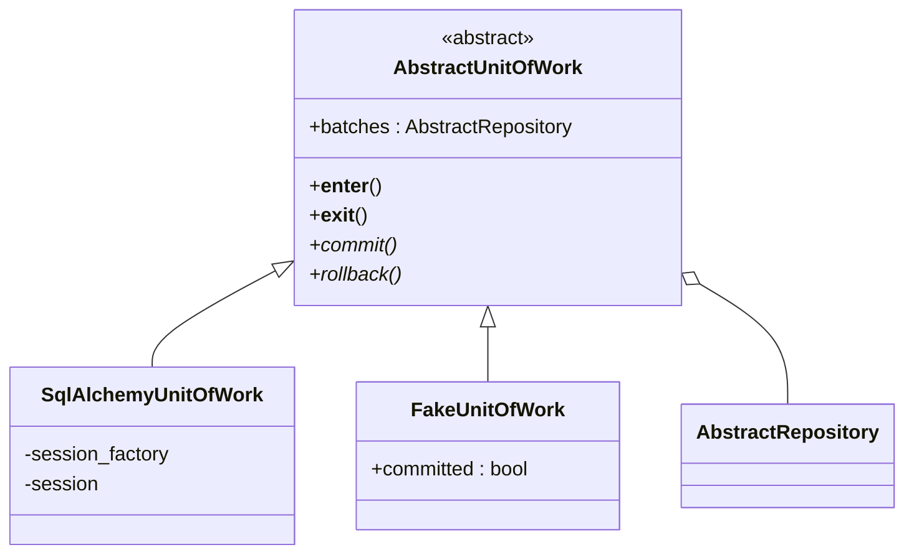
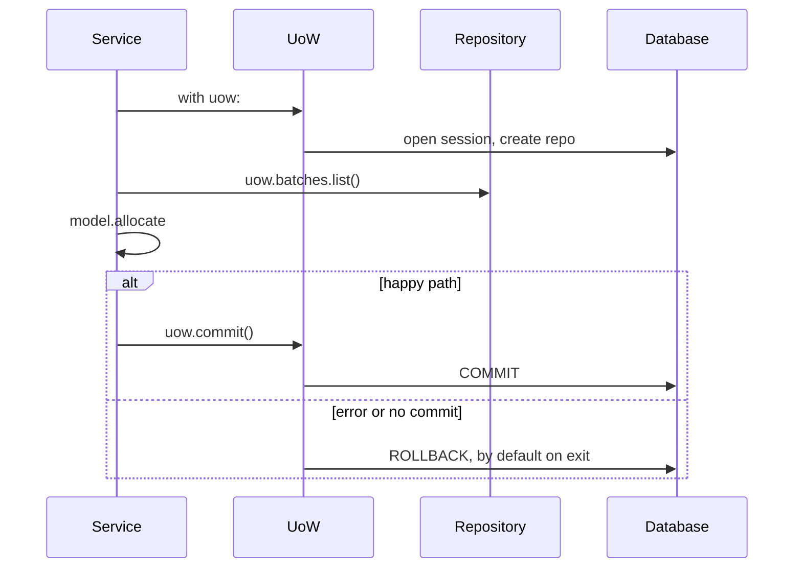

# Chapter 6: Unit of Work Pattern

## ✈️ 30,000 ft
Services still juggle `repo` and `session`, and they know about commits. The **Unit of Work (UoW)** is a single abstraction over "a transaction plus all the repositories involved", used as a context manager. It defines the atomic boundary of a use case.

## 🛫 10,000 ft
- UoW = *"one atomic operation"*: either everything in the `with` block commits, or nothing does.
- Gives services access to repos via `uow.batches`. They no longer see the session.
- **Default is rollback**: if you don't call `uow.commit()` explicitly, work is discarded. Safe by default.
- Two implementations: `SqlAlchemyUnitOfWork` (real) and `FakeUnitOfWork` (in-memory repo + `committed` flag).
- Trade-off: yet another abstraction, but it removes the main smell from ch04 and centralises the transaction logic.

### 🗺️ Diagram: the unit of work





## 🛬 1,000 ft: design decisions
- `AbstractUnitOfWork` implements `__enter__`/`__exit__`; `__exit__` calls `self.rollback()`.
- `commit()` and `rollback()` are abstract; `batches` is an attribute set in `__enter__`.
- The real UoW takes a `session_factory`, creates the session in `__enter__`, and creates the repo from it.
- Services become `with uow: batches = uow.batches.list(); ...; uow.commit()`.
- Integration tests for the UoW itself:
  - can retrieve a batch and allocate to it
  - rolls back uncommitted work
  - rolls back on error

## 🛞 Touchdown: code along

> Starts from your finished ch05 project. New: `service_layer/unit_of_work.py`. Changed: services, Flask app, service tests. Added: UoW integration tests. All code below was run and passes (30 tests).

### The smell you're fixing

Every service takes `(…, repo, session)` and has to remember to call `session.commit()`. The Flask handler creates the session and repo. Two things know about the transaction. The Unit of Work makes *one* object own it.

### Step 1: Write the abstraction

**Do:** create `service_layer/unit_of_work.py`. Start with just `AbstractUnitOfWork`.

**Why each part exists:**
- It's a **context manager** (`with uow:`), so "start" and "end" of an atomic operation are explicit and impossible to forget.
- `__exit__` calls `rollback()`. That makes **rollback the default**: if the code inside the `with` block raises, or never calls `uow.commit()`, nothing is saved. Safe by default; you have to *opt in* to persistence.
- It exposes `batches`, the repository, so services reach storage through the UoW and never see the session.
- `SqlAlchemyUnitOfWork` takes a `session_factory`, creates a fresh session in `__enter__`, and closes it in `__exit__`. One unit of work = one session = one transaction.

**📄 `src/allocation/service_layer/unit_of_work.py`**

```python
# pylint: disable=attribute-defined-outside-init
from __future__ import annotations
import abc

from allocation.adapters import repository


class AbstractUnitOfWork(abc.ABC):
    batches: repository.AbstractRepository

    def __enter__(self) -> AbstractUnitOfWork:
        return self

    def __exit__(self, *args):
        # Safe by default: anything not explicitly committed is thrown away.
        self.rollback()

    @abc.abstractmethod
    def commit(self):
        raise NotImplementedError

    @abc.abstractmethod
    def rollback(self):
        raise NotImplementedError


class SqlAlchemyUnitOfWork(AbstractUnitOfWork):
    def __init__(self, session_factory):
        self.session_factory = session_factory

    def __enter__(self):
        self.session = self.session_factory()  # a fresh session per unit of work
        self.batches = repository.SqlAlchemyRepository(self.session)
        return super().__enter__()

    def __exit__(self, *args):
        super().__exit__(*args)
        self.session.close()

    def commit(self):
        self.session.commit()

    def rollback(self):
        self.session.rollback()
```

### Step 2: Rewrite the service tests with a `FakeUnitOfWork` (red → green)

**Do:** replace `FakeSession` with a `FakeUnitOfWork` in the unit tests. Update each call from `(…, repo, session)` to `(…, uow)`. The tests fail until the services change.

**Why:** the fake UoW is trivially simple, because it only holds a fake repo and a `committed` flag. Deleting `FakeSession` removes the smell from ch04.

**📄 `tests/unit/test_services.py`**

```python
from datetime import date

import pytest

from allocation.adapters import repository
from allocation.service_layer import services, unit_of_work


class FakeRepository(repository.AbstractRepository):
    def __init__(self, batches):
        self._batches = set(batches)

    def add(self, batch):
        self._batches.add(batch)

    def get(self, reference):
        return next(b for b in self._batches if b.reference == reference)

    def list(self):
        return list(self._batches)


class FakeUnitOfWork(unit_of_work.AbstractUnitOfWork):
    def __init__(self):
        self.batches = FakeRepository([])
        self.committed = False

    def commit(self):
        self.committed = True

    def rollback(self):
        pass


def test_add_batch():
    uow = FakeUnitOfWork()
    services.add_batch("b1", "CRUNCHY-ARMCHAIR", 100, None, uow)
    assert uow.batches.get("b1") is not None
    assert uow.committed


def test_allocate_returns_allocation():
    uow = FakeUnitOfWork()
    services.add_batch("batch1", "COMPLICATED-LAMP", 100, None, uow)
    result = services.allocate("o1", "COMPLICATED-LAMP", 10, uow)
    assert result == "batch1"


def test_allocate_errors_for_invalid_sku():
    uow = FakeUnitOfWork()
    services.add_batch("b1", "AREALSKU", 100, None, uow)

    with pytest.raises(services.InvalidSku, match="Invalid sku NONEXISTENTSKU"):
        services.allocate("o1", "NONEXISTENTSKU", 10, uow)


def test_allocate_commits():
    uow = FakeUnitOfWork()
    services.add_batch("b1", "OMINOUS-MIRROR", 100, None, uow)
    uow.committed = False

    services.allocate("o1", "OMINOUS-MIRROR", 10, uow)
    assert uow.committed is True


def test_deallocate_decrements_available_quantity():
    uow = FakeUnitOfWork()
    services.add_batch("b1", "BLUE-PLINTH", 100, None, uow)
    services.allocate("o1", "BLUE-PLINTH", 100, uow)

    services.deallocate("o1", "BLUE-PLINTH", 100, uow)

    assert services.allocate("o2", "BLUE-PLINTH", 100, uow) == "b1"


def test_prefers_warehouse_batches_to_shipments():
    uow = FakeUnitOfWork()
    services.add_batch("in-stock-batch", "RETRO-CLOCK", 100, None, uow)
    services.add_batch("shipment-batch", "RETRO-CLOCK", 100, date(2030, 1, 1), uow)

    batchref = services.allocate("oref", "RETRO-CLOCK", 10, uow)

    assert batchref == "in-stock-batch"
```

### Step 3: Change the services to use the UoW

**Do:** wrap each service body in `with uow:`, use `uow.batches`, and call `uow.commit()` explicitly.

**📄 `src/allocation/service_layer/services.py`**

```python
from __future__ import annotations
from datetime import date
from typing import Optional

from allocation.domain import model
from allocation.service_layer import unit_of_work


class InvalidSku(Exception):
    pass


def is_valid_sku(sku, batches):
    return sku in {b.sku for b in batches}


def add_batch(
    ref: str,
    sku: str,
    qty: int,
    eta: Optional[date],
    uow: unit_of_work.AbstractUnitOfWork,
):
    with uow:
        uow.batches.add(model.Batch(ref, sku, qty, eta))
        uow.commit()


def allocate(
    orderid: str, sku: str, qty: int, uow: unit_of_work.AbstractUnitOfWork
) -> str:
    line = model.OrderLine(orderid, sku, qty)
    with uow:
        batches = uow.batches.list()
        if not is_valid_sku(line.sku, batches):
            raise InvalidSku(f"Invalid sku {line.sku}")
        batchref = model.allocate(line, batches)
        uow.commit()
    return batchref


def deallocate(
    orderid: str, sku: str, qty: int, uow: unit_of_work.AbstractUnitOfWork
):
    line = model.OrderLine(orderid, sku, qty)
    with uow:
        batches = uow.batches.list()
        if not is_valid_sku(line.sku, batches):
            raise InvalidSku(f"Invalid sku {line.sku}")
        for batch in batches:
            batch.deallocate(line)
        uow.commit()
```

### Step 4: Change the Flask app

**Do:** the handlers now build a `SqlAlchemyUnitOfWork(session_factory)` and hand it over. No session, no repo in the entrypoint.

**📄 `src/allocation/entrypoints/flask_app.py`**

```python
from datetime import datetime

from flask import Flask, request
from sqlalchemy import create_engine
from sqlalchemy.orm import sessionmaker

from allocation import config
from allocation.adapters import orm
from allocation.domain import model
from allocation.service_layer import services, unit_of_work


def create_app(session_factory=None):
    if session_factory is None:
        engine = create_engine(config.get_db_uri())
        orm.metadata.create_all(engine)
        orm.start_mappers()
        session_factory = sessionmaker(bind=engine)

    app = Flask(__name__)

    @app.route("/add_batch", methods=["POST"])
    def add_batch_endpoint():
        eta = request.json["eta"]
        if eta is not None:
            eta = datetime.fromisoformat(eta).date()
        services.add_batch(
            request.json["ref"],
            request.json["sku"],
            request.json["qty"],
            eta,
            unit_of_work.SqlAlchemyUnitOfWork(session_factory),
        )
        return "OK", 201

    @app.route("/allocate", methods=["POST"])
    def allocate_endpoint():
        try:
            batchref = services.allocate(
                request.json["orderid"],
                request.json["sku"],
                request.json["qty"],
                unit_of_work.SqlAlchemyUnitOfWork(session_factory),
            )
        except (model.OutOfStock, services.InvalidSku) as e:
            return {"message": str(e)}, 400

        return {"batchref": batchref}, 201

    return app
```

### Step 5: Integration tests for the UoW itself

**Do:** create `tests/integration/test_uow.py`. These tests run against a real (file-based SQLite) database because the UoW's job *is* to manage a real transaction.

They prove three guarantees:
1. you can read a batch and a committed allocation is persisted;
2. work that isn't committed is rolled back;
3. an exception inside the block rolls back too.

**📄 `tests/integration/test_uow.py`**

```python
import pytest
from sqlalchemy import text

from allocation.domain import model
from allocation.service_layer import unit_of_work


def insert_batch(session, ref, sku, qty, eta):
    session.execute(
        text(
            "INSERT INTO batches (reference, sku, _purchased_quantity, eta)"
            " VALUES (:ref, :sku, :qty, :eta)"
        ),
        dict(ref=ref, sku=sku, qty=qty, eta=eta),
    )


def get_allocated_batch_ref(session, orderid, sku):
    [[orderlineid]] = session.execute(
        text("SELECT id FROM order_lines WHERE orderid=:orderid AND sku=:sku"),
        dict(orderid=orderid, sku=sku),
    )
    [[batchref]] = session.execute(
        text(
            "SELECT b.reference FROM allocations JOIN batches AS b ON batch_id = b.id"
            " WHERE orderline_id=:orderlineid"
        ),
        dict(orderlineid=orderlineid),
    )
    return batchref


def test_uow_can_retrieve_a_batch_and_allocate_to_it(session_factory):
    session = session_factory()
    insert_batch(session, "batch1", "HIPSTER-WORKBENCH", 100, None)
    session.commit()

    uow = unit_of_work.SqlAlchemyUnitOfWork(session_factory)
    with uow:
        batch = uow.batches.get(reference="batch1")
        line = model.OrderLine("o1", "HIPSTER-WORKBENCH", 10)
        batch.allocate(line)
        uow.commit()

    batchref = get_allocated_batch_ref(session, "o1", "HIPSTER-WORKBENCH")
    assert batchref == "batch1"


def test_rolls_back_uncommitted_work_by_default(session_factory):
    uow = unit_of_work.SqlAlchemyUnitOfWork(session_factory)
    with uow:
        insert_batch(uow.session, "batch1", "MEDIUM-PLINTH", 100, None)

    new_session = session_factory()
    rows = list(new_session.execute(text('SELECT * FROM "batches"')))
    assert rows == []


def test_rolls_back_on_error(session_factory):
    class MyException(Exception):
        pass

    uow = unit_of_work.SqlAlchemyUnitOfWork(session_factory)
    with pytest.raises(MyException):
        with uow:
            insert_batch(uow.session, "batch1", "LARGE-FORK", 100, None)
            raise MyException()

    new_session = session_factory()
    rows = list(new_session.execute(text('SELECT * FROM "batches"')))
    assert rows == []
```

> The `session_factory` fixture (from ch04's `conftest.py`) uses a SQLite *file* in pytest's `tmp_path`, so that "another session" really is another connection. With in-memory SQLite, separate sessions can share one connection and make the rollback tests misleading.

### Step 6: Run everything

```bash
pytest -q
# 30 passed
```

### Stretch

- Make the real code fail: delete `self.rollback()` from `AbstractUnitOfWork.__exit__`. Which test catches it?
- Sketch (on paper) how you'd write a Django version of the UoW using `transaction.atomic()` (Appendix D).

## Check yourself
- Why is rollback the default?
- What problem does the context manager solve compared with try/finally everywhere?
- Why does the UoW own the repository rather than the other way around?
- Where would you start a transaction in a Django app, and how would you map that to this pattern? (See Appendix D.)
