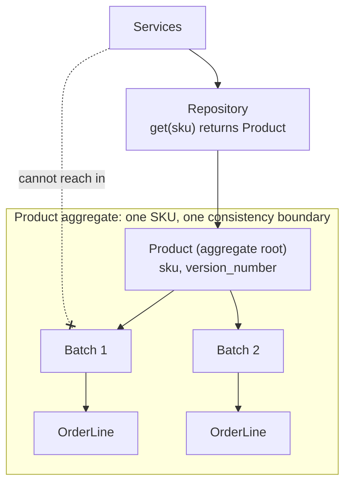
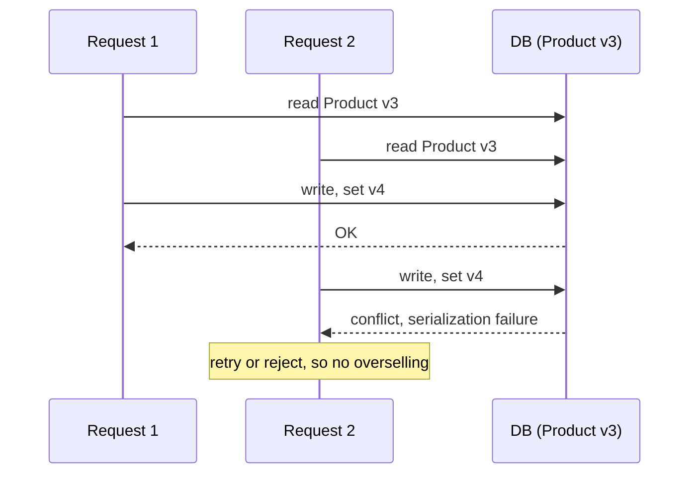

# Chapter 7: Aggregates and Consistency Boundaries

## ✈️ 30,000 ft
Which objects must be consistent *together*, and how do we protect that under concurrent requests? An **aggregate** is a cluster of objects treated as one unit, with a single entry point (the aggregate root) and a single transaction.

## 🛫 10,000 ft
- Problem: `allocate(line, batches)` needs *all* batches of a SKU to decide, and there's no object representing "all stock for this SKU".
- Solution: a new **`Product`** aggregate per SKU, holding its batches. `Product.allocate(line)` replaces the free function.
- **Aggregate root** = `Product`. Repos return only aggregates. Outsiders never reach in and mutate batches.
- Rule of thumb: *one aggregate = one repository = one consistency boundary*.
- **Concurrency**: two requests allocating the same SKU at once can oversell. Fix with **optimistic concurrency** via a `version_number` on `Product`, plus a DB isolation level (`REPEATABLE READ`) or pessimistic `SELECT ... FOR UPDATE`.
- Trade-off: aggregates should be small. Big ones mean contention and slowness.

### 🗺️ Diagram: the Product aggregate

## 🛬 1,000 ft: design decisions
- `Product(sku, batches, version_number)`; repo API becomes `get(sku)`.
- Service `allocate` now: `product = uow.products.get(sku=line.sku)`; if `None` → `InvalidSku`.
- `add_batch` creates the Product if missing.
- Concurrency test: two threads, each with a UoW, both allocate; one must fail (`OperationalError`/serialization failure) and the DB should show exactly one allocation.
- Options compared: version column with isolation level vs `with_for_update()`. Know both, and note that one is "optimistic", the other "pessimistic".
- Foreshadow of ch08: `Product` is where events will be raised.

## 🛞 Touchdown
1. Add `Product` to the model; move `allocate` into it; fix/port ch01 tests to `product.allocate(...)`.
2. Update ORM mapping (products table + `version_number`) and the repo (`get(sku)`).
3. Update UoW + services to use `uow.products`.
4. Write the threaded concurrency test (Postgres required) and make it pass using the isolation level or `with_for_update`.
5. Draw the aggregate diagram in your own words, and write which invariants it guards.

## Check yourself
- What invariant forced us to introduce `Product`?
- Why can't a service load a single `Batch` directly any more?
- Optimistic vs pessimistic locking: when does each win?
- How do you decide aggregate size?
