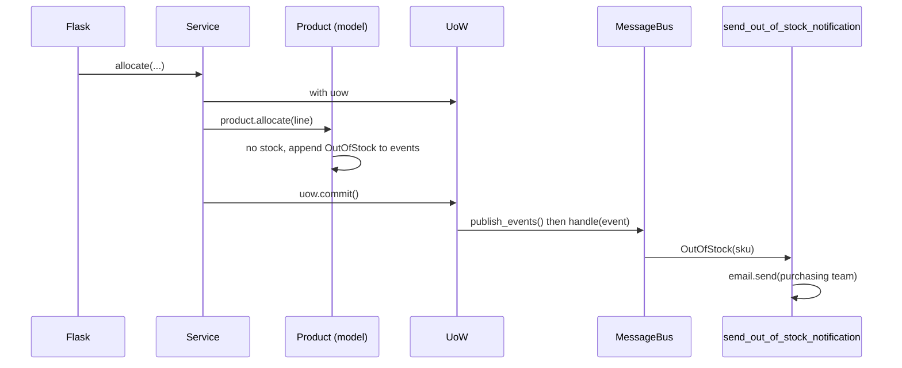
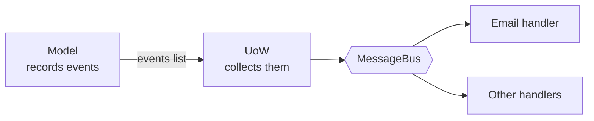

# Chapter 8: Events and the Message Bus

## ✈️ 30,000 ft
New requirement: "when a SKU is out of stock, email the purchasing team." Bolting that into `allocate` (or the service, or Flask) tangles unrelated concerns. Instead, the model **records an event** and a **message bus** routes it to handlers.

## 🛫 10,000 ft
- **Single Responsibility Principle**: "allocate" should not know about email.
- **Domain event**: a fact that happened, named in past tense (`OutOfStock(sku)`), as a dataclass.
- **Message bus**: maps event types → list of handlers.
- The aggregate collects events in `product.events`; the service layer / UoW publishes them after the work is done.
- Option progression the book walks through:
  1. Put email in the web controller ✗
  2. Put it in the model ✗ (model shouldn't do I/O)
  3. Put it in the service ✗ (muddy)
  4. **Events + bus** ✓
- Trade-off: control flow becomes indirect: harder to follow with "who handles this?" questions.

### 🗺️ Diagram: events and the bus





## 🛬 1,000 ft: design decisions
- `events.py`: `Event` base + `OutOfStock`.
- `Product.allocate` now appends `events.OutOfStock(sku)` and returns `None` instead of raising.
- `messagebus.handle(event)` looks up `HANDLERS[type(event)]`.
- Naive approach: every service calls `messagebus.handle(...)` for each event in `product.events` after committing. Smelly: each service has to remember to do it.
- Better: the repository records every product it hands out (`seen`), and the **UoW** publishes their events in `commit()` (via `publish_events()`). Ch09 flips the direction: the bus *pulls* with `collect_new_events()`.
- Handler example: `send_out_of_stock_notification` (use a patched `email.send` in the tests, one of the few justified mocks).

## 🛞 Touchdown: code along

> Starts from your finished ch07 project. New requirement: **email the purchasing team when a SKU is out of stock.** New files: `domain/events.py`, `adapters/email.py`, `service_layer/handlers.py`, `service_layer/messagebus.py`. 34 tests pass, 1 skipped (the Postgres one).

### Why not just call `email.send()` where the failure happens?

| Place | Problem |
|---|---|
| In the Flask handler | The web layer now makes business decisions. |
| In `Product.allocate` | The domain model does I/O; it can't be tested without mocking email. |
| In the service | Allocation logic gets entangled with notification. Next requirement ("also text the warehouse") makes it worse. |

The pattern: the model **records a fact** (`OutOfStock`), something else **reacts** to it.

### Step 1: Define the event

**Do:** create `domain/events.py`. Events are plain dataclasses named in the **past tense**: they report something that already happened.

**📄 `src/allocation/domain/events.py`**

```python
from dataclasses import dataclass


class Event:
    pass


@dataclass
class OutOfStock(Event):
    sku: str
```

### Step 2: Test that the model records the event (red → green)

**Do:** in `tests/unit/test_product.py`, replace `test_raises_out_of_stock_exception_if_cannot_allocate` with this test:

```python
from allocation.domain import events

def test_records_out_of_stock_event_if_cannot_allocate():
    batch = Batch("batch1", "SMALL-FORK", 10, eta=today)
    product = Product(sku="SMALL-FORK", batches=[batch])
    product.allocate(OrderLine("order1", "SMALL-FORK", 10))

    allocation = product.allocate(OrderLine("order2", "SMALL-FORK", 1))

    assert product.events[-1] == events.OutOfStock(sku="SMALL-FORK")
    assert allocation is None
```

### Step 3: Make `Product` record events

**Do:** in `model.py`, import `events`, give `Product` an `events` list, and replace the `raise OutOfStock` with recording an event and returning `None`.

```python
from allocation.domain import events          # new import at the top

class Product:
    def __init__(self, sku: str, batches: List[Batch], version_number: int = 0):
        self.sku = sku
        self.batches = batches
        self.version_number = version_number
        self.events = []  # type: List[events.Event]      # new

    def allocate(self, line: OrderLine) -> Optional[str]:
        try:
            batch = next(b for b in sorted(self.batches) if b.can_allocate(line))
            batch.allocate(line)
            self.version_number += 1
            return batch.reference
        except StopIteration:
            self.events.append(events.OutOfStock(line.sku))   # record, don't raise
            return None
```

**Why:** the model stays pure. It doesn't know who is listening or what they'll do. (You can now delete the unused `OutOfStock` exception from the model, or keep it for now.)

> **A gotcha you must handle.** SQLAlchemy doesn't call `__init__` when it *loads* an object from the database, so a loaded `Product` would have no `events` attribute. Add this listener at the bottom of `orm.py`:

```python
from sqlalchemy import event           # add to the imports

@event.listens_for(model.Product, "load")
def receive_load(product, _):
    product.events = []
```

### Step 4: The handler and the message bus

**Do:** create `adapters/email.py` (a stand-in that just prints), `service_layer/handlers.py`, and `service_layer/messagebus.py`.

**Why:** the bus is only a dictionary from event type to a list of handler functions, plus a loop. Adding "also text the warehouse" later means appending another handler to the list; no existing code changes.

**📄 `src/allocation/adapters/email.py`**

```python
def send(*args):
    print("SENDING EMAIL:", *args)
```

**📄 `src/allocation/service_layer/handlers.py`**

```python
from allocation.adapters import email
from allocation.domain import events


def send_out_of_stock_notification(event: events.OutOfStock):
    email.send(
        "stock@made.com",
        f"Out of stock for {event.sku}",
    )
```

**📄 `src/allocation/service_layer/messagebus.py`**

```python
from typing import List, Dict, Callable, Type

from allocation.domain import events
from allocation.service_layer import handlers


def handle(event: events.Event):
    for handler in HANDLERS[type(event)]:
        handler(event)


HANDLERS = {
    events.OutOfStock: [handlers.send_out_of_stock_notification],
}  # type: Dict[Type[events.Event], List[Callable]]
```

### Step 5: Who publishes the events? The Unit of Work.

You *could* have each service call `messagebus.handle(...)` after committing, but then every service must remember to do it. Instead, the repository remembers every product it handed out (`seen`), and the UoW publishes their events right after a successful commit.

**Do:**
1. In `repository.py`, make `add`/`get` concrete methods that record `seen` and delegate to abstract `_add`/`_get`.
2. In `unit_of_work.py`, make `commit()` call `_commit()` then `publish_events()`.
3. Update your `FakeRepository` (`_add`/`_get`, call `super().__init__()`) and `FakeUnitOfWork` (`_commit`).

**📄 `src/allocation/adapters/repository.py`**

```python
import abc
from typing import Set

from allocation.domain import model


class AbstractRepository(abc.ABC):
    def __init__(self):
        # every aggregate that passes through the repo; the UoW reads its events
        self.seen = set()  # type: Set[model.Product]

    def add(self, product: model.Product):
        self._add(product)
        self.seen.add(product)

    def get(self, sku) -> model.Product:
        product = self._get(sku)
        if product:
            self.seen.add(product)
        return product

    @abc.abstractmethod
    def _add(self, product: model.Product):
        raise NotImplementedError

    @abc.abstractmethod
    def _get(self, sku) -> model.Product:
        raise NotImplementedError


class SqlAlchemyRepository(AbstractRepository):
    def __init__(self, session):
        super().__init__()
        self.session = session

    def _add(self, product):
        self.session.add(product)

    def _get(self, sku):
        return self.session.query(model.Product).filter_by(sku=sku).first()
```

**📄 `src/allocation/service_layer/unit_of_work.py`**

```python
# pylint: disable=attribute-defined-outside-init
from __future__ import annotations
import abc

from allocation.adapters import repository
from allocation.service_layer import messagebus


class AbstractUnitOfWork(abc.ABC):
    products: repository.AbstractRepository

    def __enter__(self) -> AbstractUnitOfWork:
        return self

    def __exit__(self, *args):
        # Safe by default: anything not explicitly committed is thrown away.
        self.rollback()

    def commit(self):
        self._commit()
        self.publish_events()

    def publish_events(self):
        for product in self.products.seen:
            while product.events:
                event = product.events.pop(0)
                messagebus.handle(event)

    @abc.abstractmethod
    def _commit(self):
        raise NotImplementedError

    @abc.abstractmethod
    def rollback(self):
        raise NotImplementedError


class SqlAlchemyUnitOfWork(AbstractUnitOfWork):
    def __init__(self, session_factory):
        self.session_factory = session_factory

    def __enter__(self):
        self.session = self.session_factory()  # a fresh session per unit of work
        self.products = repository.SqlAlchemyRepository(self.session)
        return super().__enter__()

    def __exit__(self, *args):
        super().__exit__(*args)
        self.session.close()

    def _commit(self):
        self.session.commit()

    def rollback(self):
        self.session.rollback()
```

### Step 6: Tell the API about "out of stock"

`allocate` now returns `None` instead of raising, so the Flask endpoint must translate that to the same 400 response as before. Replace the `except` clause and add the `None` check:

```python
        except services.InvalidSku as e:
            return {"message": str(e)}, 400

        if batchref is None:
            return {"message": f"Out of stock for sku {request.json['sku']}"}, 400
        return {"batchref": batchref}, 201
```

(Change the service's return type to `Optional[str]`, remove the now-unused `model` import from `flask_app.py`.) Add an e2e test `test_out_of_stock_returns_400`.

### Step 7: Prove the email is sent

Update the fakes in `tests/unit/test_services.py` and add this test. `mock.patch` is justified here: email is a true external side-effect you don't own.

```python
from unittest import mock

class FakeRepository(repository.AbstractRepository):
    def __init__(self, products):
        super().__init__()
        self._products = set(products)

    def _add(self, product):
        self._products.add(product)

    def _get(self, sku):
        return next((p for p in self._products if p.sku == sku), None)


class FakeUnitOfWork(unit_of_work.AbstractUnitOfWork):
    def __init__(self):
        self.products = FakeRepository([])
        self.committed = False

    def _commit(self):
        self.committed = True

    def rollback(self):
        pass


def test_sends_email_on_out_of_stock_error():
    uow = FakeUnitOfWork()
    services.add_batch("b1", "POPULAR-CURTAINS", 9, None, uow)

    with mock.patch("allocation.adapters.email.send") as mock_send_mail:
        services.allocate("o1", "POPULAR-CURTAINS", 10, uow)
        assert mock_send_mail.call_args == mock.call(
            "stock@made.com", "Out of stock for POPULAR-CURTAINS"
        )
```

```bash
pytest -q
# 34 passed, 1 skipped
```

### Trade-off to write in your notes

Control flow is now **indirect**: reading `services.allocate`, you can't see that an email gets sent. To find out, you look up `OutOfStock` in `messagebus.HANDLERS`. That's the price of decoupling.

### Stretch

- Add a second handler to the `OutOfStock` list that appends the SKU to a `reorder.log` file. Which existing files did you have to touch?
- What happens if the email handler raises an exception here? (We'll deal with that in ch10.)

## Check yourself
- Why is "past tense" important in event names?
- Why does the model record events instead of publishing them?
- Who should be responsible for publishing: service or UoW? Why did the book move it?
- What gets harder to debug with a message bus?
