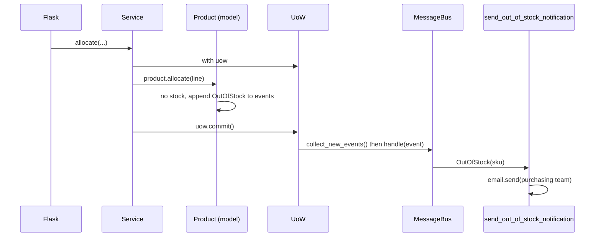
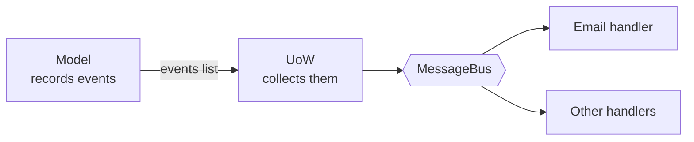

# Chapter 8: Events and the Message Bus

## ✈️ 30,000 ft
New requirement: "when a SKU is out of stock, email the purchasing team." Bolting that into `allocate` (or the service, or Flask) tangles unrelated concerns. Instead, the model **records an event** and a **message bus** routes it to handlers.

## 🛫 10,000 ft
- **Single Responsibility Principle**: "allocate" should not know about email.
- **Domain event**: a fact that happened, named in past tense (`OutOfStock(sku)`), as a dataclass.
- **Message bus**: maps event types → list of handlers.
- The aggregate collects events in `product.events`; the service layer / UoW publishes them after the work is done.
- Option progression the book walks through:
  1. Put email in the web controller ✗
  2. Put it in the model ✗ (model shouldn't do I/O)
  3. Put it in the service ✗ (muddy)
  4. **Events + bus** ✓
- Trade-off: control flow becomes indirect: harder to follow with "who handles this?" questions.

### 🗺️ Diagram: events and the bus

## 🛬 1,000 ft: design decisions
- `events.py`: `Event` base + `OutOfStock`.
- `Product.allocate` now appends `events.OutOfStock(sku)` and returns `None` instead of raising.
- `messagebus.handle(event)` looks up `HANDLERS[type(event)]`.
- First approach: services call `messagebus.handle(...)` for each event in `product.events`. Smelly: the service has to remember to do it.
- Better approach: the **UoW** collects events from the aggregates it has seen (`uow.products.seen`) via `collect_new_events()`, and the bus pulls from it.
- Handler example: `send_out_of_stock_notification` (use a patched `email.send` in the tests, one of the few justified mocks).

## 🛞 Touchdown
1. Add `events.py`, and an `events` list on `Product`.
2. Change out-of-stock handling to raise/record `OutOfStock`; fix the tests.
3. Write `messagebus.py` with `handle()` + `HANDLERS`.
4. Make the service call the bus, then refactor so the **UoW** publishes events (`publish_events`).
5. Test: the e2e/integration test asserts that `email.send` is called with the right args.

## Check yourself
- Why is "past tense" important in event names?
- Why does the model record events instead of publishing them?
- Who should be responsible for publishing: service or UoW? Why did the book move it?
- What gets harder to debug with a message bus?
