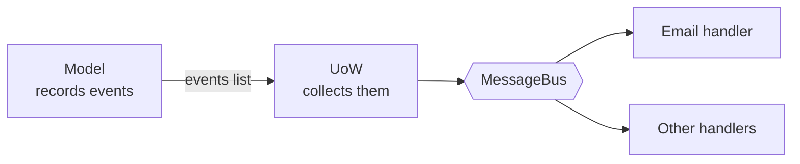

# Chapter 8: Events and the Message Bus

## ✈️ 30,000 ft
New requirement: "when a SKU is out of stock, email the purchasing team." Bolting that into `allocate` (or the service, or the web handler) tangles unrelated concerns. Instead, the model **records an event** and a **message bus** routes it to handlers.

## 🛫 10,000 ft
- **Single Responsibility Principle**: "allocate" should not know about email.
- **Domain event**: a fact that happened, named in past tense (`OutOfStock(sku)`), as a dataclass.
- **Message bus**: maps event types → list of handlers.
- The aggregate collects events in `product.events`; the service layer / UoW publishes them after the work is done.
- Option progression the book walks through:
  1. Put email in the web controller ✗
  2. Put it in the model ✗ (model shouldn't do I/O)
  3. Put it in the service ✗ (muddy)
  4. **Events + bus** ✓
- Trade-off: control flow becomes indirect: harder to follow with "who handles this?" questions.

### 🗺️ Diagram: events and the bus




## 🛫 5,000 ft: the conventional way vs. the better way

> Evidence tags: 🧪 I ran it · 🧮 arithmetic · 📖 documentation or reasoning (not run).

### Addition 1: "email purchasing when we run out of stock"

**The conventional way:** just send it where the failure is detected.

```python
def allocate(orderid, sku, qty, uow):
    with uow:
        product = uow.products.get(sku=sku)
        batchref = product.allocate(OrderLine(orderid, sku, qty))
        if batchref is None:
            email.send("stock@made.com", f"Out of stock for {sku}")   # I/O inline
        uow.commit()
    return batchref
```

**Where it breaks**
- Ordering has no good answer. Send *before* the commit and you can email about a transaction that later rolls back. Send *after* and a failing mail server turns a finished piece of work into an exception. 🧪 (the same effect as ch06's demo: the work was persisted, the caller saw an error, and a retry duplicates it.)
- Every test of `allocate` now needs to stub out email.
- The next request ("also post to Slack, also update the dashboard") edits the same function. It grows into a god-function that knows about every consumer of its results.

**The better way** (Steps 3-5): the model *records a fact* (`OutOfStock(sku)`) and a **handler** reacts to it, wired through a small message bus.

**Why it's right:** `allocate` stays about allocation. Adding "also post to Slack" is appending one function to a list; nothing existing changes.
**What it costs:** the control flow is now indirect. Reading `allocate` you can't see that an email goes out; you have to look up `OutOfStock` in the handler table. Debugging means following events.

### Addition 2: where does the model hand off the side-effect?

**The conventional way:** the domain model does the I/O itself.

```python
class Product:
    def allocate(self, line):
        ...
        except StopIteration:
            email.send("stock@made.com", f"Out of stock for {line.sku}")
```

**Where it breaks:** the model imports infrastructure, so every domain test needs a mail stub, and a script that merely *uses* the model (a simulation, a data fix) can send real emails by accident. It also undoes the whole of ch01-ch02: the pure model is gone.

**The better way** (Step 3): `Product` appends an event to `self.events`; it never learns who listens.

**Why it's right:** the domain stays free of I/O, and recording an event is a plain assertion in a unit test (`product.events[-1] == OutOfStock(...)`).
**What it costs:** one more concept (events) and a small ORM gotcha: SQLAlchemy skips `__init__` when loading, so you need the `load` listener from Step 3.

### Addition 3: who publishes the events?

**The conventional way:** each service remembers to call `messagebus.handle(...)` after committing.

**Where it breaks:** forgetting it in one of the services gives you a use case that silently never notifies. No test fails; the email just never arrives.

**The better way** (Step 5): the repository records every product it hands out (`seen`), and the Unit of Work publishes their events right after a successful commit, for every use case.

**Why it's right:** it can't be forgotten, because it isn't the service's job.
**What it costs:** the UoW now depends on the message bus. Ch09 reverses that so the bus pulls events from the UoW instead.

## 🛬 1,000 ft: design decisions
- `events.py`: `Event` base + `OutOfStock`.
- `Product.allocate` now appends `events.OutOfStock(sku)` and returns `None` instead of raising.
- `messagebus.handle(event)` looks up `HANDLERS[type(event)]`.
- Naive approach: every service calls `messagebus.handle(...)` for each event in `product.events` after committing. Smelly: each service has to remember to do it.
- Better: the repository records every product it hands out (`seen`), and the **UoW** publishes their events in `commit()` (via `publish_events()`). Ch09 flips the direction: the bus *pulls* with `collect_new_events()`.
- Handler example: `send_out_of_stock_notification` (use a patched `email.send` in the tests, one of the few justified mocks).

## 🛞 Touchdown: code along

> Starts from your finished ch07 project. New requirement: **email the purchasing team when a SKU is out of stock.** New files: `domain/events.py`, `adapters/email.py`, `service_layer/handlers.py`, `service_layer/messagebus.py`. 37 tests pass, 1 skipped (the Postgres one).

### Why not just call `email.send()` where the failure happens?

| Place | Problem |
|---|---|
| In the FastAPI handler | The web layer now makes business decisions. |
| In `Product.allocate` | The domain model does I/O; it can't be tested without mocking email. |
| In the service | Allocation logic gets entangled with notification. Next requirement ("also text the warehouse") makes it worse. |

The pattern: the model **records a fact** (`OutOfStock`), something else **reacts** to it.

### Step 1: Define the event

**Do:** create `domain/events.py`. Events are plain dataclasses named in the **past tense**: they report something that already happened.

**📄 `src/allocation/domain/events.py`**

```python
"""Domain events: facts about something that has already happened, named in the past tense.

The model records them; handlers react to them. Nothing here knows who is listening.
"""

from dataclasses import dataclass


class Event:
    """Base class for domain events."""

    pass


@dataclass
class OutOfStock(Event):
    """A SKU could not be allocated because no batch has enough stock."""

    sku: str
```

### Step 2: Test that the model records the event (red → green)

**Do:** in `tests/unit/test_product.py`, replace `test_raises_out_of_stock_exception_if_cannot_allocate` with this test:

```python
from allocation.domain import events

def test_records_out_of_stock_event_if_cannot_allocate():
    batch = Batch("batch1", "SMALL-FORK", 10, eta=today)
    product = Product(sku="SMALL-FORK", batches=[batch])
    product.allocate(OrderLine("order1", "SMALL-FORK", 10))

    allocation = product.allocate(OrderLine("order2", "SMALL-FORK", 1))

    assert product.events[-1] == events.OutOfStock(sku="SMALL-FORK")
    assert allocation is None
```

### Step 3: Make `Product` record events

**Do:** in `model.py`, import `events`, give `Product` an `events` list, and replace the `raise OutOfStock` with recording an event and returning `None`.

```python
from allocation.domain import events          # new import at the top

class Product:
    def __init__(self, sku: str, batches: list[Batch], version_number: int = 0):
        self.sku = sku
        self.batches = batches
        self.version_number = version_number
        self.events: list[events.Event] = []      # new

    def allocate(self, line: OrderLine) -> str | None:
        """Allocate ``line`` to the best available batch of this SKU.

        Args:
            line: The order line to allocate.

        Returns:
            The reference of the chosen batch, or ``None`` if no batch can take the line. In
            that case an ``events.OutOfStock`` event is recorded in ``self.events``; the model
            never sends the email itself.
        """
        try:
            batch = next(b for b in sorted(self.batches) if b.can_allocate(line))
            batch.allocate(line)
            self.version_number += 1
            return batch.reference
        except StopIteration:
            self.events.append(events.OutOfStock(line.sku))   # record, don't raise
            return None
```

**Why:** the model stays pure. It doesn't know who is listening or what they'll do. (You can now delete the unused `OutOfStock` exception from the model, or keep it for now.)

> **A gotcha you must handle.** SQLAlchemy doesn't call `__init__` when it *loads* an object from the database, so a loaded `Product` would have no `events` attribute. Add this listener at the bottom of `orm.py`:

```python
from sqlalchemy import event           # add to the imports

@event.listens_for(model.Product, "load")
def receive_load(product, _):
    """Give products loaded from the database an empty event list.

    SQLAlchemy does not call ``__init__`` when it loads an object, so without this a loaded
    ``Product`` would have no ``events`` attribute.
    """
    product.events = []
```

### Step 4: The handler and the message bus

**Do:** create `adapters/email.py` (a stand-in that just prints), `service_layer/handlers.py`, and `service_layer/messagebus.py`.

**Why:** the bus is only a dictionary from event type to a list of handler functions, plus a loop. Adding "also text the warehouse" later means appending another handler to the list; no existing code changes.

**📄 `src/allocation/adapters/email.py`**

```python
"""A stand-in email sender that just prints. Replaced by a real adapter in ch13."""


def send(*args):
    """Pretend to send an email."""
    print("SENDING EMAIL:", *args)
```

**📄 `src/allocation/service_layer/handlers.py`**

```python
"""Event handlers: what the system does when something happens."""

from allocation.adapters import email
from allocation.domain import events


def send_out_of_stock_notification(event: events.OutOfStock):
    """Email the purchasing team that a SKU ran out.

    Args:
        event: The out-of-stock event.
    """
    email.send(
        "stock@made.com",
        f"Out of stock for {event.sku}",
    )
```

**📄 `src/allocation/service_layer/messagebus.py`**

```python
"""The message bus: routes each message to its handlers."""

from collections.abc import Callable

from allocation.domain import events
from allocation.service_layer import handlers


def handle(event: events.Event):
    """Pass an event to its handlers.

    Args:
        event: The event to handle.
    """
    for handler in HANDLERS[type(event)]:
        handler(event)


HANDLERS: dict[type[events.Event], list[Callable]] = {
    events.OutOfStock: [handlers.send_out_of_stock_notification],
}
```

### Step 5: Who publishes the events? The Unit of Work.

You *could* have each service call `messagebus.handle(...)` after committing, but then every service must remember to do it. Instead, the repository remembers every product it handed out (`seen`), and the UoW publishes their events right after a successful commit.

**Do:**
1. In `repository.py`, make `add`/`get` concrete methods that record `seen` and delegate to abstract `_add`/`_get`.
2. In `unit_of_work.py`, make `commit()` call `_commit()` then `publish_events()`.
3. Update your `FakeRepository` (`_add`/`_get`, call `super().__init__()`) and `FakeUnitOfWork` (`_commit`).

**📄 `src/allocation/adapters/repository.py`**

```python
"""Repositories: the application's view of storage as a collection of aggregates."""

import abc

from allocation.domain import model


class AbstractRepository(abc.ABC):
    """The smallest storage interface the application needs, for products.

    It remembers every product it hands out in ``seen``, so the unit of work can collect the
    events those products recorded. Subclasses implement the underscore methods.
    """

    def __init__(self):
        # every aggregate that passes through the repo; the UoW reads its events
        self.seen: set[model.Product] = set()

    def add(self, product: model.Product):
        """Add a product to the collection."""
        self._add(product)
        self.seen.add(product)

    def get(self, sku) -> model.Product:
        """Return the product for this SKU, or ``None`` if there is none."""
        product = self._get(sku)
        if product:
            self.seen.add(product)
        return product

    @abc.abstractmethod
    def _add(self, product: model.Product):
        """Store the product (called by ``add``)."""
        raise NotImplementedError

    @abc.abstractmethod
    def _get(self, sku) -> model.Product:
        """Look up a product by SKU (called by ``get``)."""
        raise NotImplementedError


class SqlAlchemyRepository(AbstractRepository):
    """Repository backed by a SQLAlchemy session."""

    def __init__(self, session):
        super().__init__()
        self.session = session

    def _add(self, product):
        """Add the product to the session."""
        self.session.add(product)

    def _get(self, sku):
        """Query the product by SKU."""
        return self.session.query(model.Product).filter_by(sku=sku).first()
```

**📄 `src/allocation/service_layer/unit_of_work.py`**

```python
"""The Unit of Work: one atomic operation, usable as a context manager.

Leaving the ``with`` block without calling ``commit()`` rolls everything back.
"""

from __future__ import annotations

import abc

from allocation.adapters import repository
from allocation.service_layer import messagebus


class AbstractUnitOfWork(abc.ABC):
    """One atomic operation over a set of repositories.

    Anything not explicitly committed is rolled back when the ``with`` block ends. After a
    successful commit it publishes the events recorded by the products it touched.
    """

    products: repository.AbstractRepository

    def __enter__(self) -> AbstractUnitOfWork:
        """Start the unit of work."""
        return self

    def __exit__(self, *args):
        # Safe by default: anything not explicitly committed is thrown away.
        """End the unit of work, rolling back anything not committed."""
        self.rollback()

    def commit(self):
        """Persist all changes, then publish the events they recorded."""
        self._commit()
        self.publish_events()

    def publish_events(self):
        """Send the events recorded by the products we touched to the message bus."""
        for product in self.products.seen:
            while product.events:
                event = product.events.pop(0)
                messagebus.handle(event)

    @abc.abstractmethod
    def _commit(self):
        """Persist changes. Implemented by subclasses."""
        raise NotImplementedError

    @abc.abstractmethod
    def rollback(self):
        """Discard all uncommitted changes."""
        raise NotImplementedError


class SqlAlchemyUnitOfWork(AbstractUnitOfWork):
    """Unit of work backed by a SQLAlchemy session.

    A new session is opened on entering the block and closed on leaving it, so one unit of work
    is one transaction.

    Args:
        session_factory: Callable that returns a new SQLAlchemy session.
    """

    def __init__(self, session_factory):
        self.session_factory = session_factory

    def __enter__(self):
        """Open a new session and the repository that uses it."""
        self.session = self.session_factory()  # a fresh session per unit of work
        self.products = repository.SqlAlchemyRepository(self.session)
        return super().__enter__()

    def __exit__(self, *args):
        """Roll back anything not committed, then close the session."""
        super().__exit__(*args)
        self.session.close()

    def _commit(self):
        """Commit the session."""
        self.session.commit()

    def rollback(self):
        """Roll back the session."""
        self.session.rollback()
```

### Step 6: Tell the API about "out of stock"

`allocate` now returns `None` instead of raising, so the endpoint must translate that into the same 400 as before. Change the service's return type to `str | None`, drop the now-unused `OutOfStock` from the `except`, and add the `None` check:

```python
        except services.InvalidSku as e:
            raise HTTPException(status_code=400, detail=str(e)) from e
        if batchref is None:
            raise HTTPException(status_code=400, detail=f"Out of stock for sku {body.sku}")
        return AllocateResponse(batchref=batchref)
```

Full file after this change (it also uses `orm.make_session_factory` from ch07):

**📄 `src/allocation/entrypoints/fastapi_app.py`**

```python
"""The HTTP entrypoint: translates requests into calls to the service layer and back.

No business logic lives here. Pydantic models validate what comes in; domain and service
errors are turned into HTTP status codes.
"""

from datetime import date

from fastapi import FastAPI, HTTPException
from pydantic import BaseModel, Field

from allocation import config
from allocation.adapters import orm
from allocation.service_layer import services, unit_of_work


class AddBatchRequest(BaseModel):
    """Body of ``POST /add_batch``.

    Attributes:
        ref: Unique reference of the new batch.
        sku: The product the batch contains.
        qty: Quantity purchased. Must be greater than zero.
        eta: Arrival date, or ``null`` for warehouse stock.
    """

    ref: str
    sku: str
    qty: int = Field(gt=0)
    eta: date | None = None  # pydantic parses "2030-01-01" for us


class AllocateRequest(BaseModel):
    """Body of ``POST /allocate``.

    Attributes:
        orderid: The customer order the line belongs to.
        sku: The product ordered.
        qty: How many units. Must be greater than zero.
    """

    orderid: str
    sku: str
    qty: int = Field(gt=0)


class AllocateResponse(BaseModel):
    """Body returned by ``POST /allocate``.

    Attributes:
        batchref: Reference of the batch the line was allocated to.
    """

    batchref: str


def create_app(session_factory=None) -> FastAPI:
    """Build the FastAPI application.

    Args:
        session_factory: Creates database sessions. Tests pass a throwaway database; when
            omitted, the real one from the settings is used.

    Returns:
        The configured application.
    """
    if session_factory is None:
        orm.start_mappers()
        session_factory = orm.make_session_factory(config.get_settings().db_uri)

    app = FastAPI(title="Allocation service")

    @app.post("/add_batch", status_code=201)
    def add_batch_endpoint(body: AddBatchRequest) -> None:
        """Add a batch of stock, creating its product if the SKU is new."""
        uow = unit_of_work.SqlAlchemyUnitOfWork(session_factory)
        services.add_batch(body.ref, body.sku, body.qty, body.eta, uow)

    @app.post("/allocate", status_code=201)
    def allocate_endpoint(body: AllocateRequest) -> AllocateResponse:
        """Allocate an order line to a batch.

        Returns 201 with the batch reference, or 400 if the SKU is unknown or out of stock.
        """
        uow = unit_of_work.SqlAlchemyUnitOfWork(session_factory)
        try:
            batchref = services.allocate(body.orderid, body.sku, body.qty, uow)
        except services.InvalidSku as e:
            raise HTTPException(status_code=400, detail=str(e)) from e
        if batchref is None:
            raise HTTPException(status_code=400, detail=f"Out of stock for sku {body.sku}")
        return AllocateResponse(batchref=batchref)

    return app
```

Add an e2e test `test_out_of_stock_returns_400`.

### Step 7: Prove the email is sent

Update the fakes in `tests/unit/test_services.py` and add this test. `mock.patch` is justified here: email is a true external side-effect you don't own.

```python
from unittest import mock

class FakeRepository(repository.AbstractRepository):
    def __init__(self, products):
        super().__init__()
        self._products = set(products)

    def _add(self, product):
        self._products.add(product)

    def _get(self, sku):
        return next((p for p in self._products if p.sku == sku), None)


class FakeUnitOfWork(unit_of_work.AbstractUnitOfWork):
    def __init__(self):
        self.products = FakeRepository([])
        self.committed = False

    def _commit(self):
        self.committed = True

    def rollback(self):
        pass


def test_sends_email_on_out_of_stock_error():
    uow = FakeUnitOfWork()
    services.add_batch("b1", "POPULAR-CURTAINS", 9, None, uow)

    with mock.patch("allocation.adapters.email.send") as mock_send_mail:
        services.allocate("o1", "POPULAR-CURTAINS", 10, uow)
        assert mock_send_mail.call_args == mock.call(
            "stock@made.com", "Out of stock for POPULAR-CURTAINS"
        )
```

```bash
uv run pytest -q
# 37 passed, 1 skipped
```

### Trade-off to write in your notes

Control flow is now **indirect**: reading `services.allocate`, you can't see that an email gets sent. To find out, you look up `OutOfStock` in `messagebus.HANDLERS`. That's the price of decoupling.

### Stretch

- Add a second handler to the `OutOfStock` list that appends the SKU to a `reorder.log` file. Which existing files did you have to touch?
- What happens if the email handler raises an exception here? (We'll deal with that in ch10.)

## Check yourself
- Why is "past tense" important in event names?
- Why does the model record events instead of publishing them?
- Who should be responsible for publishing: service or UoW? Why did the book move it?
- What gets harder to debug with a message bus?
