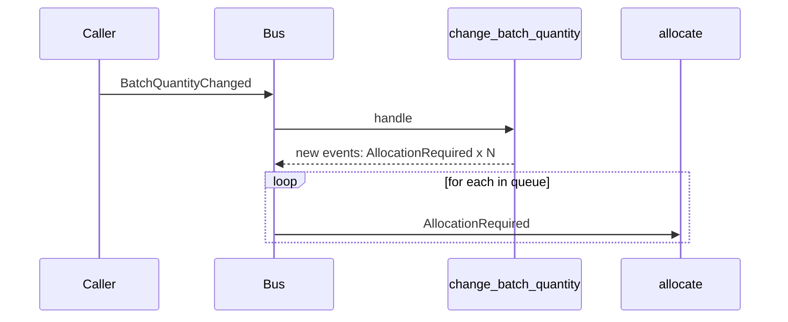

# Chapter 9: Going to Town on the Message Bus

## ✈️ 30,000 ft
Make the message bus the **main entrypoint** of the whole application. The service layer disappears into handlers: every use case is "an event arrives → a handler runs". Flask just builds a message and hands it to the bus.

## 🛫 10,000 ft
- Services become **handlers**; each takes `(event, uow)`.
- The bus processes a **queue** of messages. Handlers can raise new events, which are appended to the queue and processed after, in order.
- The UoW still collects new events from aggregates; the bus loops: `queue = [message]; while queue: ...`.
- New events in the loop: `BatchCreated`, `BatchQuantityChanged`, `AllocationRequired`.
- Requirement used to drive it: a batch quantity changes (shipment damaged) → deallocate enough lines and re-allocate them.
- Trade-off: everything is an event, so naming and semantics of "event vs request" get blurry. Ch10 fixes this.

### 🗺️ Diagram: the bus as the single entrypoint

## 🛬 1,000 ft: design decisions
- `handle(event, uow)` returns after draining `queue`. Handlers are registered in dict `{EventType: [handlers]}`.
- `Product.change_batch_quantity(ref, qty)` deallocates lines until the batch is no longer over-allocated and emits `AllocationRequired` events for each freed line.
- The test style: **service-style tests become tests that send events through the bus** and inspect the fake UoW.
- Flask shrinks to: parse JSON → `messagebus.handle(event, uow)`.

## 🛞 Touchdown
1. Create events: `BatchCreated`, `AllocationRequired`, `BatchQuantityChanged`.
2. Move the service functions to `handlers.py` with signature `(event, uow)`.
3. Make the bus loop over a queue, collecting `uow.collect_new_events()` after each handler.
4. Implement `Product.change_batch_quantity`; unit-test it in the domain.
5. Write the end-to-end scenario with `FakeUnitOfWork`: batch quantity changes → lines are reallocated to a second batch.
6. Update Flask endpoints to build events.

## Check yourself
- What's the advantage of a queue over direct recursion?
- How does event ordering matter when one handler produces events?
- What did we lose by dropping the dedicated service layer, and what did we gain?
- What kind of message is `AllocationRequired`: a fact or a request? (Set up for ch10.)
