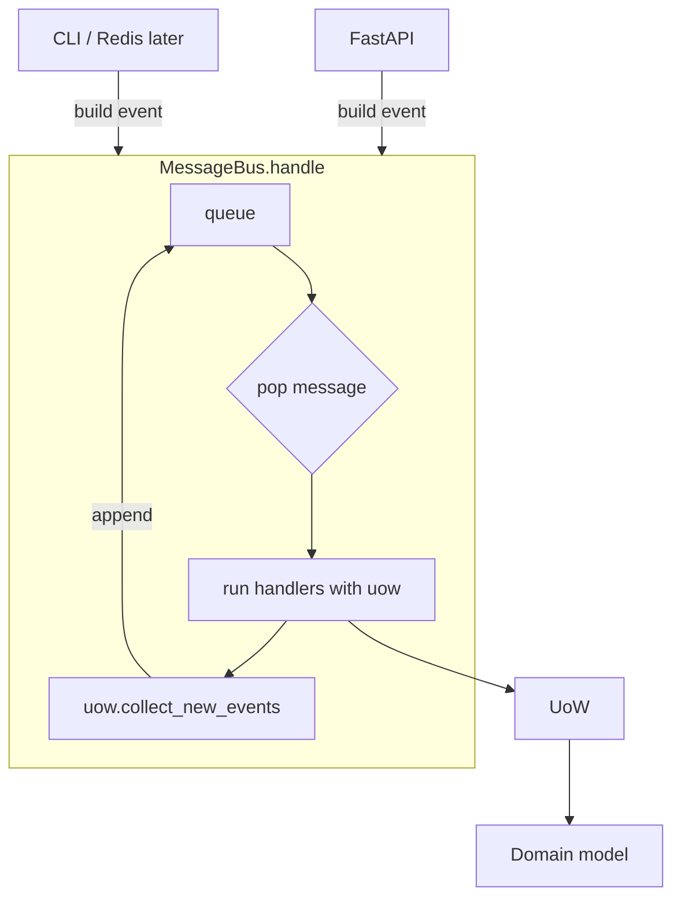
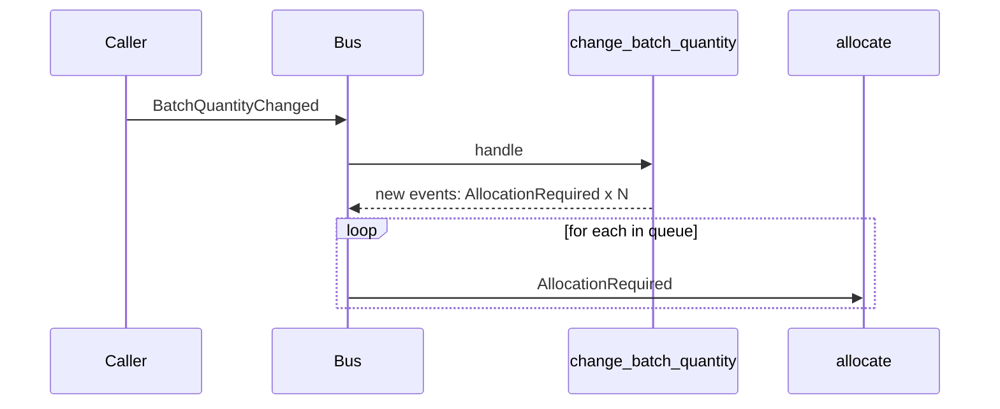

# Chapter 9: Going to Town on the Message Bus

## ✈️ 30,000 ft
Make the message bus the **main entrypoint** of the whole application. The service layer disappears into handlers: every use case is "an event arrives → a handler runs". FastAPI just builds a message and hands it to the bus.

## 🛫 10,000 ft
- Services become **handlers**; each takes `(event, uow)`.
- The bus processes a **queue** of messages. Handlers can raise new events, which are appended to the queue and processed after, in order.
- The UoW still collects new events from aggregates; the bus loops: `queue = [message]; while queue: ...`.
- New events in the loop: `BatchCreated`, `BatchQuantityChanged`, `AllocationRequired`.
- Requirement used to drive it: a batch quantity changes (shipment damaged) → deallocate enough lines and re-allocate them.
- Trade-off: everything is an event, so naming and semantics of "event vs request" get blurry. Ch10 fixes this.

### 🗺️ Diagram: the bus as the single entrypoint





## 🛫 5,000 ft: the conventional way vs. the better way

> Evidence tags: 🧪 I ran it · 🧮 arithmetic · 📖 documentation or reasoning (not run).

### Addition 1: "a batch shrank, so move the bumped orders elsewhere"

**The conventional way:** do the reallocation inline, inside the same handler and transaction.

```python
def change_batch_quantity(ref, qty, uow):
    with uow:
        product = uow.products.get_by_batchref(ref)
        batch = product.get_batch(ref)
        batch._purchased_quantity = qty
        while batch.available_quantity < 0:
            line = batch.deallocate_one()
            product.allocate(line)          # re-allocate right here
        uow.commit()
```

**Where it breaks**
- One transaction now carries two different stories: "the shipment lost units" (a fact that must stand) and "find homes for the bumped orders" (best effort). If any reallocation fails, the whole thing rolls back, **including the quantity change**, and the system believes the damaged shipment is intact.
- The long loop holds the product's row for as long as it runs.
- The allocation logic is duplicated or tangled into a handler that is about something else.

**The better way** (Steps 2, 5): `Product.change_batch_quantity` only deallocates and emits an event/request per freed line; the **bus** handles each as its own message and its own transaction.

**Why it's right:** the fact is committed first and stays committed; each reallocation succeeds or fails on its own.
**What it costs:** **eventual consistency**: for a moment the batch is shrunk and the bumped lines are unallocated, and a reader looking right then sees that intermediate state. You have to be comfortable with that, and with failures that leave some lines unreallocated (which ch10 makes visible rather than silent).

### Addition 2: handling the follow-up messages

**The conventional way:** the bus calls itself recursively.

```python
def handle(event):
    for handler in HANDLERS[type(event)]:
        handler(event)        # a handler may call handle(new_event) from inside
```

**Where it breaks** 📖
- The follow-up runs *inside* the first handler, before that handler has finished, so you can observe half-finished work. Execution order depends on call nesting, which is hard to predict.
- Long chains nest deeply, and every handler has to know it is responsible for calling `handle`.

**The better way** (Step 5): a **queue** in the bus: run a handler, collect the new events from the UoW, append them, and take the next message.

**Why it's right:** each message is processed to completion, in a predictable first-in-first-out order, and handlers don't need to know about the bus.
**What it costs:** a loop is easy to write infinitely (an event that always produces another), and stepping through a chain in a debugger takes more thought than reading a call stack.

### Addition 3: two ways into the system

**The conventional way:** requests use service functions, events use a bus. Two dispatch paths.

**Where it breaks:** logging, error handling and transaction rules need implementing twice, and sooner or later they differ.

**The better way:** one entrypoint, the bus, for everything; services become handlers.

**Why it's right:** one place for cross-cutting behaviour (ch10 adds error policy there).
**What it costs:** the bus becomes the hub of the system, and "everything is a message" blurs requests with facts until ch10 separates them.

## 🛬 1,000 ft: design decisions
- `handle(event, uow)` returns after draining `queue`. Handlers are registered in dict `{EventType: [handlers]}`.
- `Product.change_batch_quantity(ref, qty)` deallocates lines until the batch is no longer over-allocated and emits `AllocationRequired` events for each freed line.
- The test style: **service-style tests become tests that send events through the bus** and inspect the fake UoW.
- FastAPI shrinks to: parse JSON → `messagebus.handle(event, uow)`.

## 🛞 Touchdown: code along

> Starts from your finished ch08 project. New requirement: **when a shipment is damaged, a batch's quantity drops; if it's now over-allocated, deallocate enough lines and re-allocate them elsewhere.** To do it cleanly, the message bus becomes the *only* entrypoint and `services.py` turns into `handlers.py`. 38 tests pass, 1 skipped (Postgres).

### The shape of the change

```
Before:  FastAPI → services.allocate(...)            (and services publish events)
After:   FastAPI → messagebus.handle(AllocationRequired(...), uow)
                    └─ handler runs → new events go back onto the bus's queue
```

### Step 1: More events

**Do:** add three "request" events. (In ch10 you'll realise these are really *commands*, and fix the naming. Living with the slight wrongness for one chapter is deliberate.)

**📄 `src/allocation/domain/events.py`**

```python
from dataclasses import dataclass
from datetime import date


class Event:
    pass


@dataclass
class BatchCreated(Event):
    ref: str
    sku: str
    qty: int
    eta: date | None = None


@dataclass
class BatchQuantityChanged(Event):
    ref: str
    qty: int


@dataclass
class AllocationRequired(Event):
    orderid: str
    sku: str
    qty: int


@dataclass
class OutOfStock(Event):
    sku: str
```

### Step 2: Domain support for the new flow

**Do:** add `Batch.deallocate_one()` and `Product.change_batch_quantity()`.

**Why:** the *domain* decides which lines to bump (a set pops an arbitrary one; a real system might bump the newest or lowest priority). It does not re-allocate; it emits an `AllocationRequired` for each freed line and lets the bus route it.

```python
# in class Batch
def deallocate_one(self) -> OrderLine:
    return self._allocations.pop()

# in class Product
def change_batch_quantity(self, ref: str, qty: int):
    batch = next(b for b in self.batches if b.reference == ref)
    batch._purchased_quantity = qty
    while batch.available_quantity < 0:
        line = batch.deallocate_one()
        self.events.append(
            events.AllocationRequired(line.orderid, line.sku, line.qty)
        )
```

### Step 3: The repository needs a second way to find a product

`BatchQuantityChanged` only knows a **batch reference**, not a SKU. Add `get_by_batchref` to the repository: a public method that records `seen`, delegating to an abstract `_get_by_batchref`. The SQLAlchemy implementation joins `products` to `batches`:

```python
from allocation.adapters import orm        # add this import to repository.py

# in SqlAlchemyRepository
def _get_by_batchref(self, batchref):
    return (
        self.session.query(model.Product)
        .join(model.Batch)
        .filter(orm.batches.c.reference == batchref)
        .first()
    )
```

(The full `repository.py` is shown in Step 6.)

### Step 4: Turn `services.py` into `handlers.py`

**Do:** `git mv service_layer/services.py service_layer/handlers.py`. Every function now takes `(event, uow)`: the bus calls handlers with the event and a Unit of Work, nothing else. `InvalidSku` moves here with them. Fold `send_out_of_stock_notification` into this file too, and add `change_batch_quantity`.

**📄 `src/allocation/service_layer/handlers.py`**

```python
from __future__ import annotations

from typing import TYPE_CHECKING

from allocation.adapters import email
from allocation.domain import events, model
from allocation.domain.model import OrderLine

if TYPE_CHECKING:
    from . import unit_of_work


class InvalidSku(Exception):
    pass


def add_batch(event: events.BatchCreated, uow: unit_of_work.AbstractUnitOfWork):
    with uow:
        product = uow.products.get(sku=event.sku)
        if product is None:
            product = model.Product(event.sku, batches=[])
            uow.products.add(product)
        product.batches.append(model.Batch(event.ref, event.sku, event.qty, event.eta))
        uow.commit()


def allocate(event: events.AllocationRequired, uow: unit_of_work.AbstractUnitOfWork):
    line = OrderLine(event.orderid, event.sku, event.qty)
    with uow:
        product = uow.products.get(sku=line.sku)
        if product is None:
            raise InvalidSku(f"Invalid sku {line.sku}")
        batchref = product.allocate(line)
        uow.commit()
        return batchref


def change_batch_quantity(event: events.BatchQuantityChanged, uow: unit_of_work.AbstractUnitOfWork):
    with uow:
        product = uow.products.get_by_batchref(batchref=event.ref)
        product.change_batch_quantity(ref=event.ref, qty=event.qty)
        uow.commit()


def send_out_of_stock_notification(event: events.OutOfStock, uow: unit_of_work.AbstractUnitOfWork):
    email.send(
        "stock@made.com",
        f"Out of stock for {event.sku}",
    )
```

### Step 5: The bus with a queue

**Do:** rewrite `messagebus.handle(event, uow)`.

**Why:** handling one message may create more (an out-of-stock event, a re-allocation request). A queue processes them in the order they appear, and after each handler we ask the UoW for the events it produced. We also collect the handlers' return values so the caller (FastAPI) can get the batch reference back.

**📄 `src/allocation/service_layer/messagebus.py`**

```python
from __future__ import annotations

from collections.abc import Callable
from typing import TYPE_CHECKING

from allocation.domain import events

from . import handlers

if TYPE_CHECKING:
    from . import unit_of_work


def handle(event: events.Event, uow: unit_of_work.AbstractUnitOfWork):
    results = []
    queue = [event]
    while queue:
        event = queue.pop(0)
        for handler in HANDLERS[type(event)]:
            results.append(handler(event, uow=uow))
            # handlers may have caused the model to raise new events
            queue.extend(uow.collect_new_events())
    return results


HANDLERS: dict[type[events.Event], list[Callable]] = {
    events.BatchCreated: [handlers.add_batch],
    events.BatchQuantityChanged: [handlers.change_batch_quantity],
    events.AllocationRequired: [handlers.allocate],
    events.OutOfStock: [handlers.send_out_of_stock_notification],
}
```

### Step 6: The UoW stops publishing

**Do:** replace `publish_events()` with `collect_new_events()`. The UoW no longer imports the message bus: the dependency now points the right way (the bus knows about the UoW, not the reverse), and the bus pulls events exactly when it wants them instead of having them pushed at it.

**📄 `src/allocation/service_layer/unit_of_work.py`**

```python
# pylint: disable=attribute-defined-outside-init
from __future__ import annotations

import abc

from allocation.adapters import repository


class AbstractUnitOfWork(abc.ABC):
    products: repository.AbstractRepository

    def __enter__(self) -> AbstractUnitOfWork:
        return self

    def __exit__(self, *args):
        self.rollback()

    def commit(self):
        self._commit()

    def collect_new_events(self):
        # The UoW no longer publishes; the message bus pulls events from it.
        for product in self.products.seen:
            while product.events:
                yield product.events.pop(0)

    @abc.abstractmethod
    def _commit(self):
        raise NotImplementedError

    @abc.abstractmethod
    def rollback(self):
        raise NotImplementedError


class SqlAlchemyUnitOfWork(AbstractUnitOfWork):
    def __init__(self, session_factory):
        self.session_factory = session_factory

    def __enter__(self):
        self.session = self.session_factory()
        self.products = repository.SqlAlchemyRepository(self.session)
        return super().__enter__()

    def __exit__(self, *args):
        super().__exit__(*args)
        self.session.close()

    def _commit(self):
        self.session.commit()

    def rollback(self):
        self.session.rollback()
```

**📄 `src/allocation/adapters/repository.py`**

```python
import abc

from allocation.adapters import orm
from allocation.domain import model


class AbstractRepository(abc.ABC):
    def __init__(self):
        # every aggregate that passes through the repo; the UoW reads its events
        self.seen: set[model.Product] = set()

    def add(self, product: model.Product):
        self._add(product)
        self.seen.add(product)

    def get(self, sku) -> model.Product:
        product = self._get(sku)
        if product:
            self.seen.add(product)
        return product

    def get_by_batchref(self, batchref) -> model.Product:
        product = self._get_by_batchref(batchref)
        if product:
            self.seen.add(product)
        return product

    @abc.abstractmethod
    def _add(self, product: model.Product):
        raise NotImplementedError

    @abc.abstractmethod
    def _get(self, sku) -> model.Product:
        raise NotImplementedError

    @abc.abstractmethod
    def _get_by_batchref(self, batchref) -> model.Product:
        raise NotImplementedError


class SqlAlchemyRepository(AbstractRepository):
    def __init__(self, session):
        super().__init__()
        self.session = session

    def _add(self, product):
        self.session.add(product)

    def _get(self, sku):
        return self.session.query(model.Product).filter_by(sku=sku).first()

    def _get_by_batchref(self, batchref):
        return (
            self.session.query(model.Product)
            .join(model.Batch)
            .filter(orm.batches.c.reference == batchref)
            .first()
        )
```

### Step 7: The endpoints build events and hand them to the bus

**Do:** each endpoint builds an event and calls `messagebus.handle(event, uow)`. Note `new_uow()`: **one Unit of Work per request**. FastAPI runs these sync endpoints in a thread pool, and a UoW holds its session as state, so a UoW shared between requests would be a race.

**📄 `src/allocation/entrypoints/fastapi_app.py`**

```python
from datetime import date

from fastapi import FastAPI, HTTPException
from pydantic import BaseModel, Field

from allocation import config
from allocation.adapters import orm
from allocation.domain import events
from allocation.service_layer import handlers, messagebus, unit_of_work


class AddBatchRequest(BaseModel):
    ref: str
    sku: str
    qty: int = Field(gt=0)
    eta: date | None = None  # pydantic parses "2030-01-01" for us


class AllocateRequest(BaseModel):
    orderid: str
    sku: str
    qty: int = Field(gt=0)


class AllocateResponse(BaseModel):
    batchref: str


def create_app(session_factory=None) -> FastAPI:
    if session_factory is None:
        orm.start_mappers()
        session_factory = orm.make_session_factory(config.get_settings().db_uri)

    app = FastAPI(title="Allocation service")

    def new_uow():
        # one UoW per request: sessions are never shared between threads
        return unit_of_work.SqlAlchemyUnitOfWork(session_factory)

    @app.post("/add_batch", status_code=201)
    def add_batch_endpoint(body: AddBatchRequest) -> None:
        messagebus.handle(events.BatchCreated(body.ref, body.sku, body.qty, body.eta), new_uow())

    @app.post("/allocate", status_code=201)
    def allocate_endpoint(body: AllocateRequest) -> AllocateResponse:
        try:
            results = messagebus.handle(
                events.AllocationRequired(body.orderid, body.sku, body.qty), new_uow()
            )
            batchref = results.pop(0)
        except handlers.InvalidSku as e:
            raise HTTPException(status_code=400, detail=str(e)) from e
        if batchref is None:
            raise HTTPException(status_code=400, detail=f"Out of stock for sku {body.sku}")
        return AllocateResponse(batchref=batchref)

    return app
```

### Step 8: Tests drive everything through the bus

**Do:** delete `tests/unit/test_services.py`; create `tests/unit/test_handlers.py`. Each test sends an event through `messagebus.handle` with a `FakeUnitOfWork`. The last test is the headline scenario: batch1 shrinks, one order is bumped, and the bus re-allocates it to batch2, all without any test touching a handler function directly.

**📄 `tests/unit/test_handlers.py`**

```python
from datetime import date
from unittest import mock

import pytest

from allocation.adapters import repository
from allocation.domain import events
from allocation.service_layer import handlers, messagebus, unit_of_work


class FakeRepository(repository.AbstractRepository):
    def __init__(self, products):
        super().__init__()
        self._products = set(products)

    def _add(self, product):
        self._products.add(product)

    def _get(self, sku):
        return next((p for p in self._products if p.sku == sku), None)

    def _get_by_batchref(self, batchref):
        return next(
            (p for p in self._products for b in p.batches if b.reference == batchref),
            None,
        )


class FakeUnitOfWork(unit_of_work.AbstractUnitOfWork):
    def __init__(self):
        self.products = FakeRepository([])
        self.committed = False

    def _commit(self):
        self.committed = True

    def rollback(self):
        pass


class TestAddBatch:
    def test_for_new_product(self):
        uow = FakeUnitOfWork()
        messagebus.handle(events.BatchCreated("b1", "CRUNCHY-ARMCHAIR", 100, None), uow)
        assert uow.products.get("CRUNCHY-ARMCHAIR") is not None
        assert uow.committed

    def test_for_existing_product(self):
        uow = FakeUnitOfWork()
        messagebus.handle(events.BatchCreated("b1", "GARISH-RUG", 100, None), uow)
        messagebus.handle(events.BatchCreated("b2", "GARISH-RUG", 99, None), uow)
        assert "b2" in [b.reference for b in uow.products.get("GARISH-RUG").batches]


class TestAllocate:
    def test_allocates(self):
        uow = FakeUnitOfWork()
        messagebus.handle(events.BatchCreated("batch1", "COMPLICATED-LAMP", 100, None), uow)
        results = messagebus.handle(events.AllocationRequired("o1", "COMPLICATED-LAMP", 10), uow)
        assert results.pop(0) == "batch1"
        [batch] = uow.products.get("COMPLICATED-LAMP").batches
        assert batch.available_quantity == 90

    def test_errors_for_invalid_sku(self):
        uow = FakeUnitOfWork()
        messagebus.handle(events.BatchCreated("b1", "AREALSKU", 100, None), uow)

        with pytest.raises(handlers.InvalidSku, match="Invalid sku NONEXISTENTSKU"):
            messagebus.handle(events.AllocationRequired("o1", "NONEXISTENTSKU", 10), uow)

    def test_commits(self):
        uow = FakeUnitOfWork()
        messagebus.handle(events.BatchCreated("b1", "OMINOUS-MIRROR", 100, None), uow)
        uow.committed = False

        messagebus.handle(events.AllocationRequired("o1", "OMINOUS-MIRROR", 10), uow)
        assert uow.committed

    def test_sends_email_on_out_of_stock_error(self):
        uow = FakeUnitOfWork()
        messagebus.handle(events.BatchCreated("b1", "POPULAR-CURTAINS", 9, None), uow)

        with mock.patch("allocation.adapters.email.send") as mock_send_mail:
            messagebus.handle(events.AllocationRequired("o1", "POPULAR-CURTAINS", 10), uow)
            assert mock_send_mail.call_args == mock.call(
                "stock@made.com", "Out of stock for POPULAR-CURTAINS"
            )


class TestChangeBatchQuantity:
    def test_changes_available_quantity(self):
        uow = FakeUnitOfWork()
        messagebus.handle(events.BatchCreated("batch1", "ADORABLE-SETTEE", 100, None), uow)
        [batch] = uow.products.get(sku="ADORABLE-SETTEE").batches
        assert batch.available_quantity == 100

        messagebus.handle(events.BatchQuantityChanged("batch1", 50), uow)

        assert batch.available_quantity == 50

    def test_reallocates_if_necessary(self):
        uow = FakeUnitOfWork()
        event_history = [
            events.BatchCreated("batch1", "INDIFFERENT-TABLE", 50, None),
            events.BatchCreated("batch2", "INDIFFERENT-TABLE", 50, date.today()),
            events.AllocationRequired("order1", "INDIFFERENT-TABLE", 20),
            events.AllocationRequired("order2", "INDIFFERENT-TABLE", 20),
        ]
        for e in event_history:
            messagebus.handle(e, uow)
        [batch1, batch2] = uow.products.get(sku="INDIFFERENT-TABLE").batches
        assert batch1.available_quantity == 10
        assert batch2.available_quantity == 50

        messagebus.handle(events.BatchQuantityChanged("batch1", 25), uow)

        # order1 or order2 will be deallocated, so we'll have 25 - 20
        assert batch1.available_quantity == 5
        # and 20 will be reallocated to the next batch
        assert batch2.available_quantity == 30
```

```bash
uv run pytest -q
# 38 passed, 1 skipped
```

### Stretch

- Add `POST /change_batch_quantity` to the FastAPI app. Which files change? (Only the entrypoint; the point of the bus.)
- What would happen to ordering if `change_batch_quantity` freed three lines while a fourth `AllocationRequired` is already in the queue? Write a test.

## Check yourself
- What's the advantage of a queue over direct recursion?
- How does event ordering matter when one handler produces events?
- What did we lose by dropping the dedicated service layer, and what did we gain?
- What kind of message is `AllocationRequired`: a fact or a request? (Set up for ch10.)
