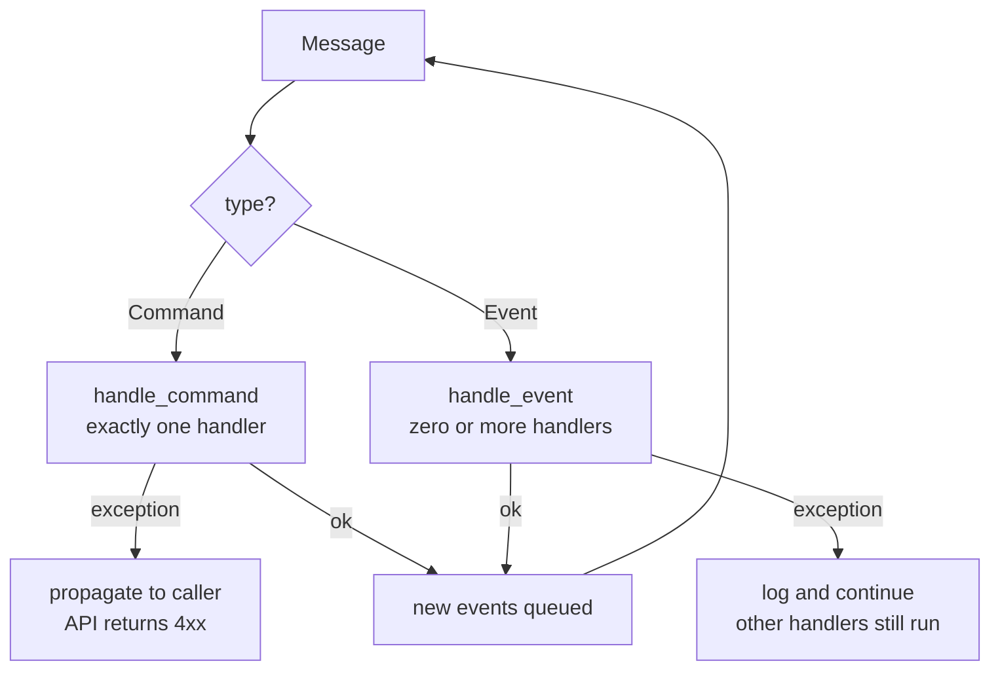

# Chapter 10: Commands and Command Handler

## ✈️ 30,000 ft
Not all messages are alike. A **command** is an instruction to do something (one handler, can fail loudly); an **event** is a broadcast of something that already happened (any number of listeners, failures shouldn't break others). Splitting them clarifies intent and error handling.

## 🛫 10,000 ft
| | Command | Event |
|---|---|---|
| Naming | imperative (`Allocate`) | past tense (`Allocated`) |
| Sender → receiver | sender expects *one* handler | publisher doesn't care who listens |
| Failure | propagates to sender | logged and swallowed, so others still run |
| Intent | "please do X" | "FYI X happened" |

- `Command` base class; commands: `Allocate`, `CreateBatch`, `ChangeBatchQuantity`.
- Events now: `Allocated`, `Deallocated`, `OutOfStock`.
- Errors: if an event handler fails, the bus **logs** and continues; if a command handler fails, the exception propagates (the caller can show an error).
- Trade-off: more classes, but clearer semantics. Eventual consistency: events are processed after the main transaction, so the failure of a follow-up shouldn't roll back the committed main work.
- Also discussed: recovering from errors, retries with `tenacity`.

### 🗺️ Diagram: commands vs events

## 🛬 1,000 ft: design decisions
- `handle(message, uow)` dispatches on `isinstance(message, events.Event | commands.Command)` into `handle_event` / `handle_command`.
- `EVENT_HANDLERS` (dict of lists) vs `COMMAND_HANDLERS` (dict of single handlers).
- Commands from the API: Flask catches exceptions from the bus (`InvalidSku` → 400).
- Handlers are small and take `(cmd, uow)`; the `allocate` handler no longer returns the event; it emits `Allocated`, and the API returns the batch ref via a read path (ch12 motivation).
- Aggregate emits `Allocated` after success, which makes room for downstream consumers (ch11).

## 🛞 Touchdown
1. Create `commands.py`; rename the "requests" from ch09 into commands.
2. Split the handler registries; update `messagebus.handle`.
3. Add exception handling: command → re-raise; event → log and continue.
4. Add `Allocated` event emitted from `Product.allocate`.
5. Test: a failing event handler doesn't stop other handlers (use a handler that raises).
6. Flask: translate command-handler exceptions into HTTP responses.

## Check yourself
- Give a rule of thumb for choosing between command and event.
- Why do event handler errors get swallowed, while command errors propagate?
- What does the system need so that a failed event handler isn't lost forever?
- What does naming a message get you beyond readability?
