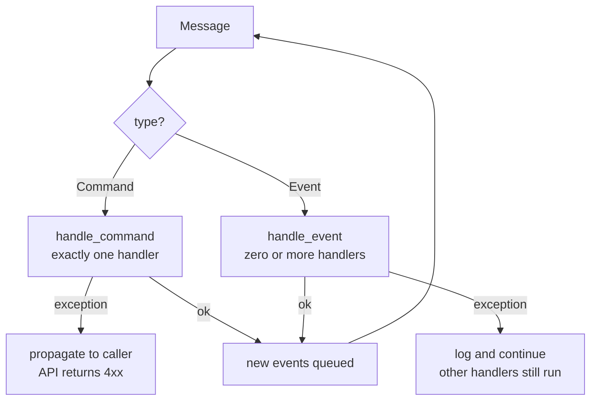
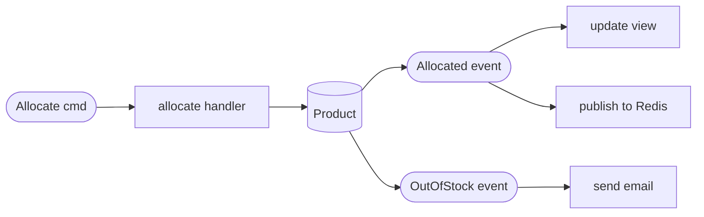

# Chapter 10: Commands and Command Handler

## ✈️ 30,000 ft
Not all messages are alike. A **command** is an instruction to do something (one handler, can fail loudly); an **event** is a broadcast of something that already happened (any number of listeners, failures shouldn't break others). Splitting them clarifies intent and error handling.

## 🛫 10,000 ft
| | Command | Event |
|---|---|---|
| Naming | imperative (`Allocate`) | past tense (`Allocated`) |
| Sender → receiver | sender expects *one* handler | publisher doesn't care who listens |
| Failure | propagates to sender | logged and swallowed, so others still run |
| Intent | "please do X" | "FYI X happened" |

- `Command` base class; commands: `Allocate`, `CreateBatch`, `ChangeBatchQuantity`.
- Events now: `Allocated`, `Deallocated`, `OutOfStock`.
- Errors: if an event handler fails, the bus **logs** and continues; if a command handler fails, the exception propagates (the caller can show an error).
- Trade-off: more classes, but clearer semantics. Eventual consistency: events are processed after the main transaction, so the failure of a follow-up shouldn't roll back the committed main work.
- Also discussed: recovering from errors, retries with `tenacity`.

### 🗺️ Diagram: commands vs events





## 🛫 5,000 ft: the conventional way vs. the better way

> Evidence tags: 🧪 I ran it · 🧮 arithmetic · 📖 documentation or reasoning (not run).

### Addition 1: one error policy for every message

**The conventional way:** treat all messages the same. There are two versions, and both hurt.

```python
# (a) swallow everything
try: handler(message)
except Exception: logger.exception("failed")        # the caller never finds out

# (b) propagate everything (this is the ch09 bus)
handler(message)                                      # any handler error reaches the caller
```

**Where it breaks**
- *(a)* A request for an unknown SKU is logged and forgotten; the API answers "OK" for something that did nothing.
- *(b)* 🧪 I ran the ch09 bus with a failing email server: the `smtp down` error came straight out of `bus.handle(...)` into the web layer. The client gets a 500 for what should have been a clean "out of stock" answer, and the loop aborts so any *other* listeners never run.

**The better way** (Step 4): **commands** (requests, exactly one handler) propagate errors to the caller; **events** (facts, any number of listeners) log and continue.

**Why it's right:** a request has a sender who needs to know whether it worked; a broadcast has no sender to tell, and one flaky listener shouldn't break the rest or undo work that already committed.
**What it costs:** swallowed event errors need follow-up, or nobody ever notices. In practice you add retries, alerts or a dead-letter store. And since swallowing is silent, systems quietly drift (ch12's read model can go stale this way).

### Addition 2: naming a request as an event

**The conventional way:** call everything an event (`AllocationRequired`) and register handlers by type.

**Where it breaks** 📖
- A name like `AllocationRequired` sounds like a fact, so another team happily subscribes an "audit" handler, and a second handler that also allocates is plausible. Nothing in the type system says only one thing should respond.
- Is it sent to someone, or broadcast? Readers can't tell, so they can't reason about who is responsible.

**The better way** (Step 1): `Allocate` is a **command** (imperative, one handler); `Allocated` is an **event** (past tense, zero or more listeners).

**Why it's right:** the name carries the contract: who is expected to act, and what happens when they fail.
**What it costs:** two vocabularies and two registries instead of one, which is more to learn and more to keep consistent.

## 🛬 1,000 ft: design decisions
- `handle(message, uow)` dispatches on `isinstance(message, events.Event | commands.Command)` into `handle_event` / `handle_command`.
- `EVENT_HANDLERS` (dict of lists) vs `COMMAND_HANDLERS` (dict of single handlers).
- Commands from the API: the FastAPI endpoint catches exceptions from the bus (`InvalidSku`) and raises `HTTPException(400)`.
- Handlers are small and take `(cmd, uow)`; the `allocate` handler still returns the batch reference (the bus collects *command* results so FastAPI can use them), and `Product.allocate` also emits an `Allocated` event for downstream listeners (ch11, ch12).
- Aggregate emits `Allocated` after success, which makes room for downstream consumers (ch11).

## 🛞 Touchdown: code along

> Starts from your finished ch09 project. In ch09 we called everything an "event", but `AllocationRequired` is not a fact, it's a *request*. This chapter separates **commands** from **events** and gives each its own error handling. 41 tests pass, 1 skipped (Postgres).

### Step 1: The vocabulary

| | Command | Event |
|---|---|---|
| Meaning | "Please do X" | "X happened" |
| Name | Imperative: `Allocate` | Past tense: `Allocated` |
| Handlers | **Exactly one** | **Zero or more** |
| If handling fails | The **sender must find out** (exception propagates) | **Log it and carry on**; other listeners and the already-committed work are unaffected |

**Do:** create `domain/commands.py`, and slim `events.py` down to two real events.

**📄 `src/allocation/domain/commands.py`**

```python
from dataclasses import dataclass
from datetime import date


class Command:
    pass


@dataclass
class Allocate(Command):
    orderid: str
    sku: str
    qty: int


@dataclass
class CreateBatch(Command):
    ref: str
    sku: str
    qty: int
    eta: date | None = None


@dataclass
class ChangeBatchQuantity(Command):
    ref: str
    qty: int
```

**📄 `src/allocation/domain/events.py`**

```python
from dataclasses import dataclass


class Event:
    pass


@dataclass
class Allocated(Event):
    orderid: str
    sku: str
    qty: int
    batchref: str


@dataclass
class OutOfStock(Event):
    sku: str
```

Renames: `BatchCreated → CreateBatch`, `AllocationRequired → Allocate`, `BatchQuantityChanged → ChangeBatchQuantity`. Use find-and-replace across `src/` and `tests/`, then fix imports.

### Step 2: The model emits a real event, and a command

**Do:** in `Product.allocate`, after a successful allocation append `events.Allocated(...)`. In `change_batch_quantity`, the freed lines now produce `commands.Allocate(...)` (the domain is asking the system to re-do work). Add `from allocation.domain import commands, events` to `model.py`.

```python
# in Product.allocate, after batch.allocate(line):
self.events.append(
    events.Allocated(
        orderid=line.orderid, sku=line.sku, qty=line.qty, batchref=batch.reference
    )
)

# in Product.change_batch_quantity:
while batch.available_quantity < 0:
    line = batch.deallocate_one()
    self.events.append(commands.Allocate(line.orderid, line.sku, line.qty))
```

Add a test first in `tests/unit/test_product.py`:

```python
def test_records_allocated_event():
    product = Product(
        sku="SCANDI-PEN", batches=[Batch("b1", "SCANDI-PEN", 100, eta=None)]
    )
    product.allocate(OrderLine("oref", "SCANDI-PEN", 10))
    assert product.events[-1] == events.Allocated(
        orderid="oref", sku="SCANDI-PEN", qty=10, batchref="b1"
    )
```

### Step 3: Handlers take commands; the one event handler stays

**Do:** change the handler parameter types to the new command classes (the function bodies are unchanged). Keep `send_out_of_stock_notification` as an event handler.

**📄 `src/allocation/service_layer/handlers.py`**

```python
from __future__ import annotations

from typing import TYPE_CHECKING

from allocation.adapters import email
from allocation.domain import commands, events, model
from allocation.domain.model import OrderLine

if TYPE_CHECKING:
    from . import unit_of_work


class InvalidSku(Exception):
    pass


def add_batch(cmd: commands.CreateBatch, uow: unit_of_work.AbstractUnitOfWork):
    with uow:
        product = uow.products.get(sku=cmd.sku)
        if product is None:
            product = model.Product(cmd.sku, batches=[])
            uow.products.add(product)
        product.batches.append(model.Batch(cmd.ref, cmd.sku, cmd.qty, cmd.eta))
        uow.commit()


def allocate(cmd: commands.Allocate, uow: unit_of_work.AbstractUnitOfWork):
    line = OrderLine(cmd.orderid, cmd.sku, cmd.qty)
    with uow:
        product = uow.products.get(sku=line.sku)
        if product is None:
            raise InvalidSku(f"Invalid sku {line.sku}")
        batchref = product.allocate(line)
        uow.commit()
        return batchref


def change_batch_quantity(cmd: commands.ChangeBatchQuantity, uow: unit_of_work.AbstractUnitOfWork):
    with uow:
        product = uow.products.get_by_batchref(batchref=cmd.ref)
        product.change_batch_quantity(ref=cmd.ref, qty=cmd.qty)
        uow.commit()


# --- event handlers: reactions to facts, no return value -----------------
def send_out_of_stock_notification(event: events.OutOfStock, uow: unit_of_work.AbstractUnitOfWork):
    email.send(
        "stock@made.com",
        f"Out of stock for {event.sku}",
    )
```

### Step 4: Two registries and two error policies

**Do:** rewrite `messagebus.py`.

**Why it looks like this:**
- `COMMAND_HANDLERS` maps a command type to **one** function; `EVENT_HANDLERS` maps an event type to a **list**.
- `handle_event` wraps each handler in `try/except`, **logs and continues**. By the time events are handled, the main transaction has committed; a broken email server shouldn't undo it or block other listeners.
- `handle_command` logs and **re-raises**, so FastAPI can return an error.
- Only command results are collected, so `results.pop(0)` in FastAPI still yields the batch reference.
- `events.Allocated: []` is an empty list on purpose: a missing key would raise `KeyError` in `handle_event`. Ch11 gives it its first listener.

**📄 `src/allocation/service_layer/messagebus.py`**

```python
from __future__ import annotations

import logging
from collections.abc import Callable
from typing import TYPE_CHECKING

from allocation.domain import commands, events

from . import handlers

if TYPE_CHECKING:
    from . import unit_of_work

logger = logging.getLogger(__name__)

Message = commands.Command | events.Event


def handle(message: Message, uow: unit_of_work.AbstractUnitOfWork):
    results = []
    queue = [message]
    while queue:
        message = queue.pop(0)
        if isinstance(message, events.Event):
            handle_event(message, queue, uow)
        elif isinstance(message, commands.Command):
            cmd_result = handle_command(message, queue, uow)
            results.append(cmd_result)
        else:
            raise Exception(f"{message} was not an Event or Command")
    return results


def handle_event(
    event: events.Event,
    queue: list[Message],
    uow: unit_of_work.AbstractUnitOfWork,
):
    for handler in EVENT_HANDLERS[type(event)]:
        try:
            logger.debug("handling event %s with handler %s", event, handler)
            handler(event, uow=uow)
            queue.extend(uow.collect_new_events())
        except Exception:
            # Events are announcements: one failing listener must not
            # break the others, or the command that already succeeded.
            logger.exception("Exception handling event %s", event)
            continue


def handle_command(
    command: commands.Command,
    queue: list[Message],
    uow: unit_of_work.AbstractUnitOfWork,
):
    logger.debug("handling command %s", command)
    try:
        handler = COMMAND_HANDLERS[type(command)]
        result = handler(command, uow=uow)
        queue.extend(uow.collect_new_events())
        return result
    except Exception:
        # Commands are requests: the caller needs to know if it failed.
        logger.exception("Exception handling command %s", command)
        raise


EVENT_HANDLERS: dict[type[events.Event], list[Callable]] = {
    events.OutOfStock: [handlers.send_out_of_stock_notification],
    events.Allocated: [],  # nobody listens yet; ch11 adds a Redis publisher
}

COMMAND_HANDLERS: dict[type[commands.Command], Callable] = {
    commands.Allocate: handlers.allocate,
    commands.CreateBatch: handlers.add_batch,
    commands.ChangeBatchQuantity: handlers.change_batch_quantity,
}
```

### Step 5: The endpoints send commands

**Do:** swap `events` for `commands` in the entrypoint: `commands.CreateBatch(...)` and `commands.Allocate(...)`. The validation (pydantic models) and error mapping (`HTTPException`) don't change.

**📄 `src/allocation/entrypoints/fastapi_app.py`**

```python
from datetime import date

from fastapi import FastAPI, HTTPException
from pydantic import BaseModel, Field

from allocation import config
from allocation.adapters import orm
from allocation.domain import commands
from allocation.service_layer import handlers, messagebus, unit_of_work


class AddBatchRequest(BaseModel):
    ref: str
    sku: str
    qty: int = Field(gt=0)
    eta: date | None = None  # pydantic parses "2030-01-01" for us


class AllocateRequest(BaseModel):
    orderid: str
    sku: str
    qty: int = Field(gt=0)


class AllocateResponse(BaseModel):
    batchref: str


def create_app(session_factory=None) -> FastAPI:
    if session_factory is None:
        orm.start_mappers()
        session_factory = orm.make_session_factory(config.get_settings().db_uri)

    app = FastAPI(title="Allocation service")

    def new_uow():
        # one UoW per request: sessions are never shared between threads
        return unit_of_work.SqlAlchemyUnitOfWork(session_factory)

    @app.post("/add_batch", status_code=201)
    def add_batch_endpoint(body: AddBatchRequest) -> None:
        messagebus.handle(commands.CreateBatch(body.ref, body.sku, body.qty, body.eta), new_uow())

    @app.post("/allocate", status_code=201)
    def allocate_endpoint(body: AllocateRequest) -> AllocateResponse:
        try:
            results = messagebus.handle(
                commands.Allocate(body.orderid, body.sku, body.qty), new_uow()
            )
            batchref = results.pop(0)
        except handlers.InvalidSku as e:
            raise HTTPException(status_code=400, detail=str(e)) from e
        if batchref is None:
            raise HTTPException(status_code=400, detail=f"Out of stock for sku {body.sku}")
        return AllocateResponse(batchref=batchref)

    return app
```

### Step 6: Test the error policy itself

**Do:** in `tests/unit/test_handlers.py`, rename the events to commands (`events.BatchCreated` → `commands.CreateBatch`, etc.) and add these two tests. They are the entire point of the chapter.

```python
class TestEventErrors:
    def test_a_failing_event_handler_does_not_stop_the_others(self):
        calls = []

        def bad(event, uow):
            raise RuntimeError("boom")

        def good(event, uow):
            calls.append(event)

        with mock.patch.dict(messagebus.EVENT_HANDLERS, {events.OutOfStock: [bad, good]}):
            messagebus.handle(events.OutOfStock("SOME-SKU"), FakeUnitOfWork())

        assert calls == [events.OutOfStock("SOME-SKU")]

    def test_command_errors_propagate_to_the_caller(self):
        with pytest.raises(handlers.InvalidSku):
            messagebus.handle(commands.Allocate("o1", "NOPE", 1), FakeUnitOfWork())
```

```bash
uv run pytest -q
# 41 passed, 1 skipped
```

### A question to answer in your notes

If an event handler fails and we only log it, how would we ever know to retry? (The book's answer: that's a real design problem; options include retries with a library like `tenacity`, a dead-letter store, or making handlers idempotent and replayable. Pick one and write a paragraph.)

### Stretch

- Add a `Deallocated` event and a `commands.Deallocate`. Which existing files stay untouched?
- Make `handle_event` retry a failing handler up to 3 times (`tenacity` makes this a decorator). Write a test with a handler that fails twice, then succeeds.

## Check yourself
- Give a rule of thumb for choosing between command and event.
- Why do event handler errors get swallowed, while command errors propagate?
- What does the system need so that a failed event handler isn't lost forever?
- What does naming a message get you beyond readability?
