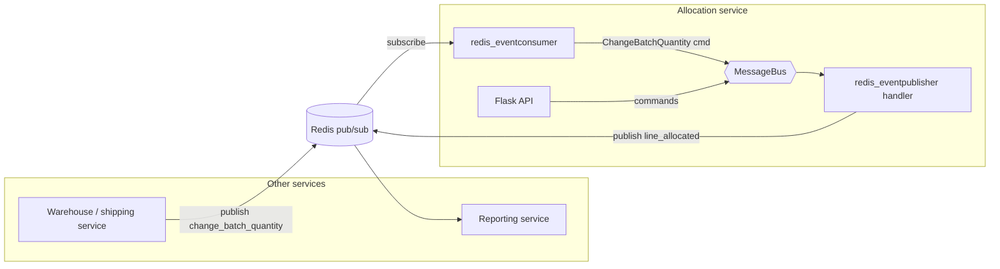
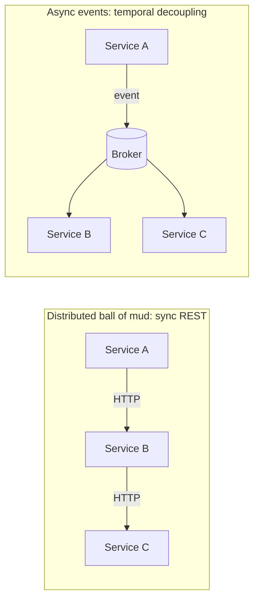

# Chapter 11: Event-Driven Architecture: Using Events to Integrate Microservices

## ✈️ 30,000 ft
Messages don't have to stay inside one process. Publish events to **Redis pub/sub** so other services (a reporting service, a shipping service) can react, and consume external messages as commands. Events are the integration contract between services.

## 🛫 10,000 ft
- Avoid **distributed ball of mud**: services calling each other synchronously via REST ("temporal coupling"). If one is down, all fail.
- Prefer **asynchronous messaging** between services, with each service owning its data and reacting to events from others.
- Terms: **temporal decoupling**, **choreography** over orchestration, **eventual consistency**.
- Redis pub/sub is the book's pragmatic broker, though it's lossy (no persistence); real systems use Kafka, RabbitMQ, SNS/SQS.
- Naming conventions: services publish **events** (facts), receive **commands** (requests) from other systems.
- Trade-off: you gain independence and resilience, but you need monitoring, idempotency and a way to handle lost/duplicate messages.

### 🗺️ Diagram: services talking via Redis

## 🛬 1,000 ft: design decisions
- `redis_eventconsumer.py`: subscribes to a channel (`change_batch_quantity`), deserialises JSON → `commands.ChangeBatchQuantity` → `messagebus.handle`.
- `redis_eventpublisher.py`: handler `publish_allocated_event` for `Allocated` → `r.publish("line_allocated", json.dumps(asdict(event)))`.
- Handlers are registered in `EVENT_HANDLERS[events.Allocated] = [..., publish_allocated_event]`.
- E2E test with Docker-compose: API + Redis + Postgres + redis consumer container. Test posts to the API, subscribes to Redis, and asserts a message.
- Authors flag the "fake it" idea: test your handlers with a `FakeRedis`/injected publisher (leads to ch13).

## 🛞 Touchdown
1. Docker-compose up Postgres + Redis (and the app).
2. Write `redis_eventconsumer.py` (subscribe + dispatch).
3. Write `redis_eventpublisher.py`; register it as an `Allocated` handler.
4. E2E test: API creates batches and allocates, then you change batch quantity via Redis and listen for `line_allocated`.
5. Reflect: which parts will break first if Redis drops a message?

## Check yourself
- Why is request/response between services risky, and what does messaging fix?
- Which side owns the schema of an external event?
- Pub/sub vs queue: what do you lose with Redis pub/sub?
- How would you make a handler idempotent?
