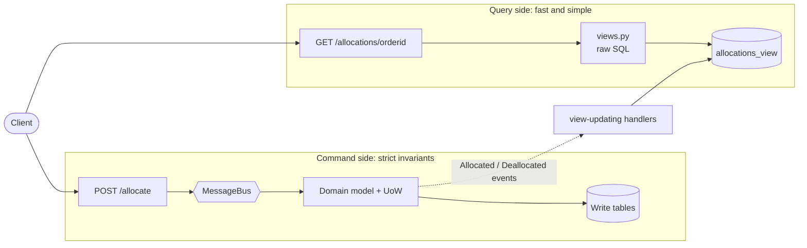
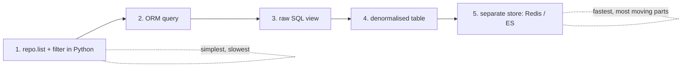

# Chapter 12: Command-Query Responsibility Segregation (CQRS)

## ✈️ 30,000 ft
Reads and writes have opposite needs: writes need strict invariants through the domain model; reads just need fast, simple answers. **Split them.** Use the domain model for commands; use simple SQL or a denormalised table for queries.

## 🛫 10,000 ft
- Domain models are for **making changes**. They're overkill (and slow) for "show me where my order was allocated".
- Options ranked, from simple to extreme:
  1. Use repository `get`/`list` and filter in Python (slow, wasteful)
  2. ORM queries on the existing tables
  3. **Raw SQL** from a `views.py` (simple, fast, bypasses the model)
  4. **Denormalised read model** updated by event handlers (`allocations_view` table)
  5. Separate datastore (Redis, Elasticsearch)
- Trade-off: the read model can lag (eventual consistency) and duplicate data, and you must keep the event handlers updating it.
- Also: reads can go through the UoW's session or a thin read-side helper.

### 🗺️ Diagram: CQRS split

## 🛬 1,000 ft: design decisions
- `views.allocations(orderid, uow)` runs raw SQL and returns a list of dicts.
- Flask `GET /allocations/<orderid>` calls the view; 404 if empty.
- The `allocation` command no longer returns anything; the client does `POST /allocate` (202 Accepted) and later `GET`.
- Denormalised table `allocations_view(orderid, sku, batchref)` updated via event handlers:
  - `Allocated` → insert
  - `Deallocated` → delete (and re-allocation)
- Tests for views use the message bus to put the system in a state, then query it: `bus.handle(commands.Allocate(...)); views.allocations(...)`.
- Authors admit: you can swap this for Redis with a one-line change in the handler.

## 🛞 Touchdown
1. Write `views.py` with raw SQL for `allocations(orderid)`. Test via bus + real DB.
2. Flask: `POST /allocate` → 202; `GET /allocations/<orderid>` → 200/404.
3. Add the `allocations_view` table; add `Allocated`/`Deallocated` event handlers to maintain it.
4. Point `views.allocations` at the new table and see all tests still pass.
5. Optional: replace the table with Redis (`hset`/`smembers`).

## Check yourself
- Why is a rich domain model a poor choice for read-only endpoints?
- What does a denormalised view cost you?
- What happens in the UI if the read model is stale?
- Where do the command side and the query side share code?
