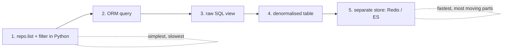

# Chapter 12: Command-Query Responsibility Segregation (CQRS)

## ✈️ 30,000 ft
Reads and writes have opposite needs: writes need strict invariants through the domain model; reads just need fast, simple answers. **Split them.** Use the domain model for commands; use simple SQL or a denormalised table for queries.

## 🛫 10,000 ft
- Domain models are for **making changes**. They're overkill (and slow) for "show me where my order was allocated".
- Options ranked, from simple to extreme:
  1. Use repository `get`/`list` and filter in Python (slow, wasteful)
  2. ORM queries on the existing tables
  3. **Raw SQL** from a `views.py` (simple, fast, bypasses the model)
  4. **Denormalised read model** updated by event handlers (`allocations_view` table)
  5. Separate datastore (Redis, Elasticsearch)
- Trade-off: the read model can lag (eventual consistency) and duplicate data, and you must keep the event handlers updating it.
- Also: reads can go through the UoW's session or a thin read-side helper.

### 🗺️ Diagram: CQRS split




## 🛫 5,000 ft: the conventional way vs. the better way

> Evidence tags: 🧪 I ran it · 🧮 arithmetic · 📖 documentation or reasoning (not run).

### Addition 1: answering "where is my order allocated?"

**The conventional way:** read through the domain model.

```python
found = []
for product in repo.list():                       # every product
    for batch in product.batches:                 # every batch
        for line in batch._allocations:           # every allocation (and reaching into a private attribute)
            if line.orderid == orderid:
                found.append((line.sku, batch.reference))
```

**Where it breaks**
- 🧪 I ran this against 20 SKUs with 3 batches each: **81 SQL statements** to answer one question (1 for products + 20 for their batches + 60 for the allocations of each batch). That is the classic N+1 pattern; it grows with your data.
- It loads whole aggregates, with all their state, to read two strings.
- Reporting needs pull the domain model toward reads (public accessors for private state), distorting the part that exists to protect writes.

**The better way** (Steps 2-3): a **read model**, a small table shaped exactly like the answer (`allocations_view`), kept current by event handlers, queried with a single plain SQL statement.

**Why it's right:** one statement, no object hydration, no pressure on the domain model. Reads can be optimised or moved (to Redis, say) without touching the write side.
**What it costs:** data now lives in two shapes. The view is **eventually consistent**, and (from ch10) if a handler that updates it fails, the error is swallowed and the view silently diverges. You also write and test the sync handlers.

### Addition 2: making the command return the answer

**The conventional way:** `POST /allocate` computes the allocation and returns the result.

**Where it breaks:** a "write" endpoint doubles as a query, so the command and the read format are glued together. Any new representation clients want forces you to change how allocation is executed.

**The better way** (Step 5): the command returns **202 Accepted**; clients ask for the result with `GET /allocations/<orderid>`.

**Why it's right:** each side can evolve alone, and the read can be cached or scaled independently.
**What it costs:** an extra round trip for clients, and "read your own write" is no longer guaranteed if the read model lags. You also changed behaviour: out-of-stock is no longer a 400 on the POST (it's an accepted request that produced nothing), which you must decide is acceptable for your users.

## 🛬 1,000 ft: design decisions
- `views.allocations(orderid, uow)` runs raw SQL and returns a list of dicts.
- FastAPI `GET /allocations/<orderid>` calls the view; 404 if empty.
- The `allocation` command no longer returns anything; the client does `POST /allocate` (202 Accepted) and later `GET`.
- Denormalised table `allocations_view(orderid, sku, batchref)` updated via event handlers:
  - `Allocated` → insert
  - `Deallocated` → delete (and re-allocation)
- Tests for views use the message bus to put the system in a state, then query it: `bus.handle(commands.Allocate(...)); views.allocations(...)`.
- Authors admit: you can swap this for Redis with a one-line change in the handler.

## 🛞 Touchdown: code along

> Starts from your finished ch11 project. New requirement: **"show me where my order was allocated."** 50 tests pass, 2 skipped (they need Postgres / the full Redis stack).

### The problem

To answer a read-only question, you'd currently load a `Product`, all its `Batch`es and their allocation sets, just to print two strings. The domain model exists to protect *write* invariants. Reads don't need it. **CQRS** says: use the model for commands; answer queries with something simple and fast.

We'll take the "denormalised read table" option: a small table `allocations_view(orderid, sku, batchref)` shaped exactly like the answer, kept up to date by **event handlers**.

### Step 1: A new fact, `Deallocated`

When a batch shrinks (ch09), the freed lines used to come back as `commands.Allocate`. The read model needs to know "this allocation no longer exists", and that's a fact, so make it an event; a handler will re-allocate.

**Do:** add to `events.py` and change `Product.change_batch_quantity`:

```python
# events.py
@dataclass
class Deallocated(Event):
    orderid: str
    sku: str
    qty: int
```

```python
# model.py (and drop the now-unused `commands` import)
while batch.available_quantity < 0:
    line = batch.deallocate_one()
    self.events.append(events.Deallocated(line.orderid, line.sku, line.qty))
```

### Step 2: The read-model table

**Do:** in `orm.py`, add a plain `Table`. Notice it is **not mapped to any domain class**. It isn't part of the model.

```python
allocations_view = Table(
    "allocations_view",
    metadata,
    Column("orderid", String(255)),
    Column("sku", String(255)),
    Column("batchref", String(255)),
)
```

### Step 3: The query: plain SQL, no domain objects

**Do:** create `allocation/views.py`.

**Why:** the query returns plain `dict`s straight from SQL. There's no repository, no `Product`, no ORM objects to hydrate. A view can be as ugly and fast as it likes without touching the model.

**📄 `src/allocation/views.py`**

```python
"""The query side: reads that skip the domain model and use plain SQL on the read model."""

from sqlalchemy import text

from allocation.service_layer import unit_of_work


def allocations(orderid: str, uow: unit_of_work.AbstractUnitOfWork):
    """Return where each line of an order was allocated.

    Args:
        orderid: The order to look up.
        uow: Provides the database session.

    Returns:
        A list of ``{"sku": ..., "batchref": ...}`` dicts, ordered by SKU. Empty if none.
    """
    with uow:
        results = uow.session.execute(
            text(
                "SELECT sku, batchref FROM allocations_view WHERE orderid = :orderid ORDER BY sku"
            ),
            dict(orderid=orderid),
        )
        return [dict(r) for r in results.mappings()]
```

### Step 4: Handlers that keep the read model in sync

**Do:** in `handlers.py` add three functions, then register them. Add `from dataclasses import asdict` and `from sqlalchemy import text` at the top.

```python
def reallocate(event: events.Deallocated, uow):
    """Allocate again a line that lost its batch.

    Args:
        event: The line that was deallocated.
        uow: The unit of work that wraps the transaction.
    """
    allocate(commands.Allocate(**asdict(event)), uow=uow)


def add_allocation_to_read_model(event: events.Allocated, uow):
    """Record an allocation in the read model that serves ``GET /allocations``.

    Args:
        event: The allocation that just happened.
        uow: The unit of work that wraps the transaction.
    """
    with uow:
        uow.session.execute(
            text("INSERT INTO allocations_view (orderid, sku, batchref)"
                 " VALUES (:orderid, :sku, :batchref)"),
            dict(orderid=event.orderid, sku=event.sku, batchref=event.batchref),
        )
        uow.commit()


def remove_allocation_from_read_model(event: events.Deallocated, uow):
    """Remove a deallocated line from the read model.

    Args:
        event: The line that lost its allocation.
        uow: The unit of work that wraps the transaction.
    """
    with uow:
        uow.session.execute(
            text("DELETE FROM allocations_view WHERE orderid = :orderid AND sku = :sku"),
            dict(orderid=event.orderid, sku=event.sku),
        )
        uow.commit()
```

```python
# messagebus.py
EVENT_HANDLERS = {
    events.OutOfStock: [handlers.send_out_of_stock_notification],
    events.Allocated: [
        handlers.publish_allocated_event,
        handlers.add_allocation_to_read_model,
    ],
    events.Deallocated: [
        handlers.remove_allocation_from_read_model,
        handlers.reallocate,
    ],
}
```

**Trace what happens when `ChangeBatchQuantity` shrinks a batch**: `Deallocated` → (1) delete from view, (2) `reallocate` → `Allocate` command → `Allocated` event → insert into view + publish to Redis. Draw that on paper before moving on.

### Step 4b: Declare `session` on the abstract Unit of Work

The new handlers and `views.py` use `uow.session`, but the abstract class never declared it. The type checker (`uv run ty check src`) is what caught this; at runtime it only worked because the real UoW happens to have one. Declare it, and widen `views.allocations` to take `AbstractUnitOfWork`:

```python
# unit_of_work.py
from typing import TYPE_CHECKING

if TYPE_CHECKING:
    from sqlalchemy.orm import Session


class AbstractUnitOfWork(abc.ABC):
    products: repository.AbstractRepository
    session: Session  # the read side runs plain SQL through it
```

(That's a small leak, an abstract UoW promising a SQLAlchemy session. The book accepts it for the read side; ch13's stretch is a place to think about doing better.)

### Step 5: FastAPI: commands return "accepted", reads go through the view

**Do:** `POST /allocate` now returns **202 Accepted** with no body; the client calls `GET /allocations/<orderid>`. (Behaviour change from ch08–11: out-of-stock is no longer a 400 on the POST; it's an accepted request that produced no allocation, plus an email via the event. In a real product you'd decide whether that's acceptable.)

What's new in the entrypoint: `status_code=202` on the POST, a `GET /allocations/{orderid}` whose return type `list[AllocationOut]` is a pydantic model (FastAPI validates and documents the response from it), and a 404 raised as `HTTPException`. Each request builds its own `new_uow()`.

**📄 `src/allocation/entrypoints/fastapi_app.py`**

```python
"""The HTTP entrypoint: sends commands to the bus and serves reads from the read model.

No business logic lives here. Pydantic models validate what comes in; domain and service
errors are turned into HTTP status codes.
"""

from datetime import date

from fastapi import FastAPI, HTTPException
from pydantic import BaseModel, Field

from allocation import config, views
from allocation.adapters import orm
from allocation.domain import commands
from allocation.service_layer import handlers, messagebus, unit_of_work


class AddBatchRequest(BaseModel):
    """Body of ``POST /add_batch``.

    Attributes:
        ref: Unique reference of the new batch.
        sku: The product the batch contains.
        qty: Quantity purchased. Must be greater than zero.
        eta: Arrival date, or ``null`` for warehouse stock.
    """

    ref: str
    sku: str
    qty: int = Field(gt=0)
    eta: date | None = None  # pydantic parses "2030-01-01" for us


class AllocateRequest(BaseModel):
    """Body of ``POST /allocate``.

    Attributes:
        orderid: The customer order the line belongs to.
        sku: The product ordered.
        qty: How many units. Must be greater than zero.
    """

    orderid: str
    sku: str
    qty: int = Field(gt=0)


class AllocationOut(BaseModel):
    """One allocation, as returned by ``GET /allocations/{orderid}``.

    Attributes:
        sku: The product.
        batchref: Reference of the batch the line is allocated to.
    """

    sku: str
    batchref: str


def create_app(session_factory=None) -> FastAPI:
    """Build the FastAPI application.

    Args:
        session_factory: Creates database sessions. Tests pass a throwaway database; when
            omitted, the real one from the settings is used.

    Returns:
        The configured application.
    """
    if session_factory is None:
        orm.start_mappers()
        session_factory = orm.make_session_factory(config.get_settings().db_uri)

    app = FastAPI(title="Allocation service")

    def new_uow():
        # one UoW per request: sessions are never shared between threads
        """Build a unit of work for one request. They are never shared between threads."""
        return unit_of_work.SqlAlchemyUnitOfWork(session_factory)

    @app.post("/add_batch", status_code=201)
    def add_batch_endpoint(body: AddBatchRequest) -> None:
        """Add a batch of stock, creating its product if the SKU is new."""
        messagebus.handle(commands.CreateBatch(body.ref, body.sku, body.qty, body.eta), new_uow())

    @app.post("/allocate", status_code=202)
    def allocate_endpoint(body: AllocateRequest) -> None:
        """Accept a request to allocate an order line.

        Returns 202 straight away; read the result from ``GET /allocations/{orderid}``. Returns 400
        if the SKU is unknown.
        """
        try:
            messagebus.handle(commands.Allocate(body.orderid, body.sku, body.qty), new_uow())
        except handlers.InvalidSku as e:
            raise HTTPException(status_code=400, detail=str(e)) from e

    @app.get("/allocations/{orderid}")
    def allocations_endpoint(orderid: str) -> list[AllocationOut]:
        """Return where each line of an order was allocated, or 404 if there are none."""
        result = views.allocations(orderid, new_uow())
        if not result:
            raise HTTPException(status_code=404, detail="not found")
        return result

    return app
```

### Step 6: Tests

**Do:**
1. Give the unit-test `FakeUnitOfWork` a `session` that swallows SQL. The read-model handlers run in unit tests too, and the SQL itself is verified by the integration test below.

```python
class FakeSession:
    def execute(self, *args, **kwargs):
        pass

class FakeUnitOfWork(unit_of_work.AbstractUnitOfWork):
    def __init__(self):
        self.products = FakeRepository([])
        self.session = FakeSession()
        self.committed = False
    # ...rest unchanged
```

2. Integration tests for the view. They drive the system **through the bus** to put it in a state, then query it, which also proves the handlers keep the table in sync:

**📄 `tests/integration/test_views.py`**

```python
from datetime import date

from allocation import views
from allocation.domain import commands
from allocation.service_layer import messagebus, unit_of_work

today = date.today()


def test_allocations_view(session_factory):
    uow = unit_of_work.SqlAlchemyUnitOfWork(session_factory)
    messagebus.handle(commands.CreateBatch("sku1batch", "sku1", 50, None), uow)
    messagebus.handle(commands.CreateBatch("sku2batch", "sku2", 50, today), uow)
    messagebus.handle(commands.Allocate("order1", "sku1", 20), uow)
    messagebus.handle(commands.Allocate("order1", "sku2", 20), uow)
    # add a spurious batch and order to make sure we're getting the right ones
    messagebus.handle(commands.CreateBatch("sku1batch-later", "sku1", 50, today), uow)
    messagebus.handle(commands.Allocate("otherorder", "sku1", 30), uow)
    messagebus.handle(commands.Allocate("otherorder", "sku2", 10), uow)

    assert views.allocations("order1", uow) == [
        {"sku": "sku1", "batchref": "sku1batch"},
        {"sku": "sku2", "batchref": "sku2batch"},
    ]


def test_deallocation_updates_the_view(session_factory):
    uow = unit_of_work.SqlAlchemyUnitOfWork(session_factory)
    messagebus.handle(commands.CreateBatch("b1", "sku1", 50, None), uow)
    messagebus.handle(commands.CreateBatch("b2", "sku1", 50, today), uow)
    messagebus.handle(commands.Allocate("o1", "sku1", 40), uow)
    assert views.allocations("o1", uow) == [{"sku": "sku1", "batchref": "b1"}]

    messagebus.handle(commands.ChangeBatchQuantity("b1", 10), uow)

    assert views.allocations("o1", uow) == [{"sku": "sku1", "batchref": "b2"}]
```

3. Update `tests/e2e/test_api.py`: the happy path now expects 202, then `GET`s the allocation. Replace the old out-of-stock test too:

```python
    r = client.post("/allocate", json=data)
    assert r.status_code == 202

    r = client.get(f"/allocations/{data['orderid']}")
    assert r.status_code == 200
    assert r.json() == [{"sku": sku, "batchref": earlybatch}]


def test_out_of_stock_is_accepted_but_nothing_is_allocated(client):
    sku, orderid = random_sku(), random_orderid()
    post_to_add_batch(client, random_batchref(), sku, 5, None)

    r = client.post("/allocate", json={"orderid": orderid, "sku": sku, "qty": 10})

    assert r.status_code == 202
    assert client.get(f"/allocations/{orderid}").status_code == 404
```

```bash
uv run pytest -q
# 50 passed, 2 skipped
```

### What this costs you

- The read model is **eventually consistent** in principle (here the handlers run immediately, but nothing guarantees that once you move them behind a queue).
- Data lives in two shapes. If a handler fails (remember: event errors are swallowed), the view drifts from the truth.
- More handlers to maintain. For a simple CRUD screen this is overkill, and the book says so too.

### Stretch

- Replace `allocations_view` with Redis hashes (`hset`/`hget`) while leaving `views.allocations` returning the same shape. Which files change? (Only handlers and the view; the test suite tells you if you broke the contract.)
- Delete the view table and write the query as a join across `order_lines`/`allocations`/`batches`. Compare. When would that be the better choice?

## Check yourself
- Why is a rich domain model a poor choice for read-only endpoints?
- What does a denormalised view cost you?
- What happens in the UI if the read model is stale?
- Where do the command side and the query side share code?
