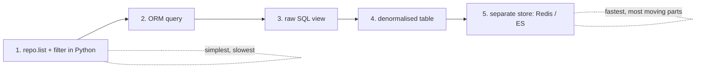

# Chapter 12: Command-Query Responsibility Segregation (CQRS)

## ✈️ 30,000 ft
Reads and writes have opposite needs: writes need strict invariants through the domain model; reads just need fast, simple answers. **Split them.** Use the domain model for commands; use simple SQL or a denormalised table for queries.

## 🛫 10,000 ft
- Domain models are for **making changes**. They're overkill (and slow) for "show me where my order was allocated".
- Options ranked, from simple to extreme:
  1. Use repository `get`/`list` and filter in Python (slow, wasteful)
  2. ORM queries on the existing tables
  3. **Raw SQL** from a `views.py` (simple, fast, bypasses the model)
  4. **Denormalised read model** updated by event handlers (`allocations_view` table)
  5. Separate datastore (Redis, Elasticsearch)
- Trade-off: the read model can lag (eventual consistency) and duplicate data, and you must keep the event handlers updating it.
- Also: reads can go through the UoW's session or a thin read-side helper.

### 🗺️ Diagram: CQRS split




## 🛬 1,000 ft: design decisions
- `views.allocations(orderid, uow)` runs raw SQL and returns a list of dicts.
- Flask `GET /allocations/<orderid>` calls the view; 404 if empty.
- The `allocation` command no longer returns anything; the client does `POST /allocate` (202 Accepted) and later `GET`.
- Denormalised table `allocations_view(orderid, sku, batchref)` updated via event handlers:
  - `Allocated` → insert
  - `Deallocated` → delete (and re-allocation)
- Tests for views use the message bus to put the system in a state, then query it: `bus.handle(commands.Allocate(...)); views.allocations(...)`.
- Authors admit: you can swap this for Redis with a one-line change in the handler.

## 🛞 Touchdown: code along

> Starts from your finished ch11 project. New requirement: **"show me where my order was allocated."** 43 tests pass, 2 skipped (they need Postgres / the full Redis stack).

### The problem

To answer a read-only question, you'd currently load a `Product`, all its `Batch`es and their allocation sets, just to print two strings. The domain model exists to protect *write* invariants. Reads don't need it. **CQRS** says: use the model for commands; answer queries with something simple and fast.

We'll take the "denormalised read table" option: a small table `allocations_view(orderid, sku, batchref)` shaped exactly like the answer, kept up to date by **event handlers**.

### Step 1: A new fact, `Deallocated`

When a batch shrinks (ch09), the freed lines used to come back as `commands.Allocate`. The read model needs to know "this allocation no longer exists", and that's a fact, so make it an event; a handler will re-allocate.

**Do:** add to `events.py` and change `Product.change_batch_quantity`:

```python
# events.py
@dataclass
class Deallocated(Event):
    orderid: str
    sku: str
    qty: int
```

```python
# model.py (and drop the now-unused `commands` import)
while batch.available_quantity < 0:
    line = batch.deallocate_one()
    self.events.append(events.Deallocated(line.orderid, line.sku, line.qty))
```

### Step 2: The read-model table

**Do:** in `orm.py`, add a plain `Table`. Notice it is **not mapped to any domain class**. It isn't part of the model.

```python
allocations_view = Table(
    "allocations_view",
    metadata,
    Column("orderid", String(255)),
    Column("sku", String(255)),
    Column("batchref", String(255)),
)
```

### Step 3: The query: plain SQL, no domain objects

**Do:** create `allocation/views.py`.

**Why:** the query returns plain `dict`s straight from SQL. There's no repository, no `Product`, no ORM objects to hydrate. A view can be as ugly and fast as it likes without touching the model.

**📄 `src/allocation/views.py`**

```python
from allocation.service_layer import unit_of_work
from sqlalchemy import text


def allocations(orderid: str, uow: unit_of_work.SqlAlchemyUnitOfWork):
    """The query side: plain SQL against the read model, no domain objects."""
    with uow:
        results = uow.session.execute(
            text(
                "SELECT sku, batchref FROM allocations_view"
                " WHERE orderid = :orderid ORDER BY sku"
            ),
            dict(orderid=orderid),
        )
        return [dict(r) for r in results.mappings()]
```

### Step 4: Handlers that keep the read model in sync

**Do:** in `handlers.py` add three functions, then register them. Add `from dataclasses import asdict` and `from sqlalchemy import text` at the top.

```python
def reallocate(event: events.Deallocated, uow):
    allocate(commands.Allocate(**asdict(event)), uow=uow)


def add_allocation_to_read_model(event: events.Allocated, uow):
    with uow:
        uow.session.execute(
            text("INSERT INTO allocations_view (orderid, sku, batchref)"
                 " VALUES (:orderid, :sku, :batchref)"),
            dict(orderid=event.orderid, sku=event.sku, batchref=event.batchref),
        )
        uow.commit()


def remove_allocation_from_read_model(event: events.Deallocated, uow):
    with uow:
        uow.session.execute(
            text("DELETE FROM allocations_view WHERE orderid = :orderid AND sku = :sku"),
            dict(orderid=event.orderid, sku=event.sku),
        )
        uow.commit()
```

```python
# messagebus.py
EVENT_HANDLERS = {
    events.OutOfStock: [handlers.send_out_of_stock_notification],
    events.Allocated: [
        handlers.publish_allocated_event,
        handlers.add_allocation_to_read_model,
    ],
    events.Deallocated: [
        handlers.remove_allocation_from_read_model,
        handlers.reallocate,
    ],
}
```

**Trace what happens when `ChangeBatchQuantity` shrinks a batch**: `Deallocated` → (1) delete from view, (2) `reallocate` → `Allocate` command → `Allocated` event → insert into view + publish to Redis. Draw that on paper before moving on.

### Step 5: Flask: commands return "accepted", reads go through the view

**Do:** `POST /allocate` now returns **202 Accepted** with no body; the client calls `GET /allocations/<orderid>`. (Behaviour change from ch08–11: out-of-stock is no longer a 400 on the POST; it's an accepted request that produced no allocation, plus an email via the event. In a real product you'd decide whether that's acceptable.)

**📄 `src/allocation/entrypoints/flask_app.py`**

```python
from datetime import datetime

from flask import Flask, jsonify, request
from sqlalchemy import create_engine
from sqlalchemy.orm import sessionmaker

from allocation import config, views
from allocation.adapters import orm
from allocation.domain import commands
from allocation.service_layer import handlers, messagebus, unit_of_work


def create_app(session_factory=None):
    if session_factory is None:
        uri = config.get_db_uri()
        kwargs = {"isolation_level": "REPEATABLE READ"} if uri.startswith("postgresql") else {}
        engine = create_engine(uri, **kwargs)
        orm.metadata.create_all(engine)
        orm.start_mappers()
        session_factory = sessionmaker(bind=engine)

    app = Flask(__name__)

    @app.route("/add_batch", methods=["POST"])
    def add_batch():
        eta = request.json["eta"]
        if eta is not None:
            eta = datetime.fromisoformat(eta).date()
        cmd = commands.CreateBatch(
            request.json["ref"], request.json["sku"], request.json["qty"], eta
        )
        messagebus.handle(cmd, unit_of_work.SqlAlchemyUnitOfWork(session_factory))
        return "OK", 201

    @app.route("/allocate", methods=["POST"])
    def allocate_endpoint():
        try:
            cmd = commands.Allocate(
                request.json["orderid"], request.json["sku"], request.json["qty"]
            )
            messagebus.handle(cmd, unit_of_work.SqlAlchemyUnitOfWork(session_factory))
        except handlers.InvalidSku as e:
            return {"message": str(e)}, 400

        return "OK", 202  # accepted: the result is read back via GET /allocations

    @app.route("/allocations/<orderid>", methods=["GET"])
    def allocations_view_endpoint(orderid):
        result = views.allocations(
            orderid, unit_of_work.SqlAlchemyUnitOfWork(session_factory)
        )
        if not result:
            return "not found", 404
        return jsonify(result), 200

    return app
```

### Step 6: Tests

**Do:**
1. Give the unit-test `FakeUnitOfWork` a `session` that swallows SQL. The read-model handlers run in unit tests too, and the SQL itself is verified by the integration test below.

```python
class FakeSession:
    def execute(self, *args, **kwargs):
        pass

class FakeUnitOfWork(unit_of_work.AbstractUnitOfWork):
    def __init__(self):
        self.products = FakeRepository([])
        self.session = FakeSession()
        self.committed = False
    # ...rest unchanged
```

2. Integration tests for the view. They drive the system **through the bus** to put it in a state, then query it, which also proves the handlers keep the table in sync:

**📄 `tests/integration/test_views.py`**

```python
from datetime import date

from allocation import views
from allocation.domain import commands
from allocation.service_layer import messagebus, unit_of_work

today = date.today()


def test_allocations_view(session_factory):
    uow = unit_of_work.SqlAlchemyUnitOfWork(session_factory)
    messagebus.handle(commands.CreateBatch("sku1batch", "sku1", 50, None), uow)
    messagebus.handle(commands.CreateBatch("sku2batch", "sku2", 50, today), uow)
    messagebus.handle(commands.Allocate("order1", "sku1", 20), uow)
    messagebus.handle(commands.Allocate("order1", "sku2", 20), uow)
    # add a spurious batch and order to make sure we're getting the right ones
    messagebus.handle(commands.CreateBatch("sku1batch-later", "sku1", 50, today), uow)
    messagebus.handle(commands.Allocate("otherorder", "sku1", 30), uow)
    messagebus.handle(commands.Allocate("otherorder", "sku2", 10), uow)

    assert views.allocations("order1", uow) == [
        {"sku": "sku1", "batchref": "sku1batch"},
        {"sku": "sku2", "batchref": "sku2batch"},
    ]


def test_deallocation_updates_the_view(session_factory):
    uow = unit_of_work.SqlAlchemyUnitOfWork(session_factory)
    messagebus.handle(commands.CreateBatch("b1", "sku1", 50, None), uow)
    messagebus.handle(commands.CreateBatch("b2", "sku1", 50, today), uow)
    messagebus.handle(commands.Allocate("o1", "sku1", 40), uow)
    assert views.allocations("o1", uow) == [{"sku": "sku1", "batchref": "b1"}]

    messagebus.handle(commands.ChangeBatchQuantity("b1", 10), uow)

    assert views.allocations("o1", uow) == [{"sku": "sku1", "batchref": "b2"}]
```

3. Update `tests/e2e/test_api.py`: the happy path now expects 202, then `GET`s the allocation. Replace the old out-of-stock test too:

```python
    r = client.post("/allocate", json=data)
    assert r.status_code == 202

    r = client.get(f"/allocations/{data['orderid']}")
    assert r.status_code == 200
    assert r.json == [{"sku": sku, "batchref": earlybatch}]


def test_out_of_stock_is_accepted_but_nothing_is_allocated(client):
    sku, orderid = random_sku(), random_orderid()
    post_to_add_batch(client, random_batchref(), sku, 5, None)

    r = client.post("/allocate", json={"orderid": orderid, "sku": sku, "qty": 10})

    assert r.status_code == 202
    assert client.get(f"/allocations/{orderid}").status_code == 404
```

```bash
pytest -q
# 43 passed, 2 skipped
```

### What this costs you

- The read model is **eventually consistent** in principle (here the handlers run immediately, but nothing guarantees that once you move them behind a queue).
- Data lives in two shapes. If a handler fails (remember: event errors are swallowed), the view drifts from the truth.
- More handlers to maintain. For a simple CRUD screen this is overkill, and the book says so too.

### Stretch

- Replace `allocations_view` with Redis hashes (`hset`/`hget`) while leaving `views.allocations` returning the same shape. Which files change? (Only handlers and the view; the test suite tells you if you broke the contract.)
- Delete the view table and write the query as a join across `order_lines`/`allocations`/`batches`. Compare. When would that be the better choice?

## Check yourself
- Why is a rich domain model a poor choice for read-only endpoints?
- What does a denormalised view cost you?
- What happens in the UI if the read model is stale?
- Where do the command side and the query side share code?
