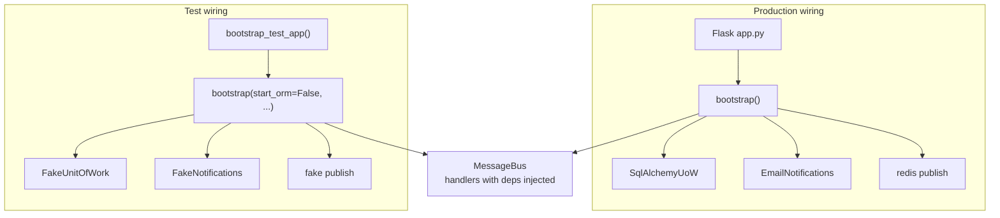
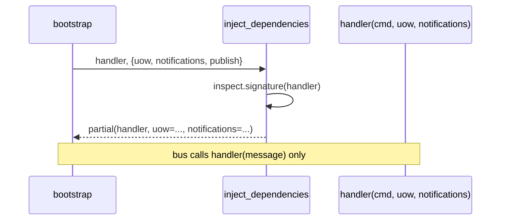

# Chapter 13: Dependency Injection (and Bootstrapping)

## ✈️ 30,000 ft
Handlers import `email`, `redis` and `unit_of_work` directly, so tests use `mock.patch`. Instead, **inject** dependencies explicitly and wire everything in one place, the **bootstrap script** (composition root).

## 🛫 10,000 ft
- **Dependency injection** = pass collaborators in, rather than importing them inside.
- **Composition root / bootstrap**: one module that builds the real objects (UoW, notifications, publisher), starts the ORM, and returns a ready-to-use `MessageBus`.
- Handlers receive dependencies by **function parameters**; the bootstrap inspects signatures and injects them (partial application).
- `MessageBus` becomes a **class** holding `uow`, `event_handlers`, `command_handlers`, not a module with globals.
- Fakes replace the real adapters in tests: `FakeNotifications`, `FakeUnitOfWork`, `FakeEventPublisher`. No more `mock.patch`.
- Trade-off: more wiring code, but explicit, testable, no import-time side effects.

### 🗺️ Diagram: composition root

## 🛬 1,000 ft: design decisions
- Adapters get their own abstract classes (`AbstractNotifications`) in `adapters/notifications.py`.
- `bootstrap(start_orm=True, uow=SqlAlchemyUnitOfWork(), notifications=None, publish=redis_eventpublisher.publish)`; all keyword args with defaults, so tests override just what they need.
- `inject_dependencies(handler, dependencies)` uses `inspect.signature` to bind only the parameters each handler declares.
- The bus: `MessageBus(uow, event_handlers, command_handlers).handle(message)`.
- Flask `app.py` calls `bus = bootstrap.bootstrap()` once at module load, and the tests build a bus with `bootstrap(start_orm=False, uow=FakeUnitOfWork(), ...)`.
- The authors show alternative: a manual closure/lambda or class-based handlers; pick one, be consistent.

## 🛞 Touchdown
1. Create `adapters/notifications.py` (`AbstractNotifications`, `EmailNotifications`) and fakes.
2. Change handlers to accept dependencies as extra parameters.
3. Write `bootstrap.py` and `inject_dependencies`.
4. Turn `messagebus` into a class.
5. Rework test fixtures: `bootstrap_test_app()`.
6. Delete all `mock.patch` uses. Run the suite, then run the real app.

## Check yourself
- Where is the *only* place that knows the concrete classes?
- Why prefer keyword defaults in `bootstrap` for testing?
- What's the difference between dependency inversion and dependency injection?
- When is a DI container (library) worthwhile, and when is manual wiring better?
